# KBDS-PC 디자인 규칙

## 1. 적용 범위와 기준

이 문서는 PC 화면을 만들 때 참조하는 재현 가능한 규칙이다. 초기 관리형 A·B에 더해 입력·동의·집중형·완료·에러 패턴 C~G는 14~20장, 팝업 패턴 H~J는 21~24장, 한도계좌 해제 패턴 K·L은 25~27장, 1920 약관·목록 패턴 M~O는 28~31장, 파일 업로드 P·Q와 로그아웃 추가 참조는 32~35장, 가입 단계 안내 R·S는 36~39장, 비대면 가입 카드형 T는 40장, 금융거래 목적 질문·확인 U는 41~43장, 전체·개별 정보 입력 V~Y는 44~46장, 수신 방법·직원 검색 Z·AA는 47~49장, 이체 완료·중요 사항·적합성 AB~AD는 50~53장, 정보 확인·거래내역·투자성향 AE~AG는 54~57장, 투자성향 결과 AH는 58~59장에 기록한다. Card / Surface·Data Block·Text Box의 역할 구분과 제작 기준은 60장에 정의한다. 원본 Figma 화면이 삭제되어도 아래 치수, 구조, 스타일, 컴포넌트 키와 보존 이미지로 각 패턴을 다시 구성할 수 있도록 작성했다.

- 확인일: 2026-11-09 (Asia/Seoul).
- 원본 파일: PC 디자인라이브러리 v0.96, `ftIWLlgj5Ldgt1uyQu9Gb8`.
- [디자인 시스템 기준 경로](https://www.figma.com/design/ftIWLlgj5Ldgt1uyQu9Gb8?node-id=0-1): PC 디자인라이브러리 v0.96. 화면 생성 시 이 파일의 컴포넌트·토큰·스타일을 우선 사용한다.
- [필수 Footer 컴포넌트](https://www.figma.com/design/ftIWLlgj5Ldgt1uyQu9Gb8?node-id=2920-38417): 새 화면에는 학습 화면의 푸터 구성 방식과 관계없이 이 컴포넌트의 인스턴스를 사용한다. 상세 기준은 13장을 따른다.
- 원본 페이지: `Templates (작성중)`.
- [패턴 A 원본 — Case_관리_1](https://www.figma.com/design/ftIWLlgj5Ldgt1uyQu9Gb8?node-id=18182-96246): 다른금융 출금계좌 관리, 1440 × 1482.
- [패턴 B 원본 — Case_관리_2](https://www.figma.com/design/ftIWLlgj5Ldgt1uyQu9Gb8?node-id=18182-96576): 자주쓰는 계좌관리, 1440 × 1669.
- 모든 치수는 Figma 논리 px이며, 좌표는 화면 프레임 좌상단을 (0, 0)으로 한다.
- 아래 수치는 두 화면에서 확인한 관리 화면 기준이다. 다른 해상도의 반응형 동작, 최소·최대 너비, 업무 로직, 미표시 상태는 아직 정의하지 않았다.
- 새로운 지시가 있으면 해당 규칙을 이 파일에서 갱신한다. 기존 KBDS 컴포넌트·토큰·스타일을 우선 재사용한다.
- 수치 변수 바인딩, GNB Fill, LNB 2열 구조와 고객정보조회 화면 수정은 61장을 우선 적용한다.
- 박스의 역할 분류·제작 방식·스타일은 60장을 우선 적용한다. 1~59장의 원본 카드 호칭·프레임 구조·실측 외형은 자동으로 제작 기준이 되지 않는다. 전용 선택 패턴·Infobox와 명시적으로 승인된 간격 예외는 해당 범위에서만 적용한다.
- 학습 화면의 시각적 규격·컴포넌트·UI 조합을 정립하되, `## BODY` 내부의 원본 레이어 이름·정리 상태는 복제하지 않는다. 생성 시 12장의 명명·실제 Auto Layout 그룹핑 규칙을 우선 적용한다.

### 원본 해석 시 주의

두 프레임의 HEADER/FOOTER 레이어에는 각각 “기업용헤더 X”, “기업용푸터 X”라고 명시되어 있다. GNB 인스턴스 자체는 `channel=corporate`이지만, 이 셸 전체를 최종 기업용 헤더·푸터 규격으로 확정하지 않는다. 아래 셸 치수는 이 두 예시를 재현하는 값이다. 다만 새 화면 생성 시 Footer의 구현 방식은 13장의 지정 컴포넌트 사용 규칙을 우선 적용한다.

샘플의 “총 건수 23건”, 표시 행 10개, 페이지 숫자, 계좌번호, 메뉴·인증마크·수상 문구는 예시 데이터다. 화면별 실제 기획을 적용하며 샘플 값을 업무 규칙으로 고정하지 않는다.

## 2. 공통 화면 골격

```text
Screen — 1440, Vertical, gap 0
├─ HEADER — 1440 × 159
│  ├─ GNB / Channel — 1440 × 110
│  └─ Breadcrumbs Area — 1440 × 49, padding 16 40
├─ BODY — width 1440, Vertical, padding 48 40, section gap 48
│  └─ 각 콘텐츠 영역 — width 1360
└─ FOOTER — 1440 × 352, background #FAFAFA
```

| 항목 | 기준 |
| --- | --- |
| 화면 배경 | #FFFFFF |
| 콘텐츠 좌우 여백 | 각각 40 |
| 콘텐츠 너비 | 1440 − 40 × 2 = 1360 |
| 본문 상하 패딩 | 각각 48 |
| 주요 본문 섹션 사이 | 48 |
| 본문 시작 | y=159 |
| 페이지 제목 | x=40, y=207, 높이 36, 왼쪽 정렬 |
| Breadcrumbs | x=40, y=126, 높이 17; 예시 너비 258 |
| Breadcrumbs 내부 간격 | 4; 홈 아이콘 16 × 16 |
| 본문 높이 | 콘텐츠에 따라 증가: A 971 / B 1158 |
| 푸터 위치 | 본문 다음 흐름에 배치: A y=1130 / B y=1317 |

화면과 본문은 세로 Auto Layout으로 구성한다. 전체 높이를 1482 또는 1669로 고정하는 대신, 해당 높이는 샘플 콘텐츠를 넣었을 때의 검산값으로 사용한다. 표·도구 모음 등 폭을 공유하는 요소는 동일한 콘텐츠 컨테이너에 정렬한다.

## 3. 간격·모서리·선 토큰

아래는 실제 바인딩에서 확인한 KBDS 이름과 값이다. 같은 의미의 토큰은 이름과 키를 재사용하고, 화면 재현을 위해 필요한 실측값도 유지한다. 수치는 61장에 따라 실제 변수로 연결한다. 실측값을 숫자로만 입력한 상태를 완료로 간주하지 않는다.

| 토큰 | 값 |
| --- | --- |
| `spacing/2xs` | 2px |
| `spacing/xs` | 4px |
| `spacing/md` | 8px |
| `spacing/lg` | 12px |
| `spacing/xl` | 16px |
| `spacing/2xl` | 20px |
| `spacing/3xl` | 24px |
| `spacing/5xl` | 32px |

| 용도 | 실측값 |
| --- | --- |
| 화면 좌우 패딩 | 40 |
| 본문 상하·주요 섹션 간격 | 48 |
| 제목 → 다음 섹션 | 48 |
| 건수/툴바 → 표 | 20 |
| 탭 → 표 툴바 | 20 |
| 표 → 페이지네이션 또는 하단 도구 모음 | 16 |
| 툴바 버튼 사이 | 8 |
| 하단 대형 버튼 사이 | 12 |
| 표 헤더/셀 패딩 | 상하 12, 좌우 16 |
| 안내 박스 패딩 | 상하 20, 좌우 24 |
| 버튼 모서리 | `radius/2xs` = 6 |
| 안내 박스 모서리 | `radius/md` = 12 |
| 표 모서리 | 0 |
| 일반 구분선 | `stroke/md` = 1 |
| 선택 탭 하단선 | `stroke/2xl` = 3 |
| 비선택 탭 하단선 | `stroke/xl` = 2 |

일부 원본에서 0값에 `radius/(삭제대기)none`, `spacing/(삭제대기)none`이 연결되어 있었다. 이는 원본 상태 기록이며 새 화면에서 삭제 예정 토큰을 새로 확산시키지 않는다. 현재 라이브러리에 공식 대체 토큰이 있으면 그것을 사용하고, 없으면 0값의 의도를 유지한다.

## 4. 색상

| 역할 | 값 | 확인된 토큰 |
| --- | --- | --- |
| 표 상단 기준선 | #444444 | `border/neutral/secondary` |
| 표 헤더 배경 | #F2F2F2 | `surface/neutral/secondary-muted` |
| 표 헤더 구분선 | #E5E5E5 | `border/neutral/secondary-muted` |
| 표 본문 배경 | #FFFFFF | `surface/neutral/quaternary-muted` |
| 표 본문 구분선 | #EDEDED | `border/neutral/tertiary-muted` |
| 안내 박스·푸터 배경 | #FAFAFA | `surface/neutral/tertiary-muted` |
| 보조 테두리 버튼 테두리 | #A5A5A5 | `border/neutral/quaternary` |
| 대형 tertiary 버튼 배경 | #EDEDED | `surface/neutral/primary-muted` |
| 대형 primary 버튼 배경 | #FFC517 | `surface/accent/brand` |
| 선택 탭 하단선 | #1C1C1C | `border/neutral/primary` |
| 기본 텍스트 | #1C1C1C | 실측값; 이 문서에서 토큰명은 미확정 |
| 표 헤더·건수 숫자 | #444444 | 실측값 |
| 부가 설명 | #6E6E6E | 실측값 |
| 총 건수 라벨·비선택 탭·보조 정보 | #8D8D8D | 실측값 |
| 등록 상태 | #1F6AFF | 실측값 |
| 미등록 상태 | #E53838 | 실측값 |

색상 역할이 다른 로고의 노란색과 primary 버튼의 노란색을 하나로 치환하지 않는다. 화면에서 보이는 회색 버튼은 선택된 컴포넌트의 상태를 확인한다. 예를 들어 B의 “삭제”는 `tertiary, disabled=false`이며 회색이라는 이유로 비활성화 상태로 해석하지 않는다.

## 5. 서체와 텍스트

- 한글·일반 UI는 **KBFG Text**, 숫자 전용 표현은 **Pretendard**를 사용한다.
- 확인된 모든 텍스트의 자간은 0px이다.
- 두 화면의 텍스트 노드에서 누락 폰트가 없음을 확인했다.
- 스타일 이름의 숫자보다 실제 노드의 fontSize·fontName·lineHeight를 우선해 재현한다. 특히 숫자 스타일 이름은 “16”이어도 실제 적용 크기는 17px이었다.

| 역할 | 폰트·굵기 | 크기/행간 | 색상 |
| --- | --- | --- | --- |
| 페이지 제목 | KBFG Text Bold | 26/36 | #1C1C1C |
| 선택 탭 | KBFG Text Bold | 20/28 | #1C1C1C |
| 비선택 탭 | KBFG Text Medium | 20/28 | #8D8D8D |
| GNB 1depth 메뉴 | KBFG Text Light | 16/24 | #6E6E6E |
| 표 헤더 | KBFG Text Medium | 14/20 | #444444 |
| 표 일반 셀·안내 문구 | KBFG Text Light | 14/20 | #1C1C1C |
| 표 숫자·계좌번호·전화번호 | Pretendard Light | 14/20 | #1C1C1C |
| 소형 버튼 | KBFG Text Bold | 14/20 | #1C1C1C |
| 총 건수 라벨 | KBFG Text Medium | 14/20 | #8D8D8D |
| 건수 숫자 | Pretendard SemiBold | 17/24 | #444444 |
| 건수 단위 “건” | KBFG Text Bold | 14/20 | #444444 |
| 페이지네이션 숫자 | Pretendard Regular | 17/24 | #1C1C1C |
| 하단 대형 버튼 | KBFG Text Bold | 18/25 | #1C1C1C |
| Breadcrumbs·푸터 메뉴 | KBFG Text Medium | 12/17 | 경로·위계에 따라 #8D8D8D / #1C1C1C |
| 푸터 회사 정보·저작권 | KBFG Text Light | 12/17 | #8D8D8D |
| 푸터 수상 예시 문구 | KBFG Text Light | 10/17 | #6E6E6E |

### 원본 텍스트 스타일 참조

아래 키는 스타일 이름 변경에 대비한 식별자다. 동일 서체 조합은 한 번만 표기했다.

| 스타일 이름 | 실제 폰트 | 실제 크기/행간 | 스타일 키 |
| --- | --- | --- | --- |
| Body/sm∙12∙Bold | KBFG Text Bold | 12/17 | `0732942051555a505388ecfd863af5b2470233ec` |
| Body/sm∙12∙Medium | KBFG Text Medium | 12/17 | `8ab464b691ced29baba9a313a25b651557b4ceb1` |
| Title/2xl∙20∙Bold | KBFG Text Bold | 20/28 | `6bc0e73b9a53e3e789e9a4cb084fdb79305628fc` |
| Title/lg∙16∙Light | KBFG Text Light | 16/24 | `fe23238368709f96a138720fda60bc6c369ae4db` |
| Display/5xl∙26∙Bold | KBFG Text Bold | 26/36 | `d15c6618112f25fafd120d9f66e7ccf3031da65d` |
| Body/md∙14∙Medium | KBFG Text Medium | 14/20 | `f5f81baf6718bb904b4793a0ecf70ff694044489` |
| Title/Numeric/2️⃣ lg∙16∙Bold | Pretendard SemiBold | 17/24 | `8b7acf18fb401cac008995792d7e76e36b2a9a5a` |
| Body/md∙14∙Bold | KBFG Text Bold | 14/20 | `fd29c6c3e60f91d214e519fc9a48bdb7bca2741a` |
| Body/Numeric/2️⃣ md∙14∙Light | Pretendard Light | 14/20 | `6222681f115880fd5a105b9ed09adb4d4e9a716b` |
| Body/md∙14∙Light | KBFG Text Light | 14/20 | `9425756dd9ccef22a21ae16afc4879e5258e1bf5` |
| Title/Numeric/2️⃣ lg∙16∙Medium | Pretendard Regular | 17/24 | `93a7b5aa0f729abc2301d0bef024187938380a71` |
| Body/sm∙12∙Light | KBFG Text Light | 12/17 | `638481398c8d9dd67579f830b9eb404dd92c6cf9` |
| 직접 지정 | KBFG Text Light | 10/17 | `없음` |
| Title/2xl∙20∙Medium | KBFG Text Medium | 20/28 | `fb7e580aeac1e188465d5d6bd2ce0e6ea675cc3b` |
| Title/xl∙18∙Bold | KBFG Text Bold | 18/25 | `dc7937a908f83807e5440ccdc445a257a5cc3c64` |

## 6. 표 공통 규칙

- `Table / Header`, `Table / Cell` 인스턴스를 사용한다. 마지막 열은 `variant=last`로 오른쪽 경계선을 제거한다.
- 숫자 전용 셀에는 `onlyNumber=true` 변형을 사용한다. 셀의 텍스트를 전부 Pretendard로 바꾸지 않는다.
- 표 상단은 #444444 1px 선이다. 헤더는 #F2F2F2 배경과 #E5E5E5 구분선, 본문은 #FFFFFF 배경과 #EDEDED 구분선을 사용한다.
- A·B 목록형 표의 헤더·셀 콘텐츠는 수평·수직 가운데 정렬이며 셀 패딩은 상하 12, 좌우 16이다. C·E·F 정보/입력 표는 왼쪽·수직 가운데 정렬을 사용하며, 구체적인 기준은 14~18장을 따른다.
- 표는 Figma Grid로 구성하며 열 사이 추가 gap은 0이다. 같은 열의 헤더와 본문 너비를 동일하게 유지한다.
- border가 없는 프레임에도 API의 기본 strokeWeight=1이 나올 수 있다. 실제 strokes가 비어 있는 프레임에 임의 테두리를 추가하지 않는다.

## 7. 패턴 A — 기본 목록·행별 조작형

### 배치

```text
BODY: padding 48 40, gap 48
├─ Title / Page: “다른금융 출금계좌 관리”, 1360 × 36
└─ ListSection: Vertical, gap 16
   ├─ Amount / Table: Vertical, gap 20
   │  ├─ Amount: 1360 × 24, 내부 gap 4
   │  └─ Table Grid: 1360 × 695
   └─ Pagination / Basic: 1360 × 36
```

| 요소 | x | y | 너비 | 높이 |
| --- | --- | --- | --- | --- |
| 페이지 제목 | 40 | 207 | 1360 | 36 |
| 총 건수 영역 | 40 | 291 | 1360 | 24 |
| 표 | 40 | 335 | 1360 | 695 |
| 페이지네이션 | 40 | 1046 | 1360 | 36 |
| 푸터 시작 | 0 | 1130 | 1440 | 352 |

### 열 구성

| 순서 | 헤더 | 너비 | 콘텐츠/정렬 |
| --- | --- | --- | --- |
| 1 | NO | 80 | 숫자, 가운데 |
| 2 | 기관명 | (1360 − 440) / 3 ≈ 306.667 | 일반 텍스트, 가운데 |
| 3 | 계좌번호 | ≈ 306.667 | 숫자 전용 셀, 가운데 |
| 4 | 계좌명(별명) | ≈ 306.667 | 일반 텍스트, 가운데 |
| 5 | 상태 | 180 | 등록/미등록 텍스트, 가운데 |
| 6 | 출금등록/해제 | 180 | 행별 BoxButton, 가운데 |

- 표 헤더의 실측 높이는 45px이다.
- 본문은 10행이다. 원본 첫 행은 64px, 이후 9행은 각각 65px로 측정되었다. 상단선 1 + 헤더 45 + 본문 649 = 전체 695px이다. 이 차이를 임의의 “모든 행은 65px” 규칙으로 숨기지 않는다.
- 행 안의 등록/해제 버튼은 `BoxButton secondary small`, 50 × 40, radius 6이다.
- “등록” 상태는 #1F6AFF, “미등록”은 #E53838이다. 상태 텍스트와 버튼 라벨을 함께 표시한다.
- 샘플에서 등록 상태의 버튼은 “해제”, 미등록 상태의 버튼은 “등록”이다. 실제 클릭 결과·확인 절차는 별도 업무 기획을 따른다.
- 총 건수는 “총 건수” 라벨과 숫자·단위를 구분한다. 바깥 수평 gap은 4px이다.
- 페이지네이션은 중앙 정렬, 높이 36이다. 앞/뒤 이동 그룹은 각각 56 × 24, 가운데 숫자 슬롯은 360 × 36, 그룹 사이 간격은 32이다. 샘플 숫자는 1~10이다.

## 8. 패턴 B — 안내·탭·다중 선택·하단 실행형

### 배치

```text
BODY: padding 48 40, gap 48
├─ Title / Page: “자주쓰는 계좌관리”, 1360 × 36
├─ Infobox / FullWidth: 1360 × 90
├─ ListSection: Vertical, gap 20
│  ├─ Tab: 1360 × 60
│  └─ Table / Button: Vertical, gap 20
│     ├─ Amount / Button Group: 1360 × 40
│     └─ TableSection: Vertical, gap 16
│        ├─ Table Grid: 1360 × 540
│        └─ 하단 도구 모음: 1360 × 40
└─ ButtonContainer: 1360 × 56, 가운데 정렬
   └─ ButtonGroup: 320 × 56, 실제 버튼 사이 gap 12
```

| 요소 | x | y | 너비 | 높이 |
| --- | --- | --- | --- | --- |
| 페이지 제목 | 40 | 207 | 1360 | 36 |
| 안내 박스 | 40 | 291 | 1360 | 90 |
| 탭 | 40 | 429 | 1360 | 60 |
| 총 건수·상단 버튼 모음 | 40 | 509 | 1360 | 40 |
| 표 | 40 | 569 | 1360 | 540 |
| 표 하단 도구 모음 | 40 | 1125 | 1360 | 40 |
| 하단 실행 버튼 | 560 | 1213 | 320 | 56 |
| 푸터 시작 | 0 | 1317 | 1440 | 352 |

### 안내 박스

- `Infobox / FullWidth`, 배경 #FAFAFA, radius 12, 실제 테두리 없음.
- 패딩 20 24, 내부 콘텐츠 너비 1312, 샘플 콘텐츠 높이 50.
- 컴포넌트 바깥 스택 itemSpacing=12, 내부 Contents 프레임 itemSpacing=8이다. 서로 다른 레벨의 간격을 혼동하지 않는다.
- 샘플은 불릿 문장 두 개다. 원본 문장은 마커 사용 설명용 예문이므로 실제 화면 안내 문구로 그대로 채택하지 않는다.
- 안내 텍스트는 KBFG Text Light 14/20이다.

### 탭과 상단 도구 모음

- `Tab variant=1depth, extendable=true`를 사용한다.
- 선택 탭: “자주쓰는 계좌 목록”, 181 × 60, Bold 20/28, #1C1C1C, 하단선 3px.
- 비선택 탭: “자주쓰는 계좌 등록”, 176 × 60, Medium 20/28, #8D8D8D, 하단선 #E5E5E5 2px.
- 탭 아이템은 상하 패딩 16이며 전체 탭 바는 콘텐츠 폭 1360을 사용한다. 아이템 너비는 두 라벨의 실측값이므로 다른 문구에 기계적으로 고정하지 않는다.
- 표 상단 40px 도구 모음에서 총 건수는 왼쪽 아래에 정렬한다. 샘플 건수 영역은 x=40, y=525, 높이 24이다.
- 오른쪽 버튼 모음은 388 × 40, 내부 간격 8이다: 계좌순서변경 120 × 40 → 계좌그룹관리 100 × 40 → 그룹 전체 선택필드 152 × 40.
- 건수 영역과 오른쪽 그룹 사이의 상위 gap은 20이다. 두 그룹을 고정 좌표로 분리하기보다 공통 가로 컨테이너에서 정렬한다.

### 열 구성과 선택 컨트롤

| 순서 | 원본 헤더/역할 | 너비 |
| --- | --- | --- |
| 1 | 전체/행 선택 체크박스 | 80 |
| 2 | 기관명 | 120 |
| 3 | 그룹명 | (1360 − 200) / 6 ≈ 193.333 |
| 4 | 금융기관명 | ≈ 193.333 |
| 5 | 계좌번호 | ≈ 193.333 |
| 6 | 출금등록/해제 | ≈ 193.333 |
| 7 | 휴대폰 번호 | ≈ 193.333 |
| 8 | 작성한 내용 노출 | ≈ 193.333 |

- 헤더와 본문 10행의 실측 높이는 모두 49이다. 상단선 1 + 49 × 11 = 전체 540이다.
- 선택 체크박스는 24 × 24이며 첫 열 가운데에 배치한다. 확인된 변형은 `size=large, fontWeight=bold, checked=false, disabled=false, indeterminate=false, invalid=false`이다.
- 체크박스가 회색으로 보이더라도 checked/disabled 상태는 변형 속성으로 판단한다.
- 원본 2열 헤더는 “기관명”이지만 셀에는 1~10이 들어간다. 원본 6열 헤더는 “출금등록/해제”지만 셀에는 계좌명 예문이 들어간다. 이는 템플릿의 의미 불일치로 기록한다. 새 화면에서는 업무 기획에 맞게 헤더와 데이터를 일치시키며 이 샘플 조합을 업무 규칙으로 복제하지 않는다.
- 계좌번호와 휴대폰 번호에는 숫자 전용 셀을 사용한다.

### 표 하단 도구 모음과 실행 버튼

- 표와 도구 모음 간격은 16이다. 도구 모음은 1360 × 40, 좌우 그룹을 `SPACE_BETWEEN`으로 정렬한다.
- 왼쪽: 필터·검색·편집 `TextButton primary small`, 각 43 × 20, 버튼 간격 16, 아이콘 16 × 16.
- 오른쪽: “다중선택 그룹변경” 라벨 103 × 20 → 선택필드 120 × 40 → 이동 버튼 50 × 40. 내부 간격은 8, 전체 너비는 289이다.
- 하단 실행 섹션은 위 도구 모음 이후 48px에 배치한다.
- 가운데 `ButtonGroup count=multi, size=large`: 전체 320 × 56, 각 버튼 154 × 56, 버튼 사이 12.
- “삭제”: `BoxButton tertiary large`, 배경 #EDEDED, disabled=false.
- “수정”: `BoxButton primary large`, 배경 #FFC517, disabled=false.
- 두 버튼 모두 radius 6, KBFG Text Bold 18/25, 텍스트 #1C1C1C이다.
- 바깥 ButtonGroup의 gap=0만 보고 버튼을 붙이지 않는다. 실제 간격은 내부 `Slot-Button`의 gap=12에 정의되어 있다.

## 9. 공통 푸터의 예시 구조

이 절은 학습 화면에서 측정한 배치 기록이다. 새 화면에서는 아래 구조를 일반 프레임·텍스트로 다시 조립하지 않고, 13장의 지정 Footer 컴포넌트 인스턴스를 사용한다.

- 배경 #FAFAFA, 높이 352, 위아래 실측 여백 48.
- 실제 콘텐츠 x=40, 너비 1360; 내부 콘텐츠 총 높이 256.
- 회사 정책 링크·회사 정보 묶음 91 → 20 간격 → 선택필드/상담/SNS 행 40 → 20 간격 → 인증·수상 마크 행 48 → 20 간격 → 저작권 행 17.
- 링크 행의 내부 간격은 8, 마크 왼쪽 그룹은 28, 오른쪽 그룹은 8이다.
- 푸터 프레임 패딩과 내부 컨테이너 패딩을 합산해 좌우 80px을 만들지 않는다. 원본의 유효 콘텐츠 시작은 x=40이다.
- 샘플 셸의 이미지 플레이스홀더·수상 예문을 공식 정보로 간주하지 않는다. 새 화면의 Footer는 학습 화면의 일반 레이어를 복사하지 않고 지정 컴포넌트로 배치한다.

## 10. 컴포넌트 재사용 식별자

원본 화면의 자식 노드 ID보다 **main component key**를 우선 사용한다. 화면 프레임이 삭제되어도 라이브러리 컴포넌트가 유지되면 아래 키로 가져올 수 있다. 키 조회가 실패하면 컴포넌트 자체가 삭제·미게시·접근 불가한 상태인지 확인하고, 임의로 같은 이름의 다른 버전으로 교체하지 않는다.

Figma Plugin API에서 가져올 때: `await figma.importComponentByKeyAsync(key)` 후 `createInstance()`. 화면의 업무 콘텐츠는 인스턴스의 텍스트·슬롯·속성으로 설정하며 기존 컴포넌트를 불필요하게 detach하지 않는다.

| 컴포넌트 | 확인한 변형 | main component key |
| --- | --- | --- |
| Footer | `variant=default` | `bb4b7042c4ccc5742c5d51c3f5460ffec409ab63` |
| Footer | `variant=compact` | `2a1bb8e301dd46cf51d5ea4deefca130b3d9dd8d` |
| GNB / Channel | `channel=corporate` | `a1805a20b85dea4155db23d9ff5bd2ece9a61386` |
| Title / Page | `align=left` | `366007b354df25708d9dce4a7788c2b44e30dba3` |
| Infobox / FullWidth | `Infobox / FullWidth` | `5fb7ce75dbc07c0aeca6e8cd5bfb876c0d0f7892` |
| Tab | `variant=1depth, extendable=true` | `53915edb5ada4215a859be5fca8d36a7e113c881` |
| Item / Tab | `variant=1depth, selected=true` | `4f00a95817bd55bdfb610f0d15c078b24108bbfc` |
| Item / Tab | `variant=1depth, selected=false` | `67b8685071f7188072054a7983fa5d828838205f` |
| Table / Header | `variant=default, onlyNumber=false` | `ba105a8f29acb712e5c5aa6a3cb2015de330f392` |
| Table / Header | `variant=last, onlyNumber=false` | `7b9fe1d8909362be16cea30e295258ba7a099d55` |
| Table / Cell | `variant=default, onlyNumber=false` | `99ea32176b75cd8c61852334027aea5149d926a5` |
| Table / Cell | `variant=default, onlyNumber=true` | `344a92f1499d52f34343a05da003acb2ef07ac87` |
| Table / Cell | `variant=last, onlyNumber=false` | `1b5a0ae0fefd157325271672a78224db2575f047` |
| CheckBox | `size=large, fontWeight=bold, checked=false, disabled=false, indeterminate=false, invalid=false` | `50a2ddb9717f6061eaae8aecea2b2e6ea9f48201` |
| BoxButton | `variant=secondary, size=small, hover=false, disabled=false, pressed=false` | `b20b82eee273f930c668788109e73de668023c03` |
| InputField | `hover=false, focused=false, disabled=false, entered=false, error=false` | `6a180f941f7bc12168489ec44f9203d0f3a4e7cc` |
| TextButton | `variant=primary, size=small, hover=false, disabled=false, pressed=false` | `95687195c8b0873f0e13393cf059964ecfde2604` |
| Pagination / Basic | `variant=default` | `13fdebbc05101067ac4c6cad5d74f38fd6c3af7f` |
| ButtonGroup | `count=multi, size=large` | `f6fbbaad278bc5dc3e0568efdc16711894a01e47` |
| BoxButton | `variant=tertiary, size=large, hover=false, disabled=false, pressed=false` | `44749aad1a2b8b103e2068161e6058a3ee80a0a6` |
| BoxButton | `variant=primary, size=large, hover=false, disabled=false, pressed=false` | `d206f834d8d80e5bd6ab306b8033f3c0e5214bc5` |

위 표의 BoxButton은 본문에서 확인한 현재 인스턴스의 키다. 헤더 안에는 다른 레거시 BoxButton도 존재하므로 이름만으로 본문 버튼을 대체하지 않는다. `onlyNumber=true`는 실제 숫자 셀에 사용하며, 마지막 열의 경계 처리는 `variant=last`로 적용한다.

## 11. 보존 이미지와 재현 검수

두 이미지는 원본을 확인한 시점의 스냅샷이며, 링크 만료에 의존하지 않도록 저장소의 상대 경로로 보존한다. 이미지는 Figma MCP가 리사이즈한 PNG다. A는 995 × 1024, B는 884 × 1024이므로 이미지 픽셀을 다시 재어 위 논리 px 수치를 덮어쓰지 않는다.

### 패턴 A

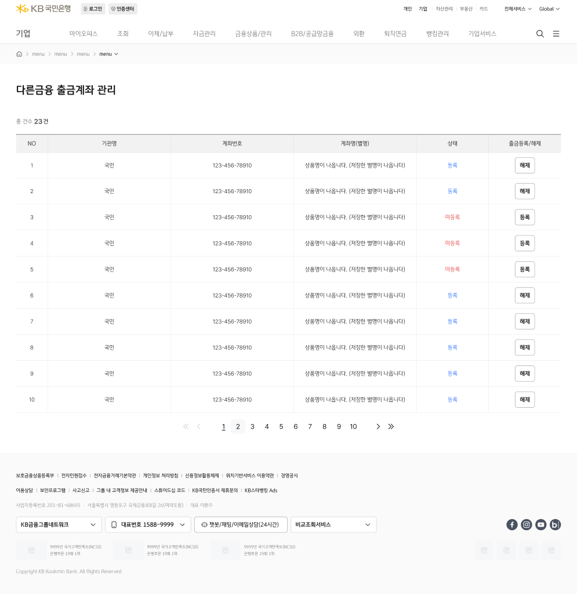

### 패턴 B

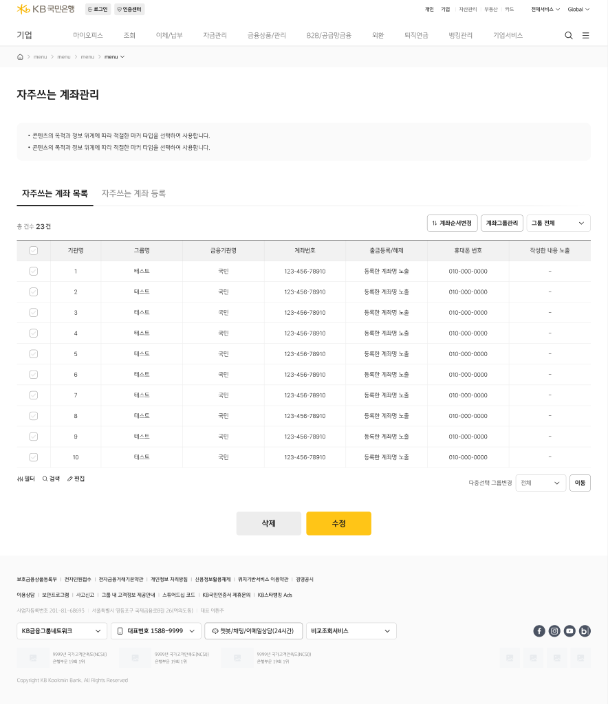

### 재현 시 확인할 항목

1. 1440 기준 콘텐츠 너비 1360, 좌우 40, 본문 상하 48, 주요 섹션 gap 48을 유지한다.
2. A는 제목·건수·6열 표·페이지네이션, B는 제목·안내·탭·툴바·8열 표·보조 조작·대형 버튼 순서를 유지한다.
3. 표 열 너비의 합이 1360이며 헤더와 본문의 열 경계가 일치하는지 확인한다. 306.667/193.333을 정수로 각각 반올림해 누적 오차를 만들지 않는다.
4. KBFG Text와 Pretendard의 용도, 실제 크기·행간·자간을 확인한다. 누락 폰트·텍스트 잘림·겹침을 검사한다.
5. 간격이 슬롯 내부에 정의된 경우까지 확인한다. 색상만으로 체크박스·버튼의 상태를 추측하지 않는다.
6. 구조·서체·화면 검수가 통과하면 같은 검수를 불필요하게 반복하지 않는다.

## 12. 레이어 명명 및 그룹핑 규칙

이 절은 사용자 정의 레이어·그룹·Auto Layout 래퍼를 정리하거나 새 화면을 생성할 때 적용한다. 이 문서 전체의 원본 트리·레이어명·Container 번호는 출처를 설명하는 관측 기록이며, 생성 화면의 사용자 정의 레이어 명명·그룹핑은 본 절을 우선 적용한다. 디자인 시스템 컴포넌트의 원형 이름과 내부 고유 계층은 유지한다.

### 12.0. 참조 화면 학습과 생성 시 적용 우선순위

- 전달받은 화면에서는 간격·패딩·크기·정렬·서체·색상, 적절한 디자인 시스템 컴포넌트와 변형, UI 조합·시각적 위계·상태별 차이를 파악하고 재현 가능한 규칙으로 정리한다.
- **참조 화면의 `## BODY` 내부 레이어 이름과 정리 상태는 학습·복제 기준으로 삼지 않는다.** 미정리된 프레임명, 잘못된 Group 명칭, 불필요한 중간 래퍼, 부정확한 명명·그룹핑을 신규 제작물에 그대로 옮기지 않는다.
- 신규 생성은 원본 기획안과 필수 디자인 규칙을 준수하며 실제 UI의 역할·내용 순서·시각적 위계·간격을 반영한다. 사용자 정의 레이어는 12.1~12.11의 규칙으로 명명하고, 관련 요소는 실제 Auto Layout으로 구성한다. 현재 자식 구성을 기준으로 이름을 다시 판정한다.
- 각 패턴 장에서 원본의 Container 개수·번호·부모·래퍼를 설명한 부분은 **신규 화면에 원본의 미정리 계층을 그대로 강제하는 지시로 해석하지 않는다.** 신규 구조는 기획상의 역할 구분과 본 절을 따른다.
- 기존 화면 자체의 레이어 정리를 수행할 때는 12.3의 Container 개수·부모·순서·역할 분할 임의 변경 금지 규칙을 유지한다. 정리 요청을 이유로 화면의 UI 구성이나 업무 영역을 임의로 재설계하지 않는다.
- 디자인 시스템 인스턴스의 원형 이름·내부 고유 계층과 연결은 유지한다. 사용자 정의 래퍼 정리를 위해 인스턴스를 detach하지 않는다.
- 이 우선순위는 지금까지 전달된 화면과 앞으로 전달될 모든 참조 화면에 적용한다.

### 12.1. 기본 원칙

- 사용자 정의 레이어·그룹 이름은 역할을 알 수 있는 영문으로 작성한다.
- 디자인 시스템 컴포넌트의 원형 이름과 내부 고유 계층은 유지한다.
- 관련 항목은 실제 Auto Layout으로 묶는다. 이름만 Group으로 변경하지 않는다.

### 12.2. 화면의 기본 영역

일반 화면은 다음 영역으로 구분한다.

```text
화면
├─ ## HEADER
├─ ## BODY
└─ ## FOOTER
```

Popup 컴포넌트 내부 영역명은 `Header`, `Body`, `Footer`를 사용한다.

### 12.3. Container 명명

- 본문 Container가 하나이면 `Container`로 명명한다.
- 복수이면 위에서부터 `Container 1`, `Container 2`, `Container 3`으로 명명한다.
- 개별 Slot 안에서도 동일한 기준을 적용한다.
- 다른 화면이나 다른 Slot의 Container 개수는 합산하지 않는다.
- 기존 화면 정리 시 Container의 개수·부모·순서·역할 분할을 임의로 변경하지 않는다.

```text
## BODY
├─ Container 1
├─ Container 2
└─ Container 3
```

### 12.4. 동일 항목의 반복

같은 종류·역할의 항목이 복수로 반복되면 실제 Auto Layout으로 묶고 `[명칭] Group`으로 명명한다.

```text
InputField Group
├─ InputField
├─ InputField
└─ InputField
```

예:

- Text Group
- TextList Group
- InputField Group
- DataList Group
- Card Group
- Data Block Group
- Text Box Group
- Accordion Group
- Radio Group
- Checkbox Group

반복 자식은 원래 이름을 유지한다.
`InputField 1`, `InputField 2`처럼 순번을 붙이지 않는다.
페이지 Container의 순번 규칙은 예외다.
Card Group·Data Block Group·Text Box Group의 역할별 자식 이름과 기본 간격은 60.5장을 따른다.

### 12.5. 단일 항목의 래퍼

단일 항목을 배치 목적으로 감싸는 경우 Group을 붙이지 않고 해당 명칭을 사용한다.

```text
InputField
└─ InputField
```

바깥은 Auto Layout 래퍼, 안쪽은 실제 컴포넌트다.

### 12.6. 서로 다른 두 요소의 결합

실제 구성 요소의 대표 명칭을 `/`로 연결한다.

| 자식 구성 | 부모 이름 |
| --- | --- |
| Title / Page + InputField | Title / InputField |
| Title / Section + InputField Group | Title / InputField Group |
| Title / Section + List Group | Title / List Group |
| Title / Element + Text | Title / Text |
| InputField Group + Button Area | InputField Group / Button Area |
| Card Group + Button Area | Card Group / Button Area |
| Text + TextList Group | Text / TextList Group |

- `Title / Page`, `Title / Section` 등의 세부 유형은 조합명에서 대표 명칭인 `Title`로 정리한다.
- `Group`, `Button Area`처럼 실제 역할을 나타내는 명칭은 보존한다.

### 12.7. 여러 종류의 콘텐츠 결합

서로 다른 세 덩이 이상을 묶으면 `[첫 요소의 대표 명칭] / Contents`로 명명한다.

```text
Title / Contents
├─ Title / Page
├─ InputField Group
└─ Accordion
```

제목과 복합 본문이 결합된 경우에도 `Title / Contents`를 사용한다.

```text
Title / Contents
├─ Title / Section
└─ Text / TextList Group
```

복수의 제목·콘텐츠 조합을 아우르는 상위 래퍼도 `Title / Contents`로 명명한다.

```text
Title / Contents
├─ Title / Accordion Group
└─ Title / Accordion Group
```

상위와 하위를 모두 `Title / Accordion Group`으로 중첩 명명하지 않는다.

### 12.8. Text와 TextList 구분

단일 일반 본문:

```text
Text
└─ Content
```

복수 일반 본문:

```text
Text Group
├─ Text
│  └─ Content
└─ Text
   └─ Content
```

복수 TextList:

```text
TextList Group
├─ TextList / Unordered
└─ TextList / Unordered
```

Text와 복수 TextList의 혼합:

```text
Title / Contents
├─ Title / Element
└─ Text / TextList Group
   ├─ Text
   │  └─ Content
   └─ TextList Group
      ├─ TextList / Unordered
      └─ TextList / Unordered
```

- 일반 Text만 반복되는 그룹을 TextList Group으로 명명하지 않는다.
- Text와 TextList가 섞인 본문 전체를 TextList Group으로 명명하지 않는다.
- 자식 구성이 혼합 본문으로 바뀌면 상위의 기존 `Title / TextList Group`도 `Title / Contents`로 변경한다.

### 12.9. 버튼 영역

본문의 독립 버튼 영역은 `Button Area`로 명명한다.

```text
InputField Group / Button Area
├─ InputField Group
│  ├─ InputField
│  └─ InputField
└─ Button Area
   └─ BoxButton
```

### 12.10. Tab·Segment·Chip

- Tab과 후속 콘텐츠를 반드시 하나의 그룹으로 묶는 의무는 없다.
- 기존 Tab 그룹은 필요에 따라 유지할 수 있다.
- Segment·Chip은 후속 콘텐츠와 실제 Auto Layout으로 묶고 구성에 맞게 명명한다.
- 이를 이유로 기존 Container를 임의로 병합하거나 분할하지 않는다.

### 12.11. 구조 변경 후 이름 재판정

- 자식 추가·삭제·교체·그룹핑 후 해당 래퍼와 영향을 받는 부모 이름을 다시 확인한다.
- 이름은 과거 구성이 아닌 현재의 실제 자식 구성을 반영해야 한다.
- 반복 그룹인지, 두 요소의 결합인지, 복합 Contents인지 순서대로 판정한다.

## 13. 디자인 시스템 기준 경로 및 Footer 필수 적용

### 13.1. 디자인 시스템 기준

- [PC 디자인라이브러리 v0.96](https://www.figma.com/design/ftIWLlgj5Ldgt1uyQu9Gb8?node-id=0-1)을 화면 생성에 사용할 디자인 시스템 기준으로 삼는다.
- 파일 키: `ftIWLlgj5Ldgt1uyQu9Gb8`, 기준 링크 노드: `0:1`.
- 컴포넌트·토큰·스타일은 이 디자인 시스템에서 재사용한다. 원형 이름과 내부 고유 계층은 유지한다.

### 13.2. Footer 식별자

[지정 Footer 원본](https://www.figma.com/design/ftIWLlgj5Ldgt1uyQu9Gb8?node-id=2920-38417)은 `Footer` 컴포넌트 세트다.

| 항목 | 확인값 |
| --- | --- |
| 파일 키 | `ftIWLlgj5Ldgt1uyQu9Gb8` |
| 페이지 | `C01. Navigation` |
| 컴포넌트 세트 이름 | `Footer` |
| 컴포넌트 세트 노드 | `2920:38417` |
| 컴포넌트 세트 키 | `014c29b758d4bd381c8273f972a4c347fffabc54` |

| 변형 | 원형 노드 | main component key | 원형 크기 |
| --- | --- | --- | --- |
| `variant=default` | `2920:37863` | `bb4b7042c4ccc5742c5d51c3f5460ffec409ab63` | 1920 × 352 |
| `variant=compact` | `2989:115415` | `2a1bb8e301dd46cf51d5ea4deefca130b3d9dd8d` | 1920 × 68 |

원본 상위 섹션 이름은 확인 시점에 `04 Footer(미확정)`이었다. 이는 라이브러리의 상태 표기이며, 화면 생성 시 이 Footer를 사용하라는 사용자 지정은 그대로 적용한다.

### 13.3. 화면 생성 시 적용 규칙

- **학습·참고 화면의 Footer가 컴포넌트가 아닌 일반 레이어로 구성되어 있어도, 새 화면에는 반드시 지정 Footer 컴포넌트의 인스턴스를 넣는다.**
- 학습 화면은 본문 패턴·간격 등 재현에 필요한 기준으로 사용한다. 학습 화면의 푸터를 일반 프레임·그룹·텍스트 묶음으로 복사하거나 다시 그리지 않는다.
- 별도의 compact 지정이 없으면 `variant=default`를 사용한다. compact 요청 시 같은 Footer 세트의 `variant=compact`를 사용한다.
- 화면의 `## FOOTER` 영역 안에 Footer 인스턴스를 배치한다. 바깥 영역은 Auto Layout으로 구성하고 내부 인스턴스의 원형 이름 `Footer`와 내부 계층을 유지한다.
- 본문 다음의 세로 흐름에 배치한다. 인스턴스 너비는 화면 너비에 맞추되, 원형 1920px 너비를 이유로 1440px 화면 밖으로 넘치게 두거나 전체를 비례 축소하지 않는다.
- Footer 내부의 패딩·Auto Layout·슬롯·토큰을 유지한다. 바깥 `## FOOTER`에 같은 패딩을 중복 적용해 여백을 늘리지 않는다.
- 컴포넌트를 detach하지 않는다. 필요한 콘텐츠 조정은 제공된 속성·슬롯·인스턴스 오버라이드를 사용한다.
- 키로 원형을 가져오거나 원본 컴포넌트에서 인스턴스를 생성한다. 실제 `mainComponent` 연결이 위 식별자와 맞는지 확인한다. 이름만 Footer인 일반 프레임으로 대체하지 않는다.
- 2·7·8·9장의 푸터 실측값과 과거 예시가 구현 방식을 달리 보여도 **본 절의 지정 컴포넌트 사용 규칙을 우선한다**. 푸터 높이가 다른 변형을 쓰면 전체 화면 높이는 본문과 푸터의 실제 흐름에 맞춰 계산한다.
- 생성 후 컴포넌트 연결, 선택한 변형, 화면 너비에 대한 배치, 중복 패딩, 텍스트 잘림·누락 폰트를 검수한다.

```text
Screen
├─ ## HEADER
├─ ## BODY
└─ ## FOOTER
   └─ Footer  [INSTANCE, variant=default]
```

위 트리의 대괄호는 노드 유형·변형을 설명하는 주석이며 실제 레이어 이름에 덧붙이지 않는다.

## 14. 추가 학습 자료와 적용 범위

2026-11-09에 추가 확인한 5개 패턴을 C~G로 기록한다. 처음 받은 브랜치 5개와 사고신고 파일의 3개, 총 8개 참조를 아래에 연결한다. 사고신고 파일의 집중형·완료·에러는 앞서 확인한 브랜치의 대응 화면과 배치가 같지만, 일부 로컬 컴포넌트 키는 다르다.

| 패턴 | 학습 원본 | 대응 브랜치 원본 |
| --- | --- | --- |
| C — 비밀번호 신규/변경 | [브랜치 18182:97027](https://www.figma.com/design/ftIWLlgj5Ldgt1uyQu9Gb8/branch/GDnwWiuiGzIZA734GOm3Yr?node-id=18182-97027) | 동일 |
| D — 등록·서비스 동의 | [브랜치 18182:97229](https://www.figma.com/design/ftIWLlgj5Ldgt1uyQu9Gb8/branch/GDnwWiuiGzIZA734GOm3Yr?node-id=18182-97229) | 동일 |
| E — 가입 집중형 | [사고신고 5067:3967](https://www.figma.com/design/yojs1BhPrWxLmDDrpg1ihD?node-id=5067-3967) | [18182:97358](https://www.figma.com/design/ftIWLlgj5Ldgt1uyQu9Gb8/branch/GDnwWiuiGzIZA734GOm3Yr?node-id=18182-97358) |
| F — 완료 | [사고신고 5067:4217](https://www.figma.com/design/yojs1BhPrWxLmDDrpg1ihD?node-id=5067-4217) | [18182:97578](https://www.figma.com/design/ftIWLlgj5Ldgt1uyQu9Gb8/branch/GDnwWiuiGzIZA734GOm3Yr?node-id=18182-97578) |
| G — 에러 | [사고신고 5067:4387](https://www.figma.com/design/yojs1BhPrWxLmDDrpg1ihD?node-id=5067-4387) | [18182:97728](https://www.figma.com/design/ftIWLlgj5Ldgt1uyQu9Gb8/branch/GDnwWiuiGzIZA734GOm3Yr?node-id=18182-97728) |

- C·D 출처: 원본 파일 키 `ftIWLlgj5Ldgt1uyQu9Gb8`, 브랜치 키 `GDnwWiuiGzIZA734GOm3Yr`, 페이지 `Templates (작성중)` (`15115:110263`).
- E·F·G 추가 출처: 파일 `05. 사고신고`, 파일 키 `yojs1BhPrWxLmDDrpg1ihD`, 페이지 `05.기타(기획 v0.6)` (`5007:20503`).
- 화면 좌표와 치수는 논리 px다. 이미지는 0.7배 PNG로 보존하므로 이미지 픽셀을 실측 좌표로 오해하지 않는다.
- 학습 원본은 배치 패턴의 근거다. 신규 화면의 디자인 시스템 기준 파일은 13장을 유지하고, Footer도 13장의 지정 인스턴스로 넣는다.
- 아래에 적은 원본의 `Title + Table`, `Frame ...`, `Text + List Group` 같은 이름은 관측 기록이다. 실제 생성·정리 시에는 12장의 영문 명명·실제 Auto Layout·Container 보존 규칙을 적용한다.
- 각 원본의 “타이틀입니다”, “버튼명”, 샘플 계좌·이름·일시·안내 문구는 기획에 따라 교체한다. 샘플 보안·서비스 안내를 모든 업무의 검증 정책으로 확대하지 않는다.

### 14.1. 공통 실측과 기존 관리형과의 차이

| 패턴 | 원본 화면명 | 전체 크기 | BODY 높이 | Footer 시작 y |
| --- | --- | --- | --- | --- |
| C | Case_비밀번호발급/변경 | 1440 × 1411 | 902 | 1059 |
| D | Case_등록 | 1440 × 1239 | 730 | 887 |
| E | Case_가입_집중형 | 1440 × 1337 | 828 | 985 |
| F | Case_완료 | 1440 × 1280 | 771 | 928 |
| G | Case_에러 | 1440 × 900 | 391 | 548 |

- C~G의 HEADER 실측은 157px이다. GNB 108 + Breadcrumbs Area 49이며, 초기 A·B의 159px (GNB 110)과 2px 차이가 있다.
- 2장의 159px을 모든 화면의 절대값으로 덮어쓰지 않는다. 선택한 실제 헤더 인스턴스 높이를 기준으로 BODY를 배치한다. C~G의 BODY 시작 y=157, 첫 콘텐츠 y=205다.
- 화면 너비 1440, 좌우 패딩 40, 기본 콘텐츠 너비 1360, 본문 상하 패딩 48은 동일하다.
- C·D·F·G는 세로 BODY와 주요 섹션 gap 48을 사용한다. **E의 BODY는 가로 3열 Auto Layout, 열 간 gap 32**인 예외다.
- C·E·F의 정보/입력 표는 **라벨·값 왼쪽 정렬, 수직 가운데 정렬**이다. A·B 목록형의 가운데 정렬을 정보 표에 일괄 적용하지 않는다.
- Grid의 `itemSpacing=10`이 남아 있어도 실제 `gridRowGap=0`, `gridColumnGap=0`이다. 행·열 사이에 10px 공백을 추가하지 않는다.
- 표 색상·셀 패딩은 기존 기준을 재사용한다: 라벨 #F2F2F2, 값 #FFFFFF, 상단선 #444444 1px, 셀 패딩 상하 12·좌우 16.

### 14.2. 추가로 확인한 서체 위계

| 역할 | 실제 폰트 | 크기/행간 |
| --- | --- | --- |
| 수평 단계 현재 번호 | Pretendard SemiBold | 16/24 |
| 수평 단계 미시작 번호 | Pretendard Light | 16/24 |
| 수평 단계 현재 라벨 | KBFG Text Bold | 14/20 |
| 세로 단계 주 라벨(완료·진행) | KBFG Text Bold | 16/24 |
| 세로 단계 미시작 라벨 | KBFG Text Medium | 16/24 |
| LNB 제목 | KBFG Text Bold | 22/31 |
| LNB 2depth | KBFG Text Medium 또는 선택 상태 Bold | 18/25 |
| LNB 하위 메뉴 | KBFG Text Light 또는 선택 상태 Medium | 14/20 |
| 동의 안내의 강조 본문 | KBFG Text Medium | 16/24 |
| 동의 안내의 보조 문장 | KBFG Text Medium | 14/20 |
| 동의 라벨 | KBFG Text Bold | 16/24 |
| 완료·에러 주 메시지 | KBFG Text Bold | 20/28 |

기본 자간은 모두 0px이다. 단계 번호의 16px은 건수·페이지네이션의 17px과 구분한다.

C·D·F·G의 추출 본문에서는 누락 폰트가 없었다. 사고신고 사본 E는 추출 본문에서 `hasMissingFont=true`인 텍스트 34개가 감지되었다. 전체 원본 프레임의 추가 점검에서는 KBFG Text Bold/Medium, Pretendard Light/SemiBold가 누락 표시에 포함됐다. 새 화면 작성 전 해당 폰트·스타일과 기준 라이브러리를 확인하며, 누락을 이유로 임의 대체 폰트를 쓰거나 글자 크기·너비를 바꾸지 않는다. 보존 이미지는 그 시점의 표시 결과다.

## 15. 패턴 C — 비밀번호 신규/변경·보안 입력형

### 15.1. 구조와 좌표

본문 Container는 원본의 4개 구분을 유지한다.

| 요소 | x | y | 너비 | 높이 |
| --- | --- | --- | --- | --- |
| Container 1 — 제목·수평 단계 | 40 | 205 | 1360 | 36 |
| 제목 | 40 | 205 | 254 | 36 |
| StepIndicator / Horizontal | 약 1126.8 | 207 | 273.2 | 32 |
| Container 2 — 안내 박스 | 40 | 289 | 1360 | 118 |
| Container 3 — 제목·비밀번호 표 | 40 | 455 | 1360 | 334 |
| 비밀번호 표 | 40 | 503 | 1360 | 286 |
| Container 4 — 제목·OTP·안내 | 40 | 837 | 1360 | 174 |
| OTP 표 | 40 | 885 | 1360 | 66 |
| OTP 안내 목록 | 40 | 967 | 1360 | 44 |

- 제목과 단계 표시는 같은 가로 Auto Layout에서 양끝 정렬하며 수직 가운데 정렬한다.
- 단계는 총 3단계: 완료 1단계, 현재 2단계 “비밀번호 및 보안정보 입력”, 미시작 3단계다. 단계 번호·라벨·상태는 컴포넌트 속성/슬롯으로 유지한다.
- 안내 박스는 radius 12, #FAFAFA, 패딩 20 24, 실제 테두리 없음이다. 샘플 안내는 3항목이다. 내부 높이 78을 포함한 원본 높이는 118이다.
- 섹션 제목은 20/28 Bold이며 표와 간격 20이다.

### 15.2. 정보·입력 표

| 행 | 구성 | 높이 |
| --- | --- | --- |
| 1 | 계좌번호 라벨 340 + 값 340 + 계좌명 라벨 340 + 값 340 | 45 |
| 2 | KB카드 라벨 340 + 값 1020 (3열 병합) | 45 |
| 3 | 현재 비밀번호 라벨 340 + 입력·확인 영역 1020 | 65 |
| 4 | 변경 후 비밀번호 라벨 340 + 입력 영역 1020 | 65 |
| 5 | 변경 후 비밀번호 확인 라벨 340 + 입력 영역 1020 | 65 |

상단선 1 + 45 + 45 + 65 × 3 = 286이다. Grid는 4열 5행이며 병합 셀의 너비를 보존한다.

- 입력필드는 400 × 40, 확인 버튼은 secondary small 50 × 40, 둘 사이 gap 8, 합계 너비 458이다.
- 현재 비밀번호 입력은 `disabled=false`, 변경 후 비밀번호와 확인 입력은 샘플에서 `disabled=true`다. 비활성 상태를 회색 도형으로 재현하지 않고 실제 변형으로 설정한다.
- 입력 활성화 조건·현재 비밀번호 확인 결과는 이 정적 화면만으로 확정하지 않는다.
- OTP는 라벨 340 + 값 1020의 1행 표, 높이 65 + 상단선 1 = 66이다. 값 영역에도 400 × 40 입력 + gap 8 + 50 × 40 확인 버튼을 쓴다.
- OTP 표 아래 목록은 gap 16 뒤에 놓는다. 목록 2개는 각 20 높이, 항목 간 gap 4, 전체 44이며 `TextList / Unordered depth=2`와 왼쪽 들여쓰기 24를 사용한다.
- OTP 자릿수·오류 횟수·입력 제한 문장은 해당 업무 기획의 내용으로 관리한다. 다른 화면에 일괄 적용하지 않는다.
- 이 원본에는 페이지 하단 대형 실행 버튼이 없다. 학습 과정에서 임의로 추가하지 않는다.

## 16. 패턴 D — 서비스 안내·동의·등록형

본문은 원본의 3개 상위 영역을 유지한다. 순서: 제목·단계 → 안내·동의 → 실행 버튼이다. 원본의 자동 생성 이름 `Frame 2147246237`은 생성 시 12장의 역할·Container 명명 규칙으로 정리한다.

| 요소 | x | y | 너비 | 높이 |
| --- | --- | --- | --- | --- |
| 제목·수평 단계 영역 | 40 | 205 | 1360 | 36 |
| StepIndicator / Horizontal | 약 1176.8 | 207 | 223.2 | 32 |
| 안내·동의 섹션 | 40 | 289 | 1360 | 446 |
| 안내 박스 | 40 | 289 | 1360 | 382 |
| Item / Consent | 40 | 687 | 1360 | 48 |
| 단일 실행 버튼 | 643 | 783 | 154 | 56 |

- 총 4단계이며 현재는 1단계 “서비스동의”, 이후 번호는 2·3·4이다.
- 안내 박스는 radius 12, 패딩 32, 테두리 #E5E5E5 1px, 원본 fill #FAFAFA다. 저장 속성과 보이는 인상을 구분하고 토큰·스타일을 유지한다.
- 테두리를 포함한 내부 콘텐츠 시작은 박스 기준 (33,33), 너비 1294다. 1360 − 2 × (32+1) = 1294로 검산한다.
- 일반 본문 묶음과 TextList Group 사이는 16, 일반 본문 두 문장은 12, TextList 9항목 사이는 8이다. 각 리스트가 20 높이이므로 목록 전체는 9 × 20 + 8 × 8 = 244다.
- 일반 본문과 리스트가 혼합된 구성이므로 12장에 따라 `Text / TextList Group` 등 실제 구성에 맞게 명명한다. 전체를 TextList Group으로 부르지 않는다.
- 안내 박스와 동의 컴포넌트 간격은 16이다. `Item / Consent variant=1d`, 상하 패딩 12, 체크 컨트롤 24 × 24, 라벨과의 gap 8이다.
- 실행 버튼은 중앙 정렬 primary large 154 × 56, radius 6, 18/25 Bold다. 원본 `ButtonGroup count=multi` 안에 버튼 하나만 들어 있으므로 외형만 보고 버튼 두 개를 추가하지 않는다.
- 원본 버튼명은 플레이스홀더다. 실제 라벨과 동의 전후 활성화·클릭 동작은 해당 기획을 따른다.

## 17. 패턴 E — LNB·집중 본문·세로 단계의 3열 가입형

### 17.1. 열과 본문

```text
## BODY — Horizontal, padding 48 40, gap 32
├─ LNB 영역 — 316
├─ 집중 본문 — 664, Vertical, section gap 48
└─ 세로 단계 카드 — 316
```

316 + 32 + 664 + 32 + 316 = 1360이다.

| 요소 | x | y | 너비 | 높이 |
| --- | --- | --- | --- | --- |
| LNB 영역·실제 LNB | 40 | 205 | 316 | 618 |
| 중앙 본문 | 388 | 205 | 664 | 732 |
| 중앙 페이지 제목 | 388 | 205 | 664 | 36 |
| 제목·표 섹션 1 | 388 | 289 | 664 | 139 |
| 제목·표 섹션 2 | 388 | 476 | 664 | 229 |
| 제목·표 섹션 3 | 388 | 753 | 664 | 184 |
| 세로 단계 카드 | 1084 | 205 | 316 | 402 |

- 본문 상위 Container의 관측 이름은 좌측 `Container 1`, 중앙 `Container 4`, 우측 `Container 3`이다. 기존 정리 시 3열의 부모·개수·순서를 보존하고, 명명은 12장에 따라 현재 실제 범위에서 판정한다. 번호를 맞추기 위해 영역을 합치거나 나누지 않는다.
- 중앙 제목과 세 표 섹션 사이, 각 표 섹션 사이는 48이다.
- 각 섹션 제목 28 + gap 20 + 표 높이 91/181/136으로 구성한다.
- 표는 180 라벨 + 484 값의 2열, 행 높이 45다. 각각 2·4·3행이고 상단선 1을 포함한다. 값과 라벨은 왼쪽 정렬한다.
- 중앙 본문 너비 664에 초기 목록형의 1360 너비 표를 그대로 넣지 않는다.

### 17.2. LNB 참고용 틀 제거 — 필수

**실제 화면을 생성할 때 `(LNB 영역만 참고)`라는 참고용 틀을 제거하고 실제 LNB 인스턴스만 정상 노출한다.**

- 사고신고 원본의 안내 틀: `5067:3976`. 대응 브랜치 노드: `18182:97367`.
- 이 틀은 LNB와 별개인 프레임이며 `layoutPositioning=ABSOLUTE`, 316 × 548, LNB 위 (40,205)에 겹쳐 있다. fill은 #D400FF, opacity 0.04다.
- 복사한 작업 화면에서 이 오버레이와 같은 목적의 안내용 표시를 제거한다. 보라색 채움이나 참고용 텍스트를 서비스 UI로 남기지 않는다.
- **실제 LNB 인스턴스는 삭제·숨김·detach하지 않는다.** 사고신고 원본의 실제 LNB는 `5067:3975`, 대응 브랜치는 `18182:97366`이다.
- LNB 너비 316, 본문과의 gap 32, 메뉴 계층·선택·펼침 상태·아이콘을 유지한다. 오버레이 제거를 이유로 LNB 영역이나 상위 Container까지 지우지 않는다.
- 오버레이의 548 높이를 LNB 높이로 오해하지 않는다. 실제 LNB 원본 높이는 618이며, 제목 45 + 메뉴 슬롯 493 + 하단 패딩 80의 구성이다.
- 관측된 LNB 2depth 항목 높이는 49, 3·4depth는 40이다. 메뉴명과 선택 경로는 화면 기획에 맞게 조정한다.
- 완료 검수에서 참고 틀이 남아 있지 않은지와 실제 LNB가 가려짐 없이 보이는지를 함께 확인한다.
- 보존 이미지는 학습 원본을 기록하므로 참고 틀이 포함되어 있다. 이 이미지의 보라색 면을 생성 결과에 재현하지 않는다. 현재 요청은 규칙 학습이며 원본 참조 화면 자체는 수정하지 않았다.

### 17.3. 세로 단계 카드

- 카드 316 × 402, 안쪽 패딩 20, radius 20, 흰 배경이다.
- 그림자 실측: x=0, y=4, blur=6, spread=0, rgba(12,17,29,0.10).
- 내부 단계 스택은 276 × 362, 단계 사이 gap 20이다.
- 완료 1·2단계 각 32, 현재 3단계 154, 미시작 4·5단계 각 32다. 32+32+154+32+32 + 20×4 = 362이다.
- 현재 단계는 “고객정보 확인”이며 depth=2 하위 단계 2개가 포함된다. 상위 번호·진행 라인·하위 라벨은 실제 StepIndicator 인스턴스의 내부 계층으로 유지한다.
- 현재 단계 확장 높이를 모든 단계에 적용하지 않는다. 고정/sticky·스크롤 추종 동작은 정적 화면에서 확인되지 않았다.

## 18. 패턴 F — 완료 Feedback·결과 요약형

본문 Container 4개를 유지한다: 완료 메시지 → 결과 표 1 → 결과 표 2 → 실행 버튼.

| 요소 | x | y | 너비 | 높이 |
| --- | --- | --- | --- | --- |
| 완료 메시지 래퍼 | 40 | 205 | 1360 | 152 |
| Feedback 인스턴스 | 40 | 225 | 1360 | 112 |
| 첫 제목·표 섹션 | 40 | 405 | 1360 | 139 |
| 첫 표 | 40 | 453 | 1360 | 91 |
| 두 번째 제목·표 섹션 | 40 | 592 | 1360 | 184 |
| 두 번째 표 | 40 | 640 | 1360 | 136 |
| 실행 버튼 모음 | 560 | 824 | 320 | 56 |

- Feedback 래퍼는 상하 20 패딩, 가운데 정렬이다.
- `Feedback varient=large`를 사용한다. `varient`는 실제 라이브러리 속성 표기이므로 임의로 `variant`로 바꾸지 않는다.
- 성공 아이콘은 `status-circleCheck` 64 × 64다. 아이콘 영역 64 → gap 20 → 주 메시지 20/28 Bold로 전체 112를 구성한다.
- 첫 표는 거래종류·거래일시 2행, 두 번째 표는 출금계좌번호·거래일시·받는분 3행이다.
- 표 너비는 라벨 240 + 값 1120, 행 높이 45, 왼쪽 정렬이다. 계좌번호·날짜는 숫자용 셀 스타일을 적용한다.
- 두 실행 버튼은 tertiary + primary large, 각 154 × 56, 내부 gap 12, 합계 320이다.
- 제목·버튼·값은 샘플 내용을 고정하지 않는다. 결과 메시지는 업무 성공 상태에 맞게 작성한다.

## 19. 패턴 G — 에러·이용 조건 안내형

| 요소 | x | y | 너비 | 높이 |
| --- | --- | --- | --- | --- |
| Feedback 래퍼 | 40 | 205 | 1360 | 295 |
| Feedback 인스턴스 | 40 | 225 | 1360 | 204 |
| Footer 시작 | 0 | 548 | 1440 | 352 |

- 목록·표·페이지 제목 없이 Feedback 중심으로 구성하는 패턴이다. 이전 화면에 제목·표가 있었다는 이유로 추가하지 않는다.
- 완료형과 같은 `Feedback varient=large`를 쓰되 아이콘 슬롯은 `status-alert` 64 × 64로 구분한다.
- 내부 구조는 아이콘 영역 64 → gap 20 → 주 메시지 2줄 56 → gap 20 → 버튼 슬롯 44다. 합계 204다.
- 주 메시지는 중앙 정렬 KBFG Text Bold 20/28, 버튼은 tertiary small 64 × 40, 14/20 Bold다.
- 바깥 래퍼 높이 295와 내부 콘텐츠+패딩 244의 차이 51은 원본의 추가 공간이다. 이를 모든 에러 화면의 공통 간격 토큰으로 만들지 않는다.
- 원본 “입출금계좌 개설 후 이용” 문장은 이 예시의 안내다. 다른 오류의 메시지·복구 행동·버튼 라벨은 해당 기획을 따른다.
- 전체 높이 900은 샘플 실측값이며, 에러 화면 전체에 고정 최소 높이나 뷰포트 정렬 규칙으로 확대하지 않는다.

## 20. 추가 컴포넌트 식별자와 삭제 대비 보존

### 20.1. 추가 확인 키

기존 10장의 Table·BoxButton·Title / Page 등은 재사용한다. 아래는 이번 학습에서 추가로 확인한 식별자다.

| 컴포넌트 | 확인 변형 | main component key |
| --- | --- | --- |
| StepIndicator / Horizontal | `StepIndicator / Horizontal` | `d621c953803a7eaa545720572e195d3758d84e99` |
| Title / Headline | `align=left` | `cd6a27c70df81353de0a000dd9666a8de67326cd` |
| InputField | `hover=false, focused=false, disabled=false, entered=false, error=false` | `6eb7815286692dc574ebe162983fcb9afe06fc05` |
| InputField | `hover=false, focused=false, disabled=true, entered=false, error=false` | `569b5095c477f6fa62c0c4fd09b6d8e9af1159c6` |
| TextList / Unordered | `variant=bullet, size=14, depth=1` | `5e484496e22e7e84c91c23bddfe11d1b4a13f35b` |
| TextList / Unordered | `variant=bullet, size=14, depth=2` | `5a5dbb8e2363c9870344034ad126740094189999` |
| Item / Consent | `variant=1d` | `e7be5a47121b2fd59a919f83033f882473b946af` |
| StepIndicator / Vertical | `StepIndicator / Vertical` | `6d64a53e165cf7f9d92e29637bba2a700ef84253` |
| Table / Cell | `variant=last, onlyNumber=true` | `494e274bfc773051437a999b5ad37c61b4321cf4` |
| status-circleCheck | `status-circleCheck` | `46a6b3505cfd401cbc4223402149f9391130515e` |
| status-alert | `status-alert` | `78f46e6680082282c14dbf37f37f2557a97d692b` |

입력필드의 `disabled=true` 키와 `disabled=false` 키는 구분한다. 수평 단계의 현재 번호는 #1F6AFF, 미시작 번호는 #8D8D8D다.

### 20.2. 같은 이름의 출처별 키 차이

| 컴포넌트 | 브랜치에서 관측한 키 | 사고신고 사본에서 관측한 키 |
| --- | --- | --- |
| LNB | `2aad82f0f97e6a0a69a2af71c272f10dc10c4e83` | `60c5aebdbb1ceb6a0d6f7ee18dd7abfc5bd91d2e` |
| Title / Headline | `cd6a27c70df81353de0a000dd9666a8de67326cd` | `bf50f457ca5583c356608499f2a479e58248073a` |
| Feedback — varient=large | `7d7b6abcae40263fa7d8f2b19a9bfdb8e84bcc42` | `d421043c19670294d67d1a724db0c2d35a5feb14` |
| 에러 내 tertiary small 버튼 | `0dd34d36c9b4e00c021f1e19738665f8f84a7e5b` | `adc24d1239ed006ee1f91cb4a8ad99fff9651f22` |

이 표는 이름이 같아도 로컬 원형이 다를 수 있음을 기록한다. 학습 파일의 로컬 키를 기준 디자인 시스템의 공식 키라고 단정하지 않는다. 생성 대상 파일에서 13장의 기준 라이브러리 원형과 변형을 확인해 사용한다. LNB·Feedback이 학습 파일과 함께 삭제될 경우에도 위 구조·치수·상태·이미지로 의도를 확인할 수 있다. Footer는 이 표와 관계없이 13장의 지정 원형을 사용한다.

### 20.3. 화면 이미지

이미지는 링크가 삭제되어도 남도록 저장소에 직접 보존했다. E~G는 사고신고 파일의 최신 전달본이며 대응 브랜치의 배치와 대조했다. 모든 이미지는 0.7배이며 너비 1008px다.

#### C — 비밀번호 신규/변경

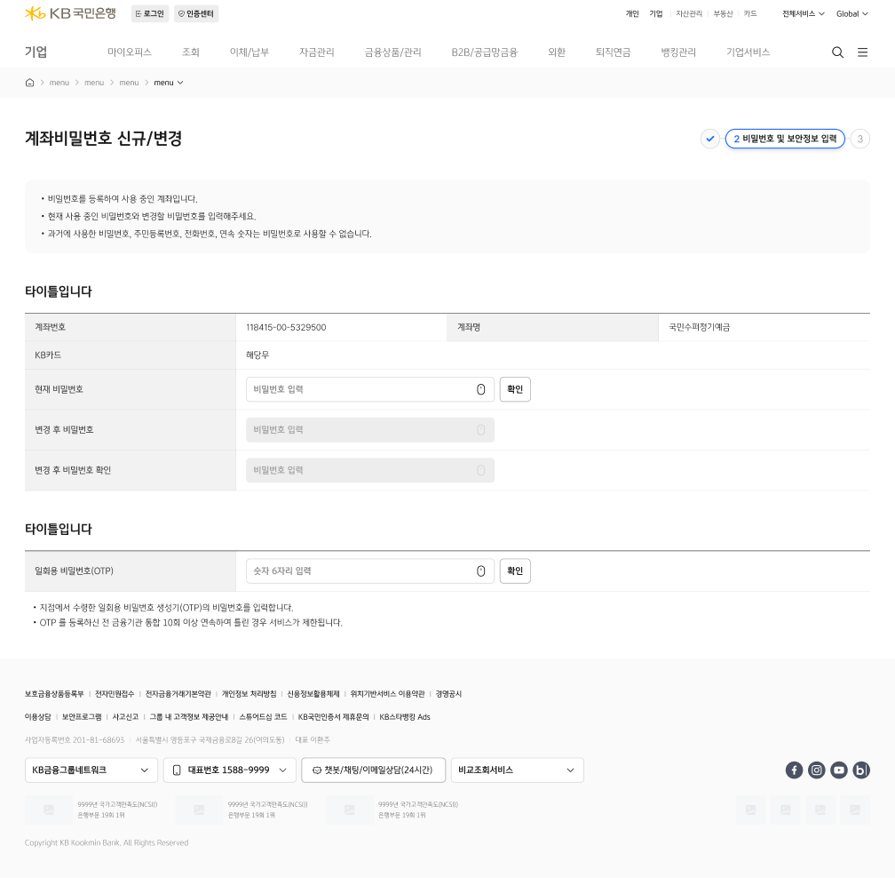

#### D — 서비스 동의

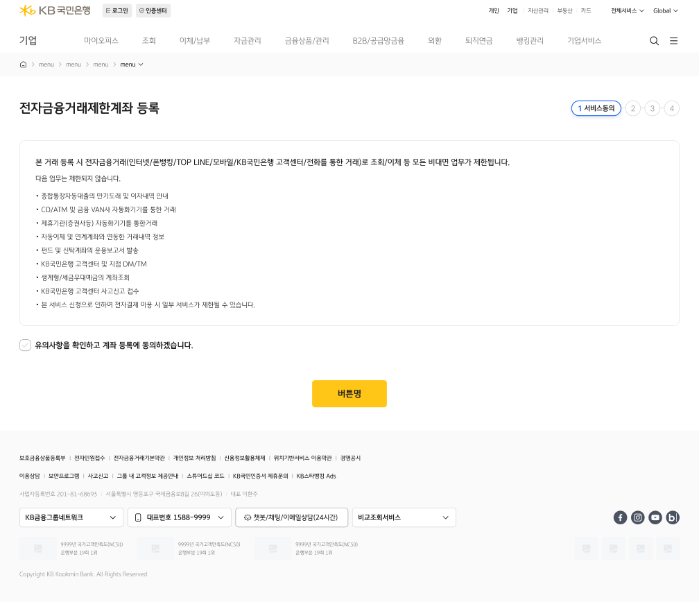

#### E — LNB 집중형

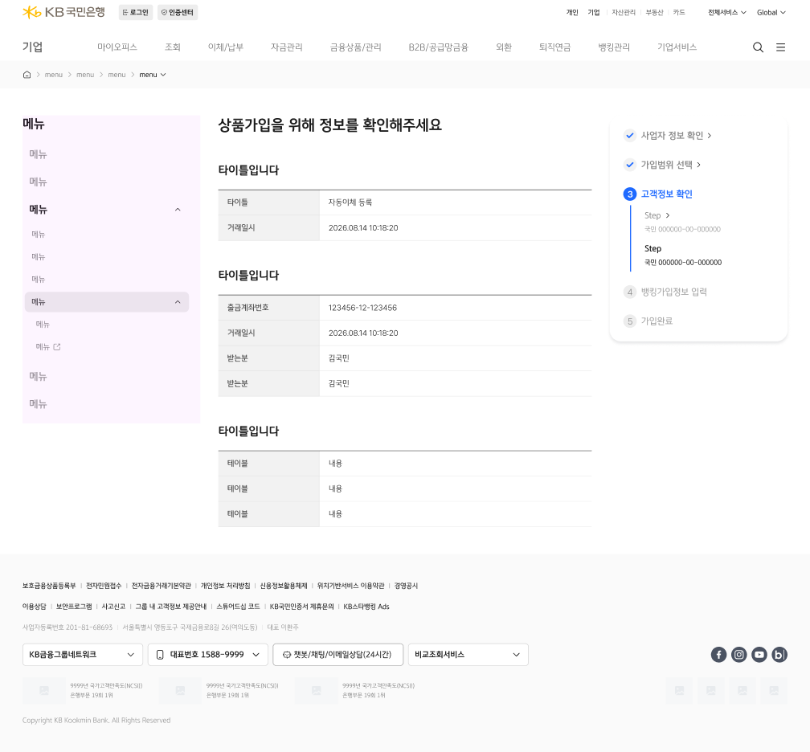

#### F — 완료

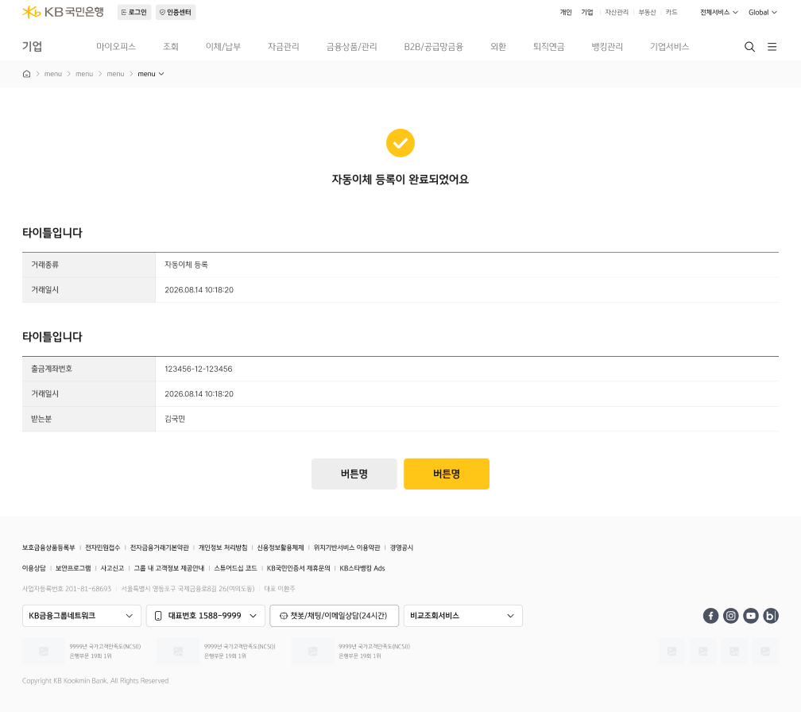

#### G — 에러

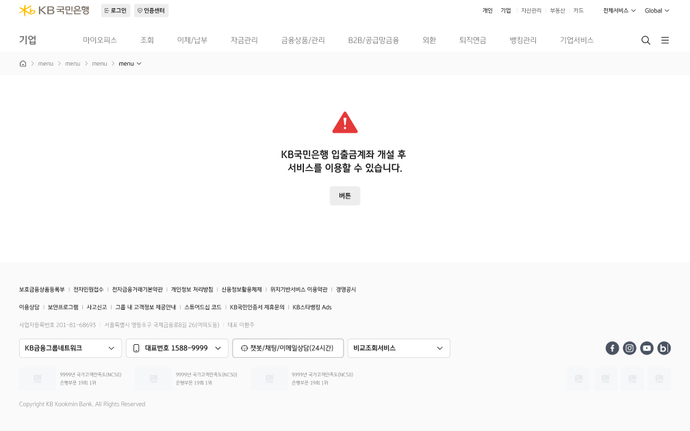

### 20.4. 이후 링크 학습·화면 생성 절차

1. 전달받은 링크는 삭제될 수 있으므로 URL만 남기지 않는다. 출처 파일·브랜치·노드, 화면 역할, 섹션 순서, 실제 Auto Layout, 치수·간격·정렬, 서체·상태·컴포넌트 식별자와 보존 이미지를 함께 기록한다.
2. 같은 패턴이 다른 파일에 복사된 경우 배치 중복은 합치고, 변경된 원형 키·폰트 상태·내용 차이는 구분한다.
3. 실제 화면 생성에서는 학습용 안내 틀·주석을 제거하고 LNB 등 실제 컴포넌트를 정상 노출한다.
4. 사용자 정의 명명·그룹핑은 12장, 디자인 시스템·Footer 원형은 13장을 적용한다. 기존 Container의 개수·부모·순서·역할을 임의로 재구성하지 않는다.
5. 컴포넌트 연결과 상태, 영역별 너비 합, 실제 행·열 gap, 서체·누락 폰트, 잘림·겹침, 참고 틀 제거를 검수한다. 통과한 항목은 반복 확인하지 않는다.

## 21. 추가 학습 — 레이어 팝업 공통 규격

2026-11-09에 `05. 사고신고` 파일의 팝업 3개를 확인했다. 파일 키는 `yojs1BhPrWxLmDDrpg1ihD`, 페이지는 `05.기타(기획 v0.6)` (`5007:20503`)이다.

| 패턴 | 원본 프레임 | 원본 링크 | 배경 프레임 | Popup 크기·위치 |
| --- | --- | --- | --- | --- |
| H — 계좌순서 변경, 데이터 있음 | Case_계좌그룹 관리 | [5067:7228](https://www.figma.com/design/yojs1BhPrWxLmDDrpg1ihD?node-id=5067-7228) | 1440 × 850 | 1200 × 551, (120,149.5) |
| I — 계좌순서 변경, 데이터 없음 | Case_계좌그룹 관리_nodata | [5067:7340](https://www.figma.com/design/yojs1BhPrWxLmDDrpg1ihD?node-id=5067-7340) | 1440 × 850 | 1200 × 557, (120,146.5) |
| J — 자동 로그아웃 안내 | 로그아웃 안내 | [5067:7408](https://www.figma.com/design/yojs1BhPrWxLmDDrpg1ihD?node-id=5067-7408) | 1440 × 900 | 400 × 320, (520,290) |

H·I는 프레임명에 “계좌그룹 관리”가 있지만 실제 팝업 제목은 “계좌순서 변경”이다. 패턴은 실제 표시 내용과 구성으로 판별한다. 실제 화면의 제목과 업무명은 해당 기획을 따른다.

### 21.1. Popup 원형과 배치

- 세 팝업 모두 `Popup` 인스턴스이며, 실제 변형은 `type=layer, vatiant=default`다. `vatiant`는 원형의 실제 속성 이름이다. 임의로 `variant`로 치환하지 않는다.
- 배경 프레임은 흰 바탕에 검정 #000000 opacity 0.20의 딤을 얹고 팝업을 가로·세로 가운데 배치한다. 단색 회색 배경을 서비스의 실제 바탕색으로 고정하지 않는다.
- Popup은 흰 배경, radius 24, 세로 Auto Layout, 자식 사이 gap 0, 바깥 패딩은 하단 24만 적용한다.
- 그림자는 x=0, y=4, blur=16, spread=0, rgba(12,17,29,0.10)이다.
- 원본 중앙 배치는 (배경 너비 − Popup 너비)/2, (배경 높이 − Popup 높이)/2로 검산한다. 데이터 상태가 달라 높이가 변하면 y도 중앙 기준으로 다시 계산한다.
- 배경 프레임 크기는 학습 시점의 표시 영역이다. 모든 실제 화면을 850px/900px 높이로 고정하는 규칙으로 확대하지 않는다.

### 21.2. 내부 영역과 패딩

```text
Popup [INSTANCE]
├─ Header 역할: Item / Header
├─ Body 역할: Slot
└─ Footer 역할: Item / Footer
```

- 12장에 따라 사용자 정의 팝업 영역 래퍼는 `Header`, `Body`, `Footer`로 명명한다. 위 트리의 “역할”은 설명이며 실제 이름에 붙이지 않는다.
- 원형의 `Item / Header`, `Slot`, `Item / Footer`와 내부 고유 계층은 컴포넌트 이름 보존 원칙에 따라 유지한다. 규칙에 맞추려 원형을 detach하거나 내부 이름을 강제로 바꾸지 않는다.
- Header 높이는 64, 패딩은 상하 16·좌우 24다. 제목은 KBFG Text Bold 16/24, #1C1C1C이며, 우측 닫기 IconButton은 24 × 24다.
- Body 역할 Slot의 패딩은 위 12·좌우 24·아래 24다. H·I는 세로 gap 32, J는 gap 0과 가운데 정렬을 사용한다.
- 팝업 Footer는 높이 48, 좌우 패딩 24, 가운데 정렬이다. 내부 버튼은 medium 높이 48이다.
- ButtonGroup 전체 너비 280 = 버튼 136 × 2 + 내부 Slot-Button gap 8이다. 바깥 ButtonGroup의 itemSpacing=0만 보고 버튼을 붙이지 않는다.
- Popup 전체 높이는 Header + Body + Footer + 바깥 하단 패딩 24의 합이다. H는 64+415+48+24=551, I는 64+421+48+24=557, J는 64+184+48+24=320이다.
- 팝업 내부 Footer는 일반 페이지의 KBDS Footer와 별개다. 팝업 내부에 13장의 은행 공통 Footer를 끼워 넣지 않는다. 팝업 뒤 일반 화면이 필요한 경우 해당 페이지의 Footer에는 13장 규칙을 적용한다.

### 21.3. 팝업 버튼의 색상·서체

| 역할 | 변형 | 크기 | 실측 배경 | 텍스트 |
| --- | --- | --- | --- | --- |
| Footer 왼쪽 보조 버튼 | tertiary medium | 136 × 48 | #EDEDED | #1C1C1C, KBFG Text Bold 16/24 |
| Footer 오른쪽 주요 버튼 | primary medium | 136 × 48 | #444444 | #FFFFFF, KBFG Text Bold 16/24 |
| 순서 이동 툴바 버튼 | secondary small | 높이 40, 내용별 너비 | #FFFFFF, 테두리 #A5A5A5 1 | #1C1C1C, KBFG Text Bold 14/20 |

- 팝업의 primary medium은 이 원본에서 짙은 회색으로 표시된다. 페이지의 primary large 노란색 규칙으로 일괄 덮어쓰지 않는다.
- 실제 컴포넌트 변형·토큰·오버라이드를 확인해 적용한다. 회색 배경만으로 disabled라고 판단하지 않는다. 관측된 버튼들은 `disabled=false`다.
- 세 화면 모두 추출 텍스트의 누락 폰트가 없었고, 자간은 0px이었다.

## 22. 패턴 H·I — 계좌순서 변경 팝업의 목록·빈 상태

### 22.1. 공통 본문

- 팝업 너비 1200, Body 콘텐츠 너비 1152 = 1200 − 24×2다. 일반 페이지의 1360px 본문 너비를 넣지 않는다.
- 구조는 안내 박스 → 32 간격 → 툴바·표 Container 순서다.
- 안내 박스는 1152 × 90, radius 12, #FAFAFA, 패딩 상하 20·좌우 24다. 두 불릿 문장은 기획 안내용 샘플이므로 실제 업무 문구로 교체한다.
- 툴바는 1152 × 40, 좌우 양끝 정렬이다. 왼쪽 InputField는 152 × 40, 오른쪽 버튼 그룹은 337 × 40이다.
- 오른쪽 순서 이동 버튼은 “맨위로” 78, “위로” 66, “아래로” 78, “맨아래로” 91 너비, 모두 높이 40이며 gap 8이다. 78+66+78+91 + 8×3 = 337이다.
- 툴바와 표 사이는 20이다. 안내 박스·툴바·표·버튼의 너비 정렬을 유지한다.

| 요소 | H — 데이터 있음 | I — 데이터 없음 |
| --- | --- | --- |
| 안내 박스 (x,y) | (144,225.5) | (144,222.5) |
| 툴바 (x,y) | (144,347.5) | (144,344.5) |
| 표 시작 (x,y) | (144,407.5) | (144,404.5) |
| 표 전체 높이 | 197 | 203 |
| Body Slot 높이 | 415 | 421 |
| Footer 시작 y | 628.5 | 631.5 |

H의 본문 Slot에는 안내 박스와 `Container`가 있다. I의 같은 Slot에는 `Container 1`(안내)과 `Container 2`(툴바·표)가 있다. 각 Slot 안에서 실제 Container 개수를 기준으로 12장의 명명을 적용한다. 데이터 상태가 다르다는 이유만으로 부모·역할·개수를 임의로 통일하지 않는다.

### 22.2. 표와 선택 컨트롤

| 열 | 역할/헤더 | 너비 |
| --- | --- | --- |
| 1 | Radio 선택 | 80 |
| 2 | 순위 | 80 |
| 3 | 금융기관명 | 248 |
| 4 | 계좌번호 | 248 |
| 5 | 계좌명 | 248 |
| 6 | 휴대폰 번호 | 248 |

- 80+80+248×4 = 1152다.
- 헤더와 데이터 행 높이는 모두 49, 라벨·값은 가운데 정렬, 셀 패딩은 상하 12·좌우 16이다.
- Grid 실제 행·열 gap은 0이다. 남아 있는 itemSpacing=10을 표 셀 사이 공백으로 해석하지 않는다.
- 상단선은 #444444 1px, 헤더 배경 #F2F2F2, 헤더 선 #E5E5E5, 데이터 선 #EDEDED를 사용한다. 마지막 열은 last 변형으로 오른쪽 선을 처리한다.
- 순위·계좌번호·휴대폰 번호는 숫자용 셀 스타일을 사용한다. 마스킹된 계좌·휴대폰 문자열도 원본의 숫자용 표현을 유지한다.
- 첫 열은 Checkbox가 아닌 **Radio 24 × 24**다. 실제 변형은 `size=large, fontWeight=bold, disabled=false, invalid=false`이며 checked 상태를 구분한다.
- H 원본에는 1·2행 Radio가 모두 checked=true로 표시되어 있다. 이를 근거로 Radio의 실제 다중 선택 동작을 정의하지 않는다. 선택 수·그룹·재정렬 동작은 실제 업무 기획에 맞게 설정한다.
- I에서도 헤더 선택 컨트롤과 순서 이동 버튼은 남아 있다. 비활성화 여부는 원본의 정적 외형만으로 추론하지 않는다.

### 22.3. H — 데이터 있음

- 6열 × 4행(헤더 1 + 데이터 3)의 Grid다.
- 상단선 1 + 49×4 = 표 높이 197이다.
- 툴바 40 + gap 20 + 표 197 = Container 높이 257이다.
- Body는 상단 패딩 12 + 안내 90 + gap 32 + Container 257 + 하단 패딩 24 = 415다.
- 그룹 선택값 “기본”, 계좌 3건과 마스킹 문자열은 샘플이다. 건수·정렬 결과·순위 저장 시점은 실제 기획에 맞춘다.
- Footer 버튼 두 개의 “버튼명”은 플레이스홀더다. 화면별 취소·확인 등의 업무 라벨을 적용한다.

### 22.4. I — 데이터 없음

- 열 헤더는 그대로 유지한다. 빈 상태는 일반 데이터 행의 텍스트를 바꾸는 방식이 아니라 **헤더 아래 별도 Feedback 영역**으로 구성한다.
- 헤더 Grid 50 = 상단선 1 + 헤더 49다.
- 빈 상태 래퍼는 1152 × 152, 상하 패딩 32다. 그 안의 `Feedback varient=small`은 1152 × 88, 중앙 정렬이다.
- Feedback은 `status-nodata` 아이콘 48 × 48 → gap 16 → 메시지 24 높이로 구성한다. 문구는 “등록된 계좌가 없습니다”다.
- 하단 `Divider / Horizontal` 1px를 유지한다. 표 전체는 50+152+1=203이다.
- 툴바 40 + gap 20 + 표 203 = Container 높이 263이다.
- 그룹 선택값 “거래처”는 원본 예시다. 실제 선택값과 메시지는 해당 상태에 맞게 설정한다.
- 빈 상태에 데이터 3행을 공간용으로 숨겨 남기거나 이전 선택 결과가 있는 것처럼 표현하지 않는다.

## 23. 패턴 J — 자동 로그아웃 안내 팝업

### 23.1. 구조와 배치

- Popup은 400 × 320이며 1440 × 900 배경의 중앙 (520,290)에 놓인다.
- Header 제목은 “자동 로그아웃 예정”, 높이 64이며 우측 닫기 버튼 24 × 24를 유지한다.
- Body Slot은 400 × 184, 패딩 위 12·좌우 24·아래 24, 가로·세로 가운데 정렬이다.
- 본문은 원본의 단일 `Container 1` 337 × 120과 같은 크기의 내부 래퍼로 구성되어 있다. 정리 시 단일 Container는 12장에 따라 `Container`로 명명하되 개수·부모·순서는 바꾸지 않는다.
- 본문 블록의 원본 절대 위치는 (551.5,380)이다. 중앙 정렬을 유지하며 세로로 설명 제목 28 → gap 12 → 카운트 28 → gap 12 → 안내 40을 배치한다. 합계 120이다.
- 제목·카운트·설명은 모두 중앙 정렬이다. 카운트 프레임은 원본 43 × 28이다. 시간 문자열 길이가 달라질 수 있으므로 그 너비를 모든 값에 고정하지 않는다.
- Footer는 y=538, 높이 48이며 Popup 바깥 하단 패딩 24 뒤 y=610에서 끝난다.

### 23.2. 서체·색상과 실행 버튼

| 요소 | 서체 | 크기/행간 | 색상 |
| --- | --- | --- | --- |
| 팝업 Header 제목 | KBFG Text Bold | 16/24 | #1C1C1C |
| “자동 로그아웃 남은시간” | KBFG Text Bold | 20/28 | #444444 |
| 남은 시간 “0:23” | Pretendard SemiBold | 20/28 | #1F6AFF |
| 서비스 안내 2줄 | KBFG Text Light | 14/20 | #6E6E6E |
| Footer 버튼 | KBFG Text Bold | 16/24 | 보조 #1C1C1C / 주요 #FFFFFF |

- 왼쪽은 “지금 로그아웃” tertiary medium, 오른쪽은 “로그인 연장” primary medium이다. 각 136 × 48, gap 8, 전체 280 너비다.
- 실제 팝업 버튼의 primary 배경은 #444444다. 일반 페이지의 노란색 primary large로 교체하지 않는다.
- “0:23”은 상태 예시다. 자동 로그아웃 총 제한시간·갱신 주기·0초 처리·로그인 연장 응답·닫기 버튼 동작은 이 정적 화면에서 확정하지 않는다.
- 실제 생성 시 타이머 값과 설명은 업무 기획에 맞게 적용한다. 시간 정책을 디자인 값에서 임의로 만들어 넣지 않는다.

## 24. 팝업 컴포넌트 식별자·보존 이미지

### 24.1. 확인한 원형

아래 Popup의 관측 main component 노드는 `5067:7206`이다. 학습 파일의 로컬 원형 키이므로 생성 시에는 기준 디자인 시스템과의 연결·동일 변형 여부도 확인한다. 구성·상태를 재현하기 위해 관련 키를 함께 보존한다.

| 컴포넌트 | 실제 변형 | main component key |
| --- | --- | --- |
| Popup | `type=layer, vatiant=default` | `58f575d37a8d4d83a30238c8f75b152d4e42db93` |
| Item / Header | `variant=default` | `2cbf7cb8b3527095493ddec2903fcfe47ac00798` |
| Item / Footer | `variant=buttonGroup` | `e20c54e3621cf093f53c6a565a37c5811b583839` |
| ButtonGroup | `count=multi, size=medium` | `8923faa9126db7ef087595a2d123151588618ff6` |
| BoxButton | `variant=tertiary, size=medium, hover=false, disabled=false, pressed=false` | `a03fad70eb160b79085f5496a27bc25f9685054b` |
| BoxButton | `variant=primary, size=medium, hover=false, disabled=false, pressed=false` | `c4ab4c1ce45fb8f3c1975cf3a624c6f05b561767` |
| Feedback | `varient=small` | `5043fce90aa14ec77b4a1ca9816dc0b3f746d0ea` |
| status-nodata | `status-nodata` | `9c863558712ee6cd973b806d707e4f2be93323d5` |
| Radio | `size=large, fontWeight=bold, checked=false, disabled=false, invalid=false` | `a0096d2601a8299ad2c5ebe3955721916b755d78` |
| Radio | `size=large, fontWeight=bold, checked=true, disabled=false, invalid=false` | `775a12d301fa09466bc5e9e52c6a683e9e7dcb63` |
| IconButton — 닫기 | `variant=primary, size=24, hover=false, disabled=false, pressed=false` | `d0596490379106ea5d1492de1100c24be4be398a` |

Popup의 실제 세트 속성은 `type`(layer/browser), `vatiant`(default/gate), `Slot#3416:35`다. 이번 학습은 layer/default만 확인했으므로 browser/gate의 치수·동작으로 확대하지 않는다.

### 24.2. 보존 이미지

원본 링크가 삭제되어도 남도록 저장소에 PNG를 직접 보존했다. 0.7배 이미지이며 모두 너비 1008px이다. 논리 치수는 21~23장의 표를 따른다.

#### H — 계좌순서 변경, 데이터 있음

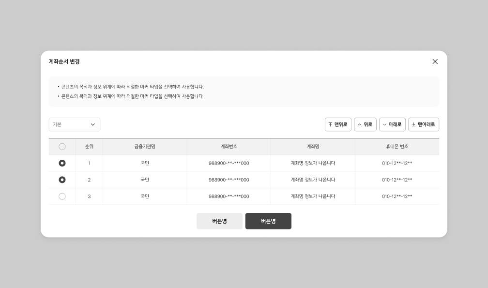

#### I — 계좌순서 변경, 데이터 없음

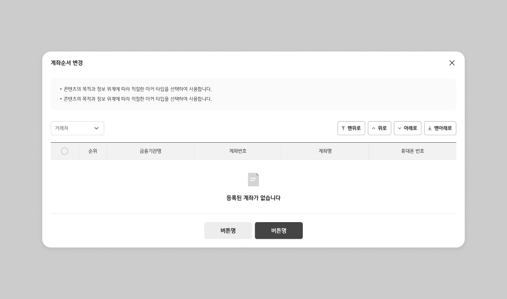

#### J — 자동 로그아웃 안내


### 24.3. 재현 검수

1. Popup 원형 연결·type/vatiant·radius·딤·중앙 배치를 확인한다.
2. Header 64, Body 패딩, Footer 48, 바깥 하단 패딩 24를 구분해 합산한다.
3. 계좌 표는 열 너비 합 1152, 행 높이 49, 실제 Grid gap 0, Radio 종류·상태를 확인한다.
4. nodata는 헤더·Feedback·하단 Divider 구조를 확인한다. 데이터 있음과 빈 상태를 같은 높이로 강제하지 않는다.
5. Footer medium 버튼은 48 높이·gap 8을 적용한다. 페이지 large 버튼의 56 높이·gap 12·노란색을 가져오지 않는다.
6. 타이머·업무 라벨·안내 예문을 실제 기획과 대조하고, 서체·누락 폰트·텍스트 잘림·겹침을 확인한다.

## 25. 추가 학습 — 금융거래한도계좌 해제 안내·상태 분기

2026-11-09에 `05. 사고신고` 파일의 두 화면을 추가 확인했다. 파일 키 `yojs1BhPrWxLmDDrpg1ihD`, 페이지 `05.기타(기획 v0.6)` (`5007:20503`)이다.

| 패턴 | 원본 프레임 | 링크 | 전체 크기 | BODY 높이 | Footer 시작 y |
| --- | --- | --- | --- | --- | --- |
| K — 대상 없음 | Case_금융거래한도계좌 해제_대상없음 | [5067:8070](https://www.figma.com/design/yojs1BhPrWxLmDDrpg1ihD?node-id=5067-8070) | 1440 × 1480 | 971 | 1128 |
| L — 대상 있음 | Case_금융거래한도계좌 해제_대상있음 | [5067:8238](https://www.figma.com/design/yojs1BhPrWxLmDDrpg1ihD?node-id=5067-8238) | 1440 × 1381 | 872 | 1029 |

### 25.1. 공통 골격과 상태별 차이

- HEADER 높이 157, BODY 시작 y=157, 좌우 패딩 40, 본문 상하 패딩 48, 콘텐츠 너비 1360, 주요 섹션 gap 48이다.
- 두 상태 모두 상위 Container 4개를 유지한다: 페이지 제목 → 안내 카드 2개 → 대상 결과 → 실행 버튼.
- 페이지 제목은 “금융거래한도계좌 해제”, KBFG Text Bold 26/36, #1C1C1C이며 x=40, y=205, 높이 36이다.
- 원본 제목 인스턴스 너비는 K 1360, L 237로 다르지만 두 상태의 제목 영역 Container 너비는 동일한 1360이다. 텍스트 인스턴스의 너비를 콘텐츠 영역 전체 너비와 혼동하지 않는다.
- Footer는 원본에서 일반 프레임이지만 실제 생성에서는 13장의 지정 Footer 인스턴스를 사용한다. 위 전체 높이와 Footer 좌표는 학습 원본의 검산값이다.
- 계좌 유무에 따라 결과와 버튼의 실제 구성을 달리 적용한다. 빈 상태에 정보 표의 가짜 행을 남기거나, 대상 있음에 빈 상태 메시지를 중첩하지 않는다.
- 기존 Container 개수·부모·순서는 보존하고, 사용자 정의 이름·그룹핑은 12장을 따른다.

| 요소 | K — 대상 없음 | L — 대상 있음 |
| --- | --- | --- |
| 안내 카드 영역 | (40,289), 1360 × 402 | (40,289), 1360 × 398 |
| 카드 1 | (40,289), 1360 × 177 | (40,289), 1360 × 177 |
| 카드 사이 실측 간격 | 16 | 12 |
| 카드 2 | (40,482), 1360 × 209 | (40,478), 1360 × 209 |
| 결과 섹션 | (40,739), 1360 × 237 | (40,735), 1360 × 142 |
| 실행 버튼 영역 | (40,1024), 1360 × 56 | (40,925), 1360 × 56 |
| 실제 버튼 모음 | (560,1024), 320 × 56 | (643,925), 154 × 56 |

카드 간격의 차이 4px을 숨기고 두 상태를 같은 높이로 통일하지 않는다. 이 차이는 원본 실측 기록이며 “대상 유무에 따라 반드시 16/12를 써야 한다”는 일반 규칙으로 확대하지 않는다. 실제 작업에서는 기획·선택한 패턴에 맞게 적용한다.

### 25.2. 이미지·텍스트 안내 카드 2종

두 `Content Box`는 실제 가로 Auto Layout이다.

| 항목 | 기준 |
| --- | --- |
| 카드 너비 | 1360 |
| 배경·테두리 | #FFFFFF, #D4D4D4 1px, INSIDE |
| 모서리 | 12 |
| 패딩 | 상하좌우 32 |
| 이미지·본문 간격 | 24 |
| 이미지 | ImageContainer ratio=1:1, 96 × 96 |
| 텍스트 영역 | 1176 너비 |
| 수직 정렬 | 이미지와 텍스트 블록 가운데 정렬 |
| 카드 제목 | KBFG Text Bold 18/25, #1C1C1C |
| 일반 불릿 | KBFG Text Light 14/20, #1C1C1C |

- 너비 검산: 32 + 96 + 24 + 1176 + 32 = 1360이다.
- 카드 내부 이미지 x는 카드 기준 32, 텍스트 x는 152다. 원본 테두리는 INSIDE이며 실제 콘텐츠 패딩에 1px을 추가하지 않는다.
- 이미지의 y는 카드 1 기준 40.5, 카드 2 기준 56.5다. 이미지와 문단을 가운데 정렬해 생기는 값이며, 두 카드에 같은 y를 강제로 적용하지 않는다.
- 원본 ImageContainer는 플레이스홀더다. 회색 이미지 기호를 최종 안내 이미지로 간주하지 않고 실제 기획 이미지로 교체한다. 컴포넌트 프레임과 비율은 유지한다.
- 바깥 `Box Align`, `Content Box`, 내부 `vStack`, `list` 등의 이름은 원본 기록이다. 반복 카드 래퍼와 제목·복합 본문은 12장에 따라 실제 자식 구성을 판정해 정리하며, 디자인 시스템 컴포넌트의 원형 이름은 유지한다.

#### 카드 1 — 계좌 정의 안내

- 제목은 “금융거래한도계좌란?”이다.
- 텍스트는 제목 25 → gap 12 → 불릿 목록 76으로 높이 113이다.
- 목록 3개는 각 높이 20, 간격 8이므로 20×3 + 8×2 = 76이다.
- 패딩 32×2 + 텍스트 113 = 카드 높이 177이다.

#### 카드 2 — 해제 기준 안내

- 제목은 “비대면 한도제한 해제 기준 안내”이다.
- 제목 25 → gap 8 → 보조 설명 24로 윗부분 57을 구성한다.
- 보조 설명은 KBFG Text Medium 16/24, #444444다.
- 윗부분 57 → gap 12 → 불릿 목록 76으로 텍스트 높이 145, 패딩 64를 더해 카드 높이 209다.
- 원본 조건·등급·기간·안내 문구는 해당 화면의 기획 내용이다. 다른 업무의 해제 정책으로 일반화하지 않는다.
- 원본 마지막 불릿에는 동일한 법인 대출 문구가 연속 중복되어 있다. 실제 문구 적용 시 해당 기획을 확인하고 샘플 중복을 그대로 복제하지 않는다.

## 26. 패턴 K·L — 대상 결과와 실행 영역

### 26.1. K — 대상 없음

- 결과 섹션은 제목·설명 64 → gap 20 → 빈 상태 영역 153으로 높이 237이다.
- 제목·설명 인스턴스는 x=40, y=739, 1360 × 64이며 왼쪽 정렬이다.
- 원본 제목은 “타이틀입니다”, 설명은 “디스크립션 텍스트”인 플레이스홀더다. 제목은 Bold 20/28, 설명은 Light 16/24, 두 텍스트 사이 12로 총 64를 구성한다.
- 빈 상태 영역은 x=40, y=823, 너비 1360, 높이 153이다. 별도의 열 헤더는 없다. 팝업 I의 “헤더 유지형 nodata”와 구분한다.
- 상단은 #444444 1px 선이고, 실제 Line 노드의 레이아웃 높이는 0이다. 그 아래 Feedback 래퍼 152와 하단 Divider 1로 레이아웃 높이 153을 구성한다. 상단 stroke를 추가 행 높이처럼 합산하지 않는다.
- Feedback 래퍼의 상하 패딩은 32, 안쪽 `Feedback varient=small`은 1360 × 88이다.
- 아이콘은 `status-nodata` 48 × 48 → gap 16 → 메시지 24다. 메시지는 “금융거래한도제한 계좌가 없습니다”, KBFG Text Bold 16/24, #1C1C1C다.
- 실행 섹션은 위 결과 영역 뒤 gap 48에 배치한다. 원본은 `ButtonGroup count=multi, size=large`, 두 버튼 각 154 × 56, 내부 gap 12, 전체 320이다.
- 원본 버튼은 “삭제” tertiary와 “수정” primary이며 `disabled=false`다. **해제 대상이 없다는 화면 목적과 맞지 않는 템플릿 예시로 기록한다.** 이를 실제 업무의 삭제·수정 기능으로 확정하지 않는다. 생성 시 화면 기획에 맞는 라벨·개수·상태·행동을 적용한다.

### 26.2. L — 대상 있음

- 결과 섹션은 x=40, y=735, 1360 × 142다.
- 제목 “한도제한계좌 정보”는 실제 KBFG Text Medium 22/31, #1C1C1C다. 카드 제목의 18/25 또는 K 플레이스홀더의 20/28을 일괄 적용하지 않는다.
- 제목 높이 31 → gap 20 → 표 91로 총 142다.
- 표는 x=40, y=786, 1360 × 91, 2열·2행, 실제 Grid 행·열 gap 0이다.
- 라벨 열 240, 값 열 1120, 각 행 높이 45이며 상단선 1 + 45×2 = 91이다.
- 첫 행은 계좌번호, 둘째 행은 상품명이다. 라벨·값 모두 왼쪽 정렬, 수직 가운데 정렬, 패딩 상하 12·좌우 16을 사용한다.
- 계좌번호는 `Table / Cell variant=last, onlyNumber=true`, 상품명은 `variant=last, onlyNumber=false`다. 마지막 열의 오른쪽 테두리를 제거하는 변형과 숫자 스타일을 구분한다.
- 원본 계좌번호에 포함된 끝의 개행·상품명의 끝 공백은 샘플 데이터 흔적이다. 실제 표시 데이터에서 불필요한 개행·공백을 그대로 재현하지 않는다.
- 실행 섹션은 결과 표 뒤 gap 48에 배치한다. 중앙 primary large 버튼 154 × 56 하나이며 원본 라벨은 “버튼명”이다.
- 바깥 ButtonGroup은 `count=multi`이지만 슬롯에 실제 버튼은 1개다. 속성 이름만 보고 버튼을 추가하지 않는다.
- 원본에 별도 동의·보안 입력·진행 단계가 없으므로 다른 학습 패턴의 요소를 임의로 추가하지 않는다.

### 26.3. 공통 검수

- 전체 높이 검산: K는 HEADER 157 + BODY 971 + Footer 352 = 1480, L은 157+872+352=1381이다.
- 카드 너비 합, 카드 간격의 실제 차이, 제목의 실제 서체·높이, 빈 상태와 정보 표의 구분을 확인한다.
- 누락 폰트는 두 화면의 추출 본문에서 모두 0이었고 자간은 0px이었다.
- 기존 컴포넌트·스타일·토큰을 재사용한다. Footer는 13장의 지정 원형, 명명·그룹핑은 12장 기준을 따른다.

## 27. 한도계좌 해제 패턴의 식별자·보존 이미지

### 27.1. 이번 학습에서 사용한 식별자

기존 10·20·24장의 컴포넌트 표와 함께 사용한다. 같은 컴포넌트라도 슬롯과 실제 적용 서체를 확인한다.

| 컴포넌트 | 변형/용도 | main component key |
| --- | --- | --- |
| ImageContainer | `ratio=1:1`, 안내 이미지 96 × 96 | `2517340b251701779e5b8e8f9abb1a33080a650a` |
| Title / Section | `align=left`, 슬롯으로 카드 제목·결과 제목 구성 | `3f4d2d1fdde69c122f754927d46b0b2aacb2948e` |
| Item / Label | `variant=section` | `aa47c7184504e3f335ceb35219e8165762ea682c` |
| Item / Label | `variant=description-16` | `c93bdeedab40b0fdb123608f9c8d1e2d68aeaed4` |
| TextList / Unordered | `variant=bullet, size=14, depth=1` | `5e484496e22e7e84c91c23bddfe11d1b4a13f35b` |
| Feedback | `varient=small` | `5043fce90aa14ec77b4a1ca9816dc0b3f746d0ea` |
| status-nodata | 대상 없음 아이콘 | `9c863558712ee6cd973b806d707e4f2be93323d5` |
| Table / Cell | `variant=last, onlyNumber=true` | `494e274bfc773051437a999b5ad37c61b4321cf4` |
| Table / Cell | `variant=last, onlyNumber=false` | `1b5a0ae0fefd157325271672a78224db2575f047` |
| ButtonGroup | `count=multi, size=large` | `f6fbbaad278bc5dc3e0568efdc16711894a01e47` |

### 27.2. 삭제 대비 보존 이미지

두 이미지는 저장소에 직접 보존한 0.7배 PNG이며 너비 1008px이다. 원본 링크가 삭제되어도 위 구조·치수·상태 기록과 함께 참조한다. 실제 생성에 원본의 플레이스홀더·기획 오류를 그대로 복제하지 않는다.

#### K — 대상 없음

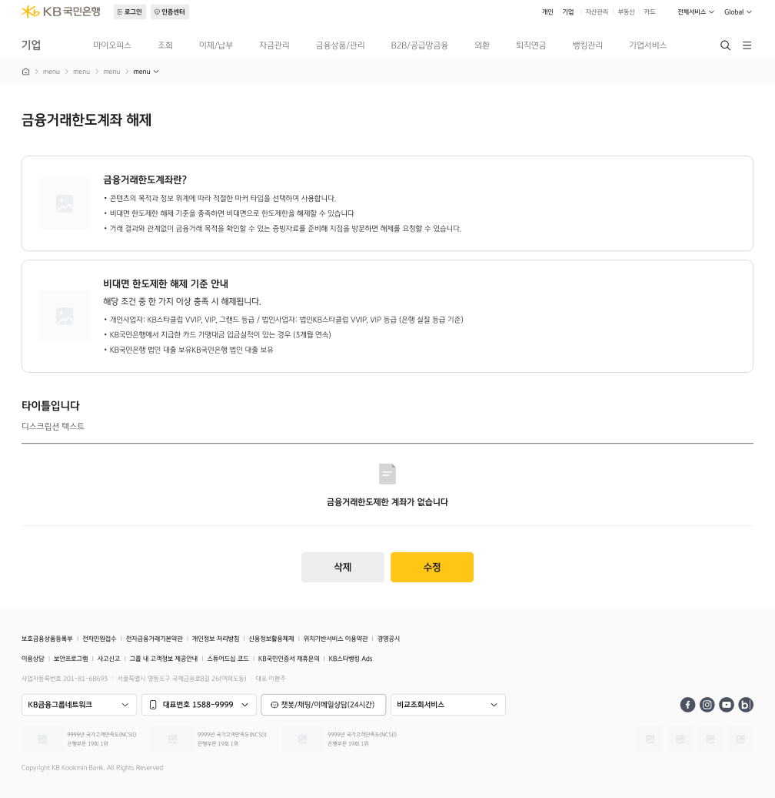

#### L — 대상 있음

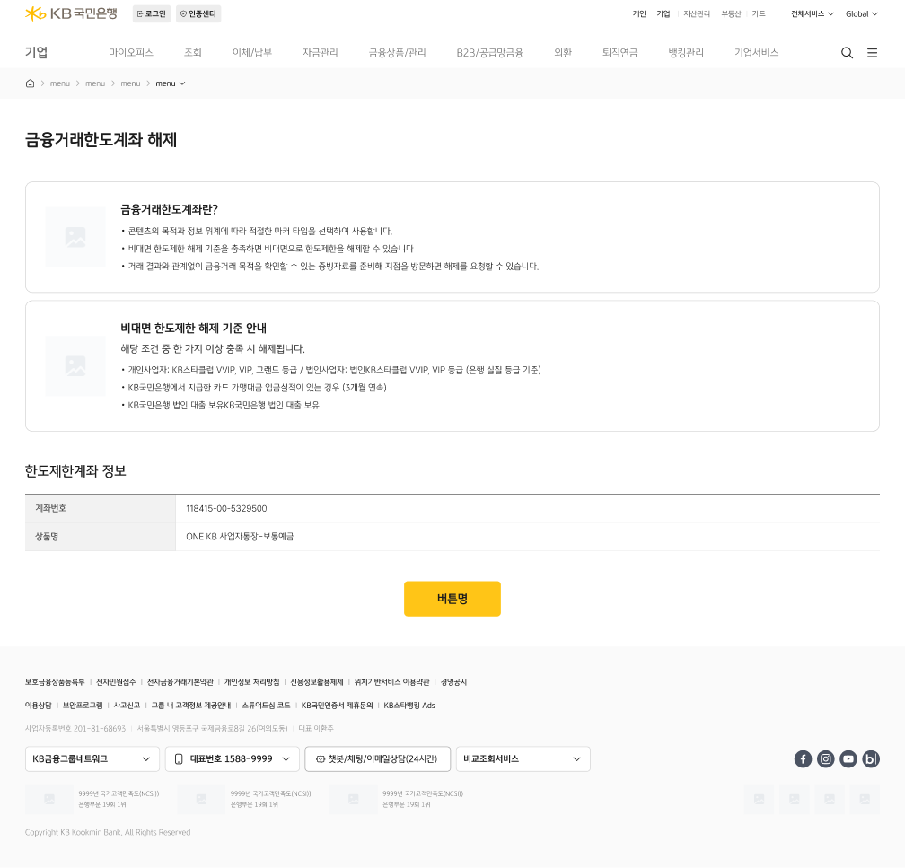

## 28. 추가 학습 — 1920 화면의 중앙 본문과 약관·목록 패턴

2026-11-09에 `05. 사고신고` 파일의 1920px 화면 3개를 추가 확인했다. 파일 키 `yojs1BhPrWxLmDDrpg1ihD`, 페이지 `05.기타(기획 v0.6)` (`5007:20503`)이다.

| 패턴 | 원본 이름 | 원본 링크 | 전체 크기 | BODY 높이 | Footer 시작 y |
| --- | --- | --- | --- | --- | --- |
| M — 집중형 약관동의 | 약관동의_집중형 | [5067:15618](https://www.figma.com/design/yojs1BhPrWxLmDDrpg1ihD?node-id=5067-15618) | 1920 × 2549 | 2040 | 2197 |
| N — 페이지네이션 목록 | 계좌개설 안내 | [5067:15805](https://www.figma.com/design/yojs1BhPrWxLmDDrpg1ihD?node-id=5067-15805) | 1920 × 1651 | 1142 | 1299 |
| O — 더보기 목록 | 계좌개설 안내 | [5067:16262](https://www.figma.com/design/yojs1BhPrWxLmDDrpg1ihD?node-id=5067-16262) | 1920 × 1607 | 1098 | 1255 |

N·O의 프레임 이름은 “계좌개설 안내”이지만 실제 내용은 자주쓰는 계좌 목록·등록 탭과 관리 표다. 패턴은 표시된 실제 구성으로 분류하며, 원본 이름을 업무 내용의 근거로 삼지 않는다.

### 28.1. 1920 화면의 공통 폭·좌표

- 화면은 1920px이지만 **BODY는 1440px 너비로 중앙 배치**되어 x=240이다. 유효 콘텐츠는 BODY 안 좌우 패딩 40을 제외한 1360px, 시작 x=280이다.
- 검산: (1920−1440)/2=240, 240+40=280, 1440−80=1360.
- HEADER와 Footer는 화면 폭 1920을 사용한다. HEADER 높이는 157, BODY 시작 y=157, 첫 콘텐츠 y=205다.
- 본문 상하 패딩 48, 주요 섹션 사이 gap 48을 유지한다.
- 1920 화면이라는 이유로 BODY를 1920, 콘텐츠를 1840으로 늘리거나 1440용 UI 전체를 비례 확대하지 않는다.
- 이 값은 확인한 1920 패턴의 구조다. 아직 보지 않은 화면 폭에서의 최소·최대 너비나 반응형 분기까지 확정한 것은 아니다.
- 원본 Footer는 일반 프레임이지만 실제 생성 시 13장의 지정 Footer 인스턴스를 화면 폭에 맞춰 사용한다.

### 28.2. 서체·원본 상태 검수

- M·O의 추출 본문은 누락 폰트 0이었다. N은 추출 본문에서 `hasMissingFont=true`가 57개 감지됐다. 실제 생성 전 해당 폰트·스타일을 확인하고 임의로 대체 폰트나 다른 크기를 적용하지 않는다.
- 세 화면의 추출 텍스트 자간은 모두 0px이다.
- M의 세로 단계 숫자는 **실제 Pretendard 17/24**다. 기존 E의 16/24와 구분하며 같은 컴포넌트 이름만 보고 크기를 통일하지 않는다.
- N의 안내 불릿은 KBFG Text Light 14/20, O는 Light 16/24다. 이 차이로 안내 박스 높이와 이후 섹션 위치가 달라진다.
- 플레이스홀더 제목·라벨·표 데이터와 업무 내용 불일치는 기존 8장의 주의사항처럼 실제 기획에 맞게 교체한다.

## 29. 패턴 M — 집중형 약관·다단계 동의

### 29.1. 본문 2열과 하단 실행

```text
## BODY — 1440, padding 48 40, Vertical, gap 48
├─ 본문 Container — 1360, Horizontal, gap 32
│  ├─ Main — 1012, Vertical, gap 48
│  │  ├─ 페이지 제목
│  │  └─ 안내·약관·최종 동의
│  └─ Right — 316, 세로 단계 카드
└─ 실행 Container — 1360, 가운데 “다음”
```

- 본문 너비 검산: 1012+32+316=1360이다. E의 LNB 포함 316/664/316 3열 패턴과 구분한다. **이 화면에는 LNB가 없다.**
- 왼쪽 Main은 (280,205), 1012 × 1840이고, 오른쪽 카드는 (1324,205), 316 × 280이다.
- 제목은 “약관을 확인해 주세요”, 26/36 Bold, 높이 36이다. 다음 안내·약관 스택은 y=289에서 시작한다.
- 원본 BODY의 상위 Container는 2개이며 이름은 `Container 1`, `Container 5`다. 번호 때문에 Container를 다섯 개로 늘리거나 역할을 나누지 않는다. 정리 시 실제 개수·순서·부모를 보존하고 12장의 번호 규칙으로 이름을 판정한다.
- 하단 버튼 섹션은 (280,2093), 1360 × 56이다. “다음” primary large 154 × 56은 x=883, 화면/1360 콘텐츠 영역의 중앙에 놓인다.
- 버튼을 왼쪽 Main 1012의 중앙으로 이동하지 않는다. 버튼 섹션의 정렬 기준은 양쪽 열을 포함한 상위 1360 영역이다.

### 29.2. 안내·약관 그룹의 순서와 간격

왼쪽 내용 스택은 1012 × 1756, 세로 gap 20이다.

| 요소 | y | 너비 | 높이 |
| --- | --- | --- | --- |
| Infobox / Solid | 289 | 1012 | 44 |
| 전체 약관 모두 동의 그룹 | 353 | 1012 | 353 |
| 고객정보 동의서 모두 동의 그룹 | 726 | 1012 | 309 |
| 상품설명서 모두 동의 그룹 | 1055 | 1012 | 233 |
| 상품서비스 안내 등 모두 동의 그룹 | 1308 | 1012 | 613 |
| 최종 동의·주의 문구 묶음 | 1941 | 1012 | 104 |

높이 검산: 44+353+309+233+613+104 + 20×5 = 1756이다.

- `Infobox / Solid size=medium, status=info`는 상하 12·좌우 16 패딩, gap 16, radius 12, #FAFAFA다. 본문은 Medium 14/20이며 “신규 가입을 위한 약관 동의를 해주세요.”가 표시된다.
- 약관 그룹은 `ConsentGroup` 인스턴스 4개다. 각 그룹 내부 컨테이너는 radius 12, 테두리 #E5E5E5, 상하 패딩 20·좌우 32다. 안쪽 너비는 948이다.
- 바깥 ConsentGroup의 패딩 0과 내부 컨테이너 패딩을 구분하고, 외부 래퍼에 32px을 또 추가하지 않는다.
- 체크 상태·필수/선택 구분·약관 상세 열기·전체 동의 연동은 실제 인스턴스 상태와 업무 기획을 따른다. 원본에 보이는 체크 표시만으로 모든 약관이 필수이거나 동의가 완료됐다고 확정하지 않는다.
- 약관명과 안내 문구는 이 화면의 기획 내용이다. 다른 상품의 동의 범위나 법적 문구로 그대로 적용하지 않는다.

### 29.3. 동의 계층

| 구성 | 실제 변형 | 높이·패딩 | 서체 |
| --- | --- | --- | --- |
| 그룹 최상위 모두 동의 | Item / Consent 1d | 높이 48, 상하 12 | Bold 16/24, #1C1C1C |
| 개별 약관 | Item / Consent 2d | 높이 40, 상하 8 | Medium 16/24, #444444 |
| 펼쳐진 하위 동의 묶음 | Item / Consent 3d-group | 샘플 116, 좌측 32·아래 12 | “동의 항목” Light 16/24 |
| 하위 체크 항목 | Item / Consent 3d | 높이 32, 내부 너비 916 | Light 14/20, #444444 |

- 최상위 동의와 세부 약관 사이 Divider 래퍼 높이는 21이다: 위 8 + 선 1 + 아래 12.
- 첫 그룹은 최상위 48 + Divider 21 + 개별 항목 6×40 + 슬롯 하단 4 + 컨테이너 상하 40 = 353이다.
- 고객정보 그룹은 최상위 48 + Divider 21 + 개별 40 + 하위 동의 묶음 116 + 개별 40 + 슬롯 하단 4 + 상하 40 = 309다.
- 상품설명서 그룹은 개별 약관 3개, 마지막 안내 그룹은 개별·중첩 동의가 혼합되어 높이 613이다. 모든 그룹을 같은 높이나 같은 항목 개수로 맞추지 않는다.
- 1d/2d/3d/3d-group의 실제 계층·들여쓰기·펼침 아이콘을 유지한다. 평평한 Checkbox 목록으로 풀어 만들거나 컴포넌트를 detach하지 않는다.

### 29.4. 최종 동의·주의 문구와 단계 카드

- `ConsentFinal variant=muted`는 1012 × 56이다. 내부 배경 #FAFAFA, radius 12, 컨테이너 패딩 상하 4·좌우 28 안에 48 높이 동의 항목이 들어간다.
- 최종 동의 뒤 gap 12, 별표 주의 문구 래퍼는 1012 × 36이다. 패딩 8, radius 12, 원본 fill #FFFAF5이며 안쪽 `TextList / Unordered variant=star, size=14, depth=1`은 996 × 20이다.
- 별표 문구의 일반 본문은 Light 14/20이다. 확인 의미·동의 문장을 임의로 요약하거나 다른 체크 항목과 합치지 않는다.
- 오른쪽 단계 카드는 패딩 20, radius 20, 내부 너비 276이다. 단계 5개는 각각 32 높이, gap 20이므로 32×5+20×4=240, 카드 전체는 280 높이다.
- 현재는 2단계 “가입범위 선택”, 1단계는 완료, 3~5단계는 미시작이다. 현재 라벨은 Bold 16/24 #1F6AFF, 미시작 라벨은 Medium 16/24 #6E6E6E다.
- 스크롤 시 카드 고정/sticky·약관 상세 열기·동의 전후 다음 버튼 활성화 동작은 정적 화면만으로 확정하지 않는다.

## 30. 패턴 N·O — 페이지네이션형·더보기형 관리 목록

두 화면은 기존 B의 안내·탭·8열 계좌 목록 패턴을 1920 중앙 BODY 안에서 재사용한다. 주요 차이는 안내 불릿 크기, 표 하단 기능과 목록 탐색 방식이다.

### 30.1. 공통 표와 툴바

- BODY 상위 Container는 제목·안내·목록의 3개다. 원본에는 별도 페이지 하단 대형 실행 버튼이 없다.
- 제목 y=205, 안내 y=289, 본문 폭 1360이다.
- Tab 높이 60, 선택 “자주쓰는 계좌 목록” Bold 20/28 #1C1C1C, 비선택 “자주쓰는 계좌 등록” Medium 20/28 #8D8D8D다.
- 탭과 40px 툴바 사이 gap 20, 툴바와 표 사이 gap 20이다.
- 툴바 오른쪽은 388 × 40: 계좌순서변경 120 → gap 8 → 계좌그룹관리 100 → gap 8 → 그룹 전체 InputField 152다.
- 왼쪽 건수는 “레이블명 1/10건” 샘플이다. 라벨은 Medium 14/20 #8D8D8D, 첫 숫자는 Pretendard SemiBold 17/24 #1F6AFF, 분모 숫자는 같은 폰트 #444444, 단위 “건”은 Bold 14/20 #444444다.
- “1/10”의 의미를 선택 건수·현재 페이지 등으로 단정하지 않는다. 실제 기획에 맞는 의미·라벨·데이터를 적용한다.
- 표는 1360 × 540, 8열, 헤더+데이터 10행이다. 행 높이 49, 상단선 1, 실제 Grid 행·열 gap 0이다.
- 열 너비는 선택 80 + 두 번째 열 120 + 나머지 6열 각 (1360−200)/6 ≈ 193.333이다. 헤더·내용의 가운데 정렬과 패딩 12 16을 유지한다.
- 첫 열은 24 × 24 CheckBox다. Radio로 바꾸지 않는다. 실제 업무의 전체 선택·행 선택·indeterminate 상태를 구분한다.
- 원본의 “기관명” 열에 순번이 표시되고, “출금등록/해제” 열에 계좌명 예문이 들어간다. 8장에서 기록한 템플릿 의미 불일치와 동일하게 취급하며 실제 데이터와 헤더를 일치시킨다.
- 표 아래 도구 행은 왼쪽 필터·검색·편집, 오른쪽 txt. 저장·엑셀 저장·인쇄다. 왼쪽 그룹 161 × 20, 오른쪽 216 × 20, 각 그룹 내부 gap 16, 양끝 정렬이다.
- 왼쪽 TextButton은 각각 43 × 20, 오른쪽은 69·72·43 너비이며 모두 높이 20이다. 표와 도구 행 사이 gap은 16이다.

### 30.2. N — 페이지네이션과 다중선택 그룹 변경

| 요소 | x | y | 너비 | 높이 |
| --- | --- | --- | --- | --- |
| 안내 | 280 | 289 | 1360 | 90 |
| 탭 | 280 | 427 | 1360 | 60 |
| 건수·상단 툴바 | 280 | 507 | 1360 | 40 |
| 표 | 280 | 567 | 1360 | 540 |
| 표 아래 도구 행 | 280 | 1123 | 1360 | 20 |
| 일괄 그룹 변경 행 | 280 | 1159 | 1360 | 40 |
| 페이지네이션 | 280 | 1215 | 1360 | 36 |

- 안내는 Light 14/20 불릿 2개, 박스 패딩 20 24, radius 12, 높이 90이다.
- 표 이후 섹션은 표 540 → gap 16 → 도구 행 20 → gap 16 → 일괄 그룹 변경 행 40 → gap 16 → 페이지네이션 36으로 684 높이다.
- 그룹 변경은 오른쪽 289 × 40 영역에 “다중선택 그룹변경” 라벨 103 + gap 8 + InputField 120 + gap 8 + 이동 버튼 50을 둔다.
- 페이지네이션은 `Pagination / Basic`, 높이 36이며 콘텐츠 가운데 정렬이다.
- 원본 1번 항목은 active, 2번은 hover, 나머지는 enabled 예시다. 두 개의 활성 페이지로 해석하지 않는다.
- 전체 목록 섹션은 Tab 60 + gap 20 + 툴바 40 + gap 20 + 하단 포함 표 영역 684 = 824다.

### 30.3. O — 더보기

| 요소 | x | y | 너비 | 높이 |
| --- | --- | --- | --- | --- |
| 안내 | 280 | 289 | 1360 | 98 |
| 탭 | 280 | 435 | 1360 | 60 |
| 건수·상단 툴바 | 280 | 515 | 1360 | 40 |
| 표 | 280 | 575 | 1360 | 540 |
| 표 아래 도구 행 | 280 | 1131 | 1360 | 20 |
| 더보기 행 | 280 | 1167 | 1360 | 40 |
| 실제 더보기 버튼 | 900 | 1167 | 120 | 40 |

- 안내 불릿은 `TextList / Unordered size=16`, Light 16/24다. N보다 안내 박스가 8px 높아 탭·툴바·표 위치도 8px 아래다.
- 표 이후는 표 540 → gap 16 → 도구 행 20 → gap 16 → 더보기 행 40으로 전체 632 높이다.
- 더보기는 secondary small 버튼 120 × 40, radius 6, 흰 배경·#A5A5A5 테두리다. 플러스 아이콘과 “더보기” 라벨을 유지한다.
- N의 다중선택 그룹변경 행과 페이지네이션을 O에 추가하지 않는다. 실제 기획이 더보기형이면 그 탐색 방식을 유지한다.
- 전체 목록 섹션은 Tab 60 + gap 20 + 툴바 40 + gap 20 + 하단 포함 표 영역 632 = 772다.
- 더보기 클릭 시 추가 행 수·종료 상태·로딩·실패 동작은 정적 화면에서 확인되지 않았다.

## 31. 추가 식별자·삭제 대비 보존 이미지

### 31.1. 약관·동의와 16px 안내 컴포넌트

| 컴포넌트 | 확인 변형 | main component key |
| --- | --- | --- |
| Infobox / Solid | `size=medium, status=info` | `18356a16cb958afdf54f8fe4da07401b6412640d` |
| ConsentGroup | `ConsentGroup` | `57c6f66085338e360c0c8cff4da4c8881842ad49` |
| Item / Consent | `variant=1d` | `ebac2930b3bb7662d3b37ef88d01213c7785aa81` |
| Item / Consent | `variant=2d` | `8295a350882644017a887db15ec7c69aef378086` |
| Item / Consent | `variant=3d-group` | `8109cc712d77c5ed727737b7f6f55fcc73d986c2` |
| Item / Consent | `variant=3d` | `5b52e206cba5f7c61b58dd02c98de74f41013ce6` |
| ConsentFinal | `variant=muted` | `d711b66277395b32eb043de1549c940dfa195b0d` |
| TextList / Unordered | `variant=star, size=14, depth=1` | `46dcbc74d52e84d05f8f79c5f152bb5d988efd45` |
| TextList / Unordered | `variant=bullet, size=16, depth=1` | `aed12ecd6e049579810ce5b245bb0f100cc4b8e1` |

기존 표·탭·페이지네이션·StepIndicator·BoxButton 키는 앞선 식별자 표를 재사용한다. 같은 이름이어도 실제 슬롯 구성·폰트 크기·상태를 확인한다.

### 31.2. 보존 이미지

3개 이미지를 저장소에 직접 보존했다. 원본 1920px 화면의 0.5배 PNG이며 이미지 너비는 960px이다. 위에 기록한 논리 px를 기준으로 재현하고, 이미지 픽셀을 역으로 실측 규칙으로 사용하지 않는다.

#### M — 집중형 약관동의

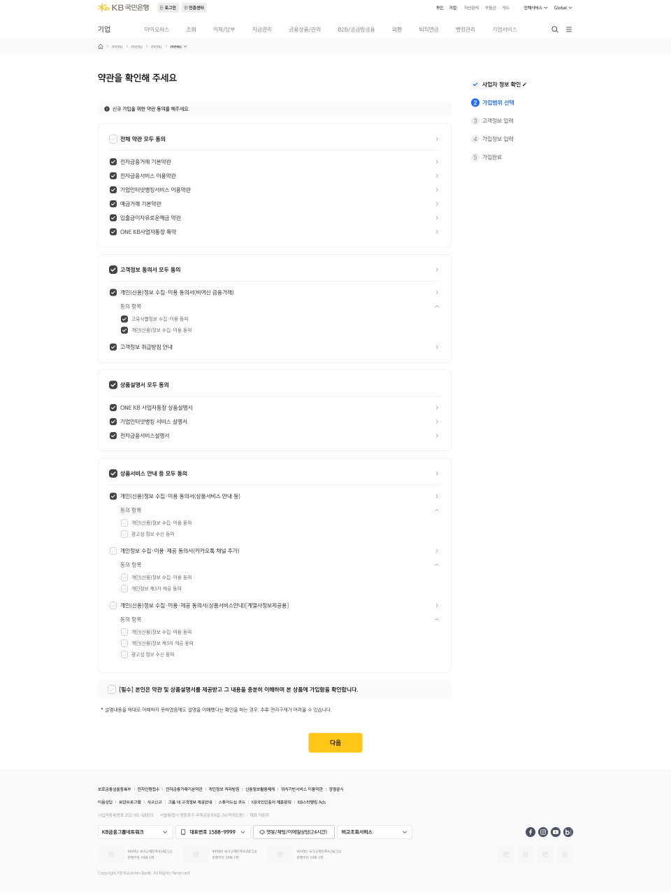

#### N — 페이지네이션형 목록

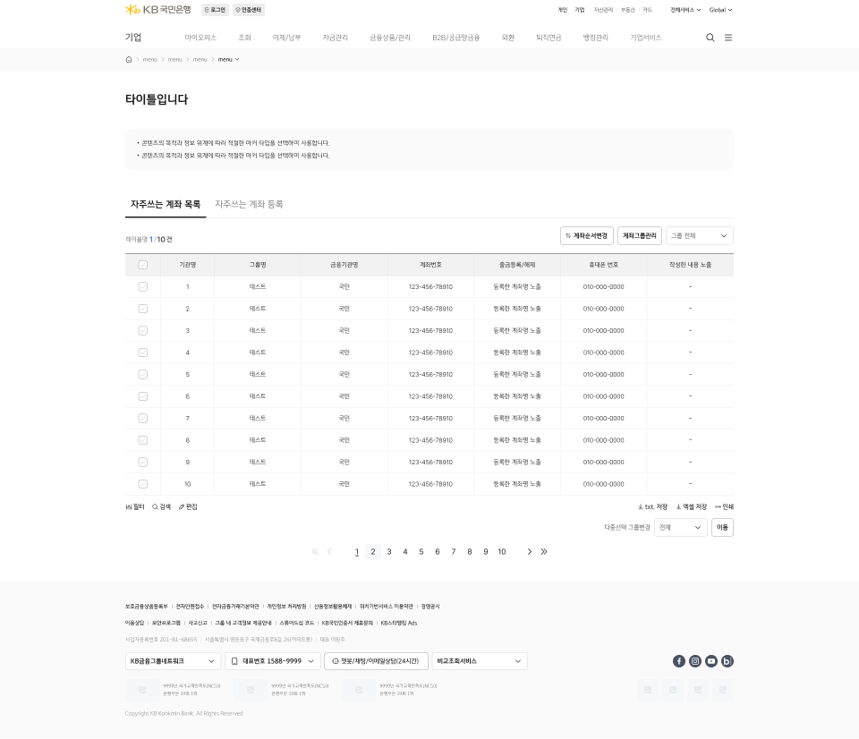

#### O — 더보기형 목록

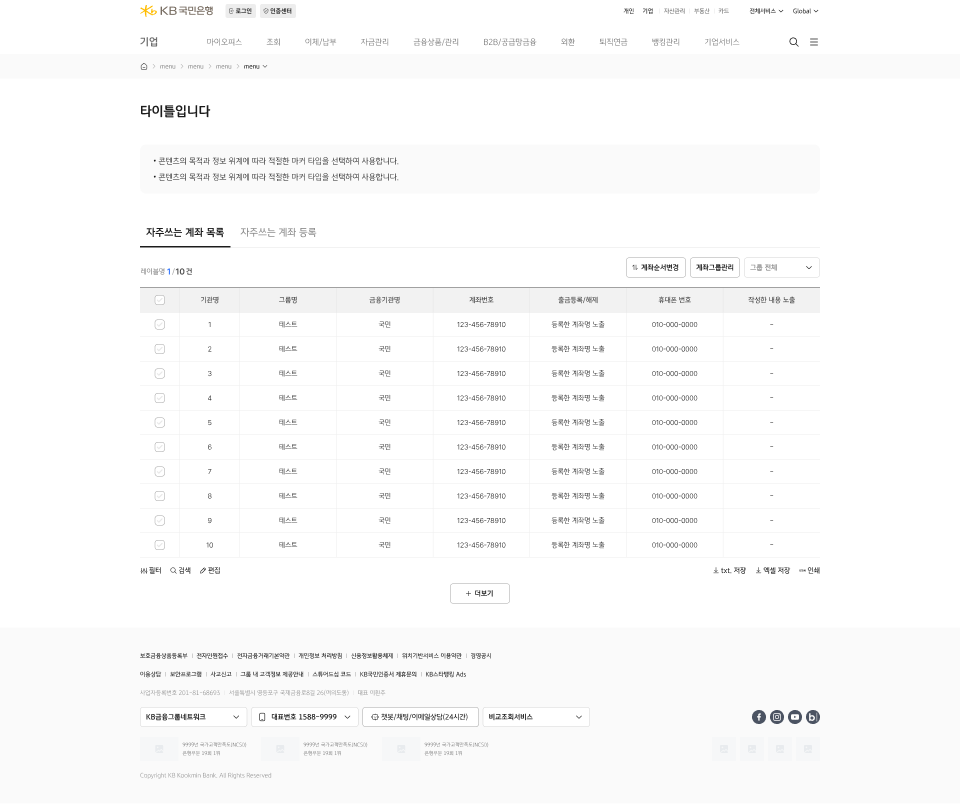

### 31.3. 생성·재현 검수

1. 1920 화면 안 BODY 1440 중앙 배치와 콘텐츠 x=280·너비 1360을 확인한다.
2. M은 LNB 없는 1012/316 두 열, 그룹 4개와 최종 동의·별표 안내, 상위 콘텐츠 전체 기준의 다음 버튼 정렬을 유지한다.
3. 동의의 깊이·들여쓰기·실제 체크/펼침 상태, 원형 연결, 내부 패딩을 확인한다. 약관 내용과 동의 연동은 기획과 대조한다.
4. N·O는 14px/16px 안내의 높이 차이, 8열 너비 합·행 높이, 실제 Grid gap을 확인한다.
5. N의 그룹 변경+페이지네이션과 O의 더보기를 구분한다. 플레이스홀더·열 의미 불일치·active/hover 예시를 업무 동작으로 확정하지 않는다.
6. M 157+2040+352=2549, N 157+1142+352=1651, O 157+1098+352=1607로 원본 전체 높이를 검산한다.
7. 이름·Container는 12장, Footer는 13장 기준을 적용하고 서체·누락 폰트·잘림·겹침을 검수한다. 통과한 검수는 반복하지 않는다.

## 32. 추가 학습 — 파일 업로드 전후와 로그아웃 안내 참조 갱신

2026-11-09에 브랜치/직접 파일 링크 3개와 사고신고 사본 링크 3개를 대조했다. 원본 링크가 삭제되어도 재현할 수 있도록 아래 실측·상태·원형 식별자와 이미지 3장을 보존한다.

| 구분 | 사고신고 사본 원본 | 브랜치/직접 파일의 대응 원본 |
| --- | --- | --- |
| P — 파일 선택 전 | [5084:21930](https://www.figma.com/design/yojs1BhPrWxLmDDrpg1ihD?node-id=5084-21930) | [18182:107459](https://www.figma.com/design/ftIWLlgj5Ldgt1uyQu9Gb8/branch/GDnwWiuiGzIZA734GOm3Yr?node-id=18182-107459) |
| Q — 파일 선택 후 | [5084:21945](https://www.figma.com/design/yojs1BhPrWxLmDDrpg1ihD?node-id=5084-21945) | [18182:107474](https://www.figma.com/design/ftIWLlgj5Ldgt1uyQu9Gb8/branch/GDnwWiuiGzIZA734GOm3Yr?node-id=18182-107474) |
| J 추가 참조 — 로그아웃 안내 | [5084:21960](https://www.figma.com/design/yojs1BhPrWxLmDDrpg1ihD?node-id=5084-21960) | [16082:62748 — v0.97 PC 링크](https://www.figma.com/design/GDnwWiuiGzIZA734GOm3Yr?node-id=16082-62748) |

- 사고신고 사본 파일 키는 `yojs1BhPrWxLmDDrpg1ihD`, 페이지 `05.기타(기획 v0.6)` (`5007:20503`)이다.
- 브랜치 링크의 원본 파일 키는 `ftIWLlgj5Ldgt1uyQu9Gb8`, 브랜치 키는 `GDnwWiuiGzIZA734GOm3Yr`다. 직접 v0.97 PC 링크의 파일 키도 `GDnwWiuiGzIZA734GOm3Yr`이며 지정 노드들은 `Templates (작성중)` (`15115:110263`)에서 확인했다.
- 이 출처 기록만으로 13장의 기준 디자인 시스템을 다른 사본으로 일괄 전환하지 않는다. 생성 시 기준 원형과 학습 출처의 변형·슬롯을 확인한다.
- 브랜치와 사본의 표시 구성·치수는 대응하지만 원형 키는 다르다. 같은 이름의 Popup·InputField라도 키를 혼용하지 않는다.
- Popup의 type=layer, vatiant=default, Header 64, Footer 48, radius 24, 검정 20% 딤, 그림자 (0,4,16,0, rgba(12,17,29,0.10))는 21장의 공통 규격을 재사용한다.
- 본문 Slot의 아래 패딩은 P·Q에서 **32**다. 21장의 앞선 예시에 있는 아래 패딩 24를 모든 Popup에 강제로 적용하지 않는다.
- 사용자 정의 래퍼는 영문 역할명·실제 Auto Layout으로 정리하고 Slot별 Container 개수를 판단한다. 컴포넌트 원형의 Item / Header·Slot·Item / Footer 계층은 유지한다.

## 33. 패턴 P·Q — 파일 업로드 팝업의 입력 상태 전환

### 33.1. 공통 구조·치수

두 원본은 1440 × 850 배경의 중앙에 같은 640 × 370 Popup을 배치한다. Popup 좌표는 (400,240)이며 파일 선택 전후에 팝업 크기·위치·전체 높이를 바꾸지 않는다.

| 요소 | x | y | 너비 | 높이 |
| --- | --- | --- | --- | --- |
| Popup | 400 | 240 | 640 | 370 |
| Header | 400 | 240 | 640 | 64 |
| Body Slot | 400 | 304 | 640 | 234 |
| 안내 박스 | 424 | 316 | 592 | 118 |
| 파일 선택 행 | 424 | 466 | 592 | 40 |
| InputField | 424 | 466 | 493 | 40 |
| 파일첨부 버튼 | 925 | 466 | 91 | 40 |
| Footer | 400 | 538 | 640 | 48 |

- Body Slot은 세로 Auto Layout, 패딩 위 12·좌우 24·아래 32, 자식 사이 gap 32다.
- 콘텐츠 너비는 640−24×2=592다. 파일 선택 행은 493+8+91=592다.
- Body 높이 검산: 위 12 + 안내 118 + gap 32 + 파일 행 40 + 아래 32 = 234.
- Popup 높이 검산: Header 64 + Body 234 + Footer 48 + 바깥 하단 패딩 24 = 370.
- Header 제목은 “파일 업로드”, Bold 16/24 #1C1C1C다. 원형의 우측 닫기 컨트롤을 유지한다.
- 안내 박스는 `Infobox / FullWidth`, radius 12, #FAFAFA, 패딩 상하 20·좌우 24, 불릿 3개다. 본문은 KBFG Text Light 14/20 #1C1C1C다.
- 안내에는 엑셀 형식, 1회 최대 500건, 재첨부 시 기존 파일 교체가 적혀 있다. 이는 이 화면의 예시 안내다. 다른 업로드 화면의 허용 확장자·파일 크기·건수·서버 검증 정책까지 일반화하지 않는다.
- Footer는 medium 버튼 2개, 각 136 × 48, gap 8, 전체 280이다. tertiary 배경 #EDEDED, primary 배경 #444444의 팝업 스타일을 재사용하며 라벨 “버튼명”은 실제 기획으로 교체한다.
- 팝업 내부 Footer는 은행 공통 페이지 Footer와 별개이며, 13장의 페이지 Footer 컴포넌트를 팝업 안에 추가하지 않는다.

### 33.2. P — 파일 선택 전

- 실제 원본 프레임명은 “파일업로드전”이다.
- InputField는 `entered=false, disabled=false, error=false` 상태다.
- 표시 문구는 “파일을 선택해주세요”, KBFG Text Bold 14/20, #8D8D8D다.
- 파일명·내부 삭제 버튼은 표시하지 않는다.
- 우측 “파일첨부”는 secondary small 91 × 40, radius 6, 흰 배경·#A5A5A5 테두리, Bold 14/20 #1C1C1C다.
- 원본 Slot 안에는 안내 Container 1과 파일 행을 담은 Container 2가 있다. Container 2 내부의 “업로드 전”은 상태 설명용 한글 이름이므로 사용자 정의 레이어 정리 시 12장의 영문 역할 명명을 적용한다.

### 33.3. Q — 파일 선택 후

- 실제 원본 프레임명은 “파일업로드후”다. 정적 원본에서 확정할 수 있는 상태는 **파일명이 들어간 입력 상태**다. 서버 업로드·검증 성공 완료를 나타내는 화면으로 단정하지 않는다.
- InputField는 `entered=true, disabled=false, error=false`이며, 원형 내부 Item / Input의 관측 변형은 `variant=giro`다. 파일명과 버튼을 가진 슬롯 구성을 유지하되 giro 이름을 실제 업무 종류의 근거로 삼지 않는다.
- 예시 “파일명.xlsx”는 KBFG Text Bold 14/20, #1C1C1C다. 실제 파일명에 맞춰 표시한다.
- 입력필드 내부에 “삭제” tertiary xsmall 버튼 38 × 28을 표시한다. 삭제 라벨은 Bold 12/17이다.
- 바깥 파일첨부 버튼은 P와 같은 (925,466), 91 × 40이다. 내부 삭제 버튼이 생겼다고 바깥 첨부 버튼을 이동하거나 행 높이를 늘리지 않는다.
- 원본 Slot 안의 두 번째 자식은 직접 파일 행이며 별도 Container 2 래퍼가 없다. P와 구조를 통일하기 위해 Container를 임의 추가하지 않는다. Slot별 실제 개수와 기존 역할을 보존한다.
- 파일명을 넣기 위해 InputField를 일반 텍스트 프레임으로 바꾸거나, 삭제 버튼을 필드 밖에 임의 배치하지 않는다.
- 재첨부·삭제 후 상태 전환, 업로드 중·오류·긴 파일명 처리, Footer 버튼 활성화 조건은 정적 화면만으로 확정되지 않았다. 실제 기획을 적용한다.

### 33.4. 서체와 누락 폰트 검수

- 두 출처 모두 표시된 서체 구성은 위 표기를 따른다. 자간은 0px이다.
- 사고신고 사본 P의 추출 텍스트에서는 누락 폰트 표시 5개가 감지되었다. 사본 Q·로그아웃 추가 참조와 브랜치 3개에서는 누락 표시가 0이었다.
- 학습 이미지가 보인다는 이유로 폰트가 모두 정상이라고 단정하지 않는다. 실제 생성 전 해당 폰트·스타일을 확인하고 임의 대체 폰트·크기로 변경하지 않는다.

## 34. 패턴 J 추가 참조 — 22px 타이머 로그아웃 안내

이번 `5084:21960`과 v0.97 PC 직접 링크 `16082:62748`은 서로 같은 표시값으로 확인됐다. 23장의 이전 `5067:7408` 참조와 기본 구조는 같지만 아래 실제 적용값은 다르다.

| 항목 | 23장 이전 참조 | 이번 참조 |
| --- | --- | --- |
| Popup | 400 × 320, (520,290) | 동일 |
| 남은 시간 서체 | Pretendard SemiBold 20/28 | **Pretendard SemiBold 22/28** |
| “0:23” 프레임 너비 | 43 | 48 |
| 서비스 안내 색상 | #6E6E6E | **#8D8D8D** |
| 타이머 색상 | #1F6AFF | 동일 |

- 기존 23장 원본의 값을 삭제하지 않고 출처별 차이로 보존한다. 이번 참조를 기반으로 생성하는 경우 22/28과 #8D8D8D를 적용하며, 모든 과거 타이머를 자동 변경하는 규칙으로 확대하지 않는다.
- 배경 1440 × 900, Popup 중앙 (520,290), Header 64, Body 184, Footer 48, 바깥 하단 패딩 24, 전체 320 높이는 동일하다.
- 본문 337 × 120은 중앙 정렬이다. 설명 제목 28 → gap 12 → 타이머 28 → gap 12 → 설명 두 줄 40을 유지한다.
- “자동 로그아웃 남은시간”은 KBFG Text Bold 20/28 #444444, 안내 문구는 Light 14/20이다.
- 타이머 크기가 커져도 높이 28을 유지한다. 예시 “0:23”의 48px 너비를 모든 시간 문자열에 고정하지 않는다.
- 왼쪽 “지금 로그아웃” tertiary medium과 오른쪽 “로그인 연장” primary medium의 실제 라벨·순서를 유지한다. 각 버튼 136 × 48, gap 8이다.
- 남은 시간·세션 연장·0초·닫기 동작은 별도 업무 기획을 따른다. 타이머 정적 값으로 보안 시간 정책을 새로 정의하지 않는다.

## 35. 업로드·로그아웃 참조의 원형 키와 보존 이미지

### 35.1. 출처별 main component key

아래는 이번 브랜치와 사고신고 사본에서 각각 확인한 원형이다. 동일한 이름·치수라도 출처에 따라 키가 달라, 가져오기 전에 기준 라이브러리와 변형·슬롯을 확인한다.

| 컴포넌트 | 브랜치/v0.97 PC에서 관측 | 사고신고 사본에서 관측 |
| --- | --- | --- |
| Popup | `98e1f7f1a08091bbcb6f8e25627d8951d2338ba8` | `58f575d37a8d4d83a30238c8f75b152d4e42db93` |
| Item / Header | `af619ecf80947e7f1b4f07de08db38f574703a17` | `2cbf7cb8b3527095493ddec2903fcfe47ac00798` |
| Item / Footer | `b0077aa8bd9b55679fb236067f60c29c65701251` | `e20c54e3621cf093f53c6a565a37c5811b583839` |
| ButtonGroup — medium | `ae3a99567323826ef6ff58b408e369486be89629` | `8923faa9126db7ef087595a2d123151588618ff6` |
| InputField — entered=false | `6eb7815286692dc574ebe162983fcb9afe06fc05` | `6a180f941f7bc12168489ec44f9203d0f3a4e7cc` |
| InputField — entered=true | `a093b7a53adbf43b22d53daf0b76f7c424513330` | `f689ed1a91c3666eab721996119a0b3540668190` |
| BoxButton — 삭제 xsmall | `0c05fe90086b423965f7e0ccf53c33c2c207d2f3` | `7c76cd19c1f5948110684820f9fdecaf97eab59c` |
| BoxButton — primary medium | `c30adfbd61e4b30ca6feae03a56f77b10678909f` | `c4ab4c1ce45fb8f3c1975cf3a624c6f05b561767` |

- 업로드 안내의 Infobox / FullWidth는 브랜치 `14346e87099b727159e6e8cd5bfb876c0d0f7892`, 사고신고 사본 `5fb7ce75dbc07c0aeca6e8cd5bfb876c0d0f7892`다.
- 바깥 “파일첨부” secondary small은 두 출처 모두 `b20b82eee273f930c668788109e73de668023c03`다.
- 원형의 `vatiant` 표기를 유지하고, 원형 연결을 detach하지 않는다. 사용자 정의 래퍼 명명은 12장, 디자인 시스템 및 일반 페이지 Footer는 13장을 따른다.

### 35.2. 삭제 대비 이미지

이미지는 사고신고 사본의 전달 시점 화면을 0.7배 PNG(너비 1008px)로 저장소에 직접 보존한 것이다. 기존 23장의 로그아웃 이미지도 이전 값의 근거로 유지한다.

#### P — 파일 선택 전


#### Q — 파일 선택 후

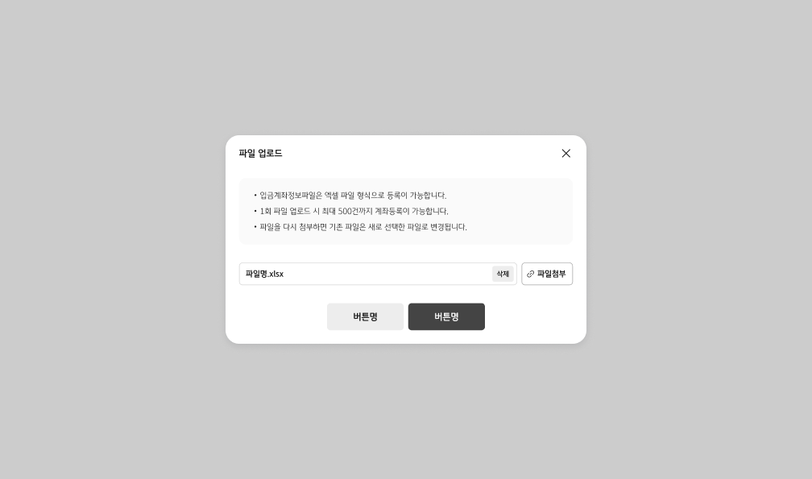

#### J 추가 참조 — 22px 타이머

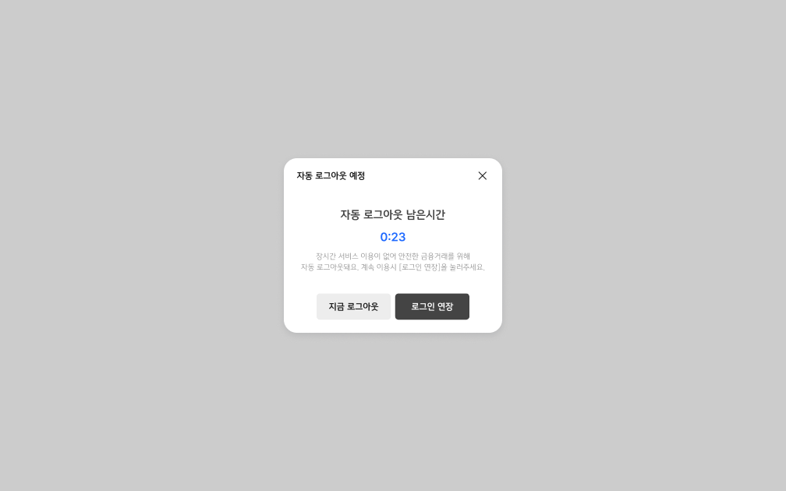

### 35.3. 재현 검수

1. 파일 선택 전후 Popup 640 × 370, (400,240), Body 아래 패딩 32와 바깥 하단 패딩 24를 구분한다.
2. 592px 파일 행 안 493px 필드 + gap 8 + 91px 첨부 버튼, 높이 40을 확인한다.
3. P/Q의 entered 상태, placeholder/파일명 색상, 내부 삭제 버튼 유무·38 × 28 크기, 실제 원형 연결을 확인한다.
4. 새 로그아웃 참조의 타이머 22/28과 안내 #8D8D8D를 이전 20/28·#6E6E6E와 구분한다.
5. 실제 업무 안내·버튼 라벨·동작을 기획과 대조하고 누락 폰트·텍스트 잘림·겹침·중복 패딩을 확인한다. 통과한 검수는 반복하지 않는다.

## 36. 패턴 R·S — 가입 단계 안내

### 36.1. 출처와 적용 범위

- 파일: 사고신고 `yojs1BhPrWxLmDDrpg1ihD`, 페이지 `05.기타(기획 v0.6)`.
- [R — 가입단계 안내 / 스타일 오버라이드](https://www.figma.com/design/yojs1BhPrWxLmDDrpg1ihD?node-id=5090-25135): 1920 × 1721.
- [S — 가입단계 안내](https://www.figma.com/design/yojs1BhPrWxLmDDrpg1ihD?node-id=5090-25320): 1920 × 1709.
- 둘 다 가입 절차를 미리 설명하는 5단계 안내 화면이다. 서로 다른 진행 상태를 나타내는 전후 화면으로 해석하지 않는다.
- R의 오버라이드를 모든 ProgressStep의 기본값으로 확대하지 않는다. 실제 기획에서 선택한 기본형·오버라이드형을 명확히 적용한다.
- 단계명, 준비물 내용, 상품 목록, 주의사항 및 “버튼명”은 원본 예시다. 실제 화면의 업무 내용·버튼 목적·이동 경로는 기획을 따른다.

### 36.2. 공통 셸과 실제 배치

원본은 흰색 Vertical 화면이며 HEADER → BODY → FOOTER의 gap은 0이다. 이번 두 화면의 Header는 **Breadcrumbs → GNB** 순서다. 기존 다른 참조의 GNB → Breadcrumbs 순서를 덮어쓰는 공통 규칙으로 확정하지 않는다. Header에도 “기업용헤더 X”가 표시되어 있으므로 실제 화면의 승인된 기업용 셸을 확인한다.

- HEADER: 1920 × 159. Breadcrumbs Area는 y=0, 높이 49, 배경 #FAFAFA다. 내부 Breadcrumbs는 x=240, 너비 1440, padding 16 40이다.
- GNB / Channel: (240,49), 1440 × 110.
- BODY: x=240, y=159, 너비 1440, padding 48 40, Vertical gap 48. 유효 콘텐츠는 x=280, 너비 1360이다.
- 페이지 제목 “가입 단계 안내”: (280,207), 1360 × 36, KBFG Text Bold 26/36, #1C1C1C.
- FOOTER: 너비 1920, 높이 352. 신규 생성에서는 13장의 지정 Footer 인스턴스를 사용한다.

| 영역 | R: y / 높이 | S: y / 높이 |
| --- | --- | --- |
| BODY | 159 / 1210 | 159 / 1198 |
| Container 1 — 페이지 제목 | 207 / 36 | 207 / 36 |
| Container 2 — 단계·준비물 안내 | 291 / 422 | 291 / 410 |
| Container 3 — 상품 안내 Accordion | 761 / 280 | 749 / 280 |
| Container 4 — 주의사항 Accordion | 1089 / 128 | 1077 / 128 |
| Container 5 — 하단 Button Area | 1265 / 56 | 1253 / 56 |
| FOOTER | 1369 / 352 | 1357 / 352 |

실제 본문 Container는 5개다. 이를 임의로 합치거나 분할하지 않는다. 사용자 정의 래퍼는 12장의 명명 기준으로 정리하고, 디자인 시스템 인스턴스의 고유 내부 이름은 유지한다.

```text
Screen
├─ ## HEADER
│  ├─ Breadcrumbs Area
│  └─ GNB / Channel
├─ ## BODY
│  ├─ Container 1
│  │  └─ Title / Page
│  ├─ Container 2
│  │  └─ ProgressStep / Infobox
│  │     ├─ ProgressStep
│  │     └─ Infobox
│  ├─ Container 3
│  │  └─ Accordion — 상품 안내
│  ├─ Container 4
│  │  └─ Accordion — 주의사항
│  └─ Container 5
│     └─ Button Area
│        └─ ButtonGroup
└─ ## FOOTER — 지정 컴포넌트 인스턴스
```

이 트리는 역할을 정리한 제작 명명 예다. `ProgressStep / Infobox`와 `Button Area`는 사용자 정의 래퍼이며, 원본의 일반 프레임을 라이브러리 컴포넌트로 오인하지 않는다.

## 37. ProgressStep·준비물의 치수와 스타일 차이

### 37.1. Container 2와 단계 영역

Container 2는 너비 1360, Vertical gap 32, 위·아래 padding 12, 좌우 0, radius 24다. 프레임 속성의 fill은 #FAFAFA이며, 실제 표시에는 내부 자식의 배경도 반영된다.

| 항목 | R — 스타일 오버라이드 | S — 기본형 |
| --- | --- | --- |
| 단계 바깥 래퍼 | (280,303), 1360 × 190 | (280,303), 1360 × 178 |
| 래퍼 padding: 위/오른쪽/아래/왼쪽 | 32 / 32 / 32 / 32 | **32 / 0 / 32 / 32** |
| 실제 ProgressStep 인스턴스 | (312,335), 1296 × 126 | (312,335), 1328 × 114 |
| 5개 항목 각각의 너비 | 259.2 | 265.6 |
| 원형 variant 이름 | align=center | align=left |
| 실제 내부 Item 정렬 | **5개 모두 align=left** | 5개 모두 align=left |
| 번호 서체 | Pretendard SemiBold 15/20, #FFFFFF | Pretendard Regular 15/20, #1C1C1C |
| 번호 원형 표시 | 파란색 원형 | 옅은 회색 원형 |
| 단계 제목 | KBFG Text Bold **18/25**, #444444 | KBFG Text Bold **14/20**, #444444 |
| 단계 설명 | KBFG Text Medium **14/20**, #6E6E6E | KBFG Text Light **12/17**, #6E6E6E |
| 보조 링크 “버튼명” | KBFG Text Medium 12/17, #444444 | 동일 |

- ProgressStep은 가로 5등분, 항목 사이 gap 0이다. 각 Item은 Vertical gap 16이며 번호 원형은 32 × 32다. 첫 4개는 position=start, 마지막은 position=end다.
- R 원형의 `align=center`라는 이름만 보고 내부 텍스트를 모두 중앙 정렬하지 않는다. 내부의 실제 `Item / Infomation`은 왼쪽 정렬이다. 라이브러리 원형의 `Infomation` 표기는 임의 수정하지 않는다.
- R의 단계명은 “사업자 정보 확인 → 정보입력 → 본인인증 → 상품가입 → 가입완료”다. S의 “스텝명 입력”, 설명 “프로세스 내용 필요 시 사용”, 링크 “버튼명”은 자리표시자다.
- R의 번호가 모두 파란색이라는 정적 표현만으로 모든 단계가 완료되었거나 활성화되었다고 정의하지 않는다. 절차 개요 ProgressStep과 현재 단계 표시·검증 동작은 실제 기획에 따라 구분한다.
- R과 S의 단계 영역 높이 차이 12가 Container 2, 이후 Container 및 Footer y좌표에 그대로 반영된다. 동일한 y좌표를 강제로 적용하지 않는다.

### 37.2. 준비물 안내

- 준비물 박스: R은 (280,525), S는 (280,513), 모두 1360 × 176. padding 32, radius 12, fill #FAFAFA다.
- 내부 `Text / List`: 1296 × 112, 제목과 목록 gap 12. Title / Group “준비물”은 KBFG Text Bold 16/24, #1C1C1C다.
- 목록은 3행, 각 높이 20, 행간 gap 8로 총 76이다. 아이콘은 `status-circleCheck` 16 × 16, 행 위에서 2px 위치, 아이콘과 본문 간격 4다. 본문은 행 왼쪽에서 20px 뒤에 시작한다.
- 원본의 각 `TextList / Unordered` 행은 **이 이름을 가진 FRAME**이며 컴포넌트 인스턴스가 아니다. 생성 시 이름만으로 인스턴스 여부를 판단하지 않는다. 적절한 KBDS 컴포넌트를 재사용할 때도 실제 원형 연결과 아이콘·문장 배치를 확인한다.
- 원본의 준비물 목록은 “종합통장자동대출의 만기도래 및 이자내역 안내”, “CD/ATM 및 금융 VAN사 자동화기기를 통한 거래”, “제휴기관(증권사등) 자동화기기를 통한거래”다. 준비물 제목과 업무상 맞지 않는 예시이므로 실제 필요 서류·준비물로 확정하지 않는다.
- 높이 검산: 준비물은 padding 64 + 제목 24 + gap 12 + 목록 76 = 176. Container 2는 R: 24 + 190 + 32 + 176 = 422, S: 24 + 178 + 32 + 176 = 410이다.

## 38. 펼쳐진 상품·주의사항과 하단 버튼

### 38.1. 상품 안내 Accordion

- 두 화면 모두 `variant=standard, type=basic, size=large, expanded=true`, 1360 × 280이다.
- Title Area: 높이 68, 위·아래 padding 20, 가로 gap 12. “상품 안내”는 KBFG Text Bold 16/24, #444444다. 펼침 아이콘은 오른쪽 28 × 28이다.
- Expand Area: 내부 y=68, 높이 212, 위 padding 8, 아래 padding 20. 실제 Slot-contents는 내부 y=76, 높이 184, gap 8이다.
- 표는 라벨 열 180 + 값 열 1180 = 1360이다. 라벨은 “가입 대상 / 서비스 이용 시간 / 가입 가능한 상품”, KBFG Text Medium 14/20 #444444다. 일반 값은 Light 14/20 #1C1C1C이며, 상품 목록은 14px TextList를 사용한다.
- 예시 값 “개인사업자(공동사업자 제외)”, “24시간 365일 언제나 가능”과 상품 3개는 화면 샘플이다. 가입 자격·이용 시간·상품 정책으로 일반화하지 않는다.
- 펼침 상태와 슬롯 내용을 보존하며, 접힘 동작·초기 상태의 선택 정책은 실제 기획을 따른다.

### 38.2. 주의사항 Accordion

- 두 화면 모두 `variant=standard, type=basic, size=medium, expanded=true`, 1360 × 128이다.
- Header: 높이 56, 위·아래 padding 16, 가로 gap 8. 왼쪽 info 아이콘 24 × 24, 오른쪽 펼침 아이콘 24 × 24다.
- 제목 “주의사항”은 **R: KBFG Text Bold 14/20**, **S: Bold 16/24**로 다르며 색상은 모두 #444444다. 같은 원형·높이라도 실제 적용된 서체 오버라이드를 확인한다.
- Expand Area는 내부 y=56, 높이 72, 위 padding 8, 아래 padding 16이다. Slot-contents는 내부 y=64, 높이 48이며 20px 불릿 2행 + gap 8로 구성된다.
- 원본의 동일 주의문 2행을 실제 기획의 필수 중복 문장으로 확정하지 않는다.

### 38.3. Button Area와 Footer

- Container 5는 1360 × 56이며, large primary 버튼 하나를 가로 중앙에 배치한다. 버튼은 154 × 56, x=883, R y=1265 / S y=1253이다.
- 실제 ButtonGroup 원형은 `count=multi`지만 보이는 자식은 1개다. variant 이름만 보고 두 번째 버튼을 추가하지 않는다.
- “버튼명”은 자리표시자이며 실제 액션 라벨·활성화 조건·다음 화면은 업무 기획을 적용한다.
- BODY 높이는 padding 96 + 제목 36 + 안내 R 422/S 410 + 상품 280 + 주의 128 + 버튼 56 + 영역 간격 48 × 4 = R 1210 / S 1198이다.
- Footer는 BODY 다음에 gap 0으로 이어진다. 기존 학습 화면의 Footer가 일반 프레임이어도 새 화면에서는 13장의 지정 컴포넌트를 인스턴스로 넣는다.

## 39. 가입 단계 안내의 원형 키·이미지·검수

### 39.1. 관측한 main component key

사고신고 파일에서 확인한 키다. 지정 디자인 시스템에서 재사용할 때는 같은 이름뿐 아니라 실제 원형·변형·슬롯·토큰을 대조하고 연결을 유지한다.

| 컴포넌트 / 변형 | main component key |
| --- | --- |
| Title / Page | `366007b354df25708d9dce4a7788c2b44e30dba3` |
| ProgressStep — R, align=center | `5bc9c95cc0b4906f44ebdf25875a18daff8930c3` |
| ProgressStep — S, align=left | `56b1705e117b8613a4403f34bbf9fd0be5683476` |
| Item / Infomation — start / left / number | `5f02d9a1f43d6ef479cc5c6f36b3414e1b5f9a20` |
| Item / Infomation — end / left / number | `c62727408533955d60d88e88526f3ec8f752161c` |
| Item / ProgressStep — number | `72a7e48dd96459e737a0f31ba87bb3fa4e69d49e` |
| Title / Group — left | `99d19cfa876f2805be637934f717ffd2763720ca` |
| Accordion — standard/basic/large/expanded | `189002d3c4cd6147e4912221bc87a9af60a61a22` |
| Accordion — standard/basic/medium/expanded | `d14342b496bd3aa5d2e707cf26a183daf5d401ce` |
| TextList — 불릿 14px | `5e484496e22e7e84c91c23bddfe11d1b4a13f35b` |
| ButtonGroup — large, count=multi | `f6fbbaad278bc5dc3e0568efdc16711894a01e47` |
| BoxButton — primary large | `d206f834d8d80e5bd6ab306b8033f3c0e5214bc5` |

### 39.2. 원본 삭제 대비 이미지

전달 시점의 두 화면을 0.5배 PNG(너비 960px)로 저장소에 보존했다. 수치 재현은 위 논리 px를 사용하고, 이미지는 전체 배치·색·서체 차이를 확인하는 근거로 사용한다.

#### R — 스타일 오버라이드

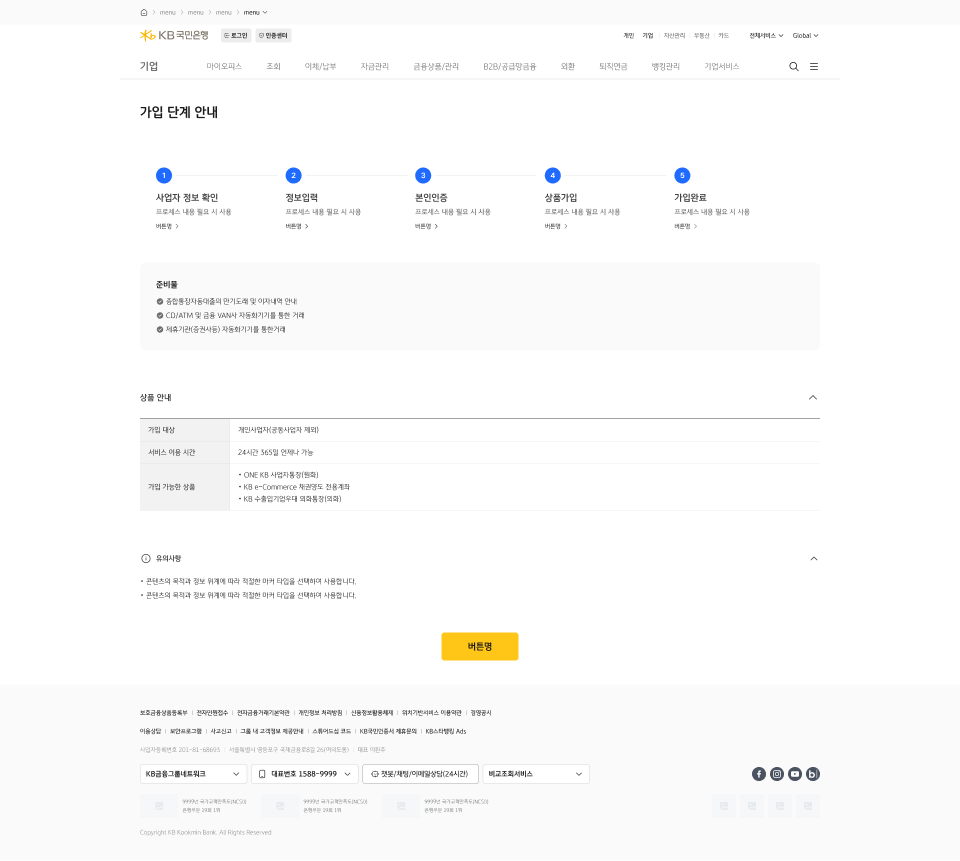

#### S — 기본형

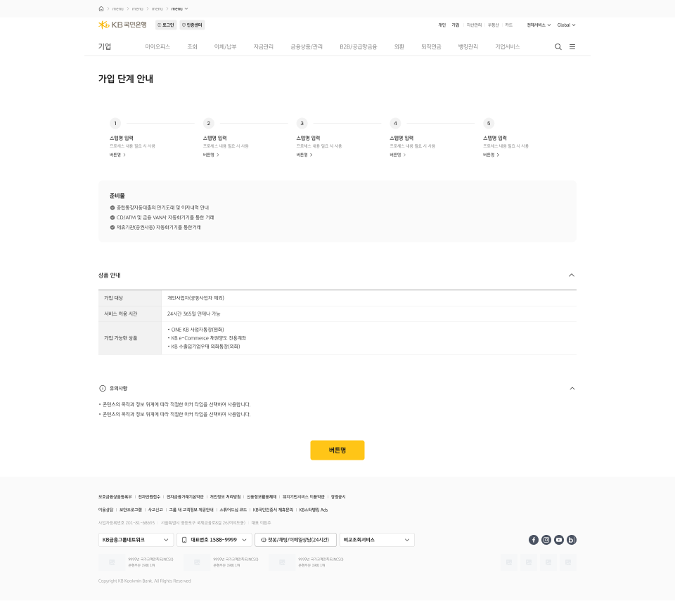

### 39.3. 재현 검수

1. 1920px 셸, 이번 출처의 Breadcrumbs → GNB 순서, BODY 1440/유효 너비 1360 및 Container 5개를 확인한다.
2. 5단계의 동일 분할, 번호 32 × 32, 실제 자식의 왼쪽 정렬 및 R/S의 제목·설명·번호 서체를 확인한다.
3. R/S의 단계 래퍼 좌우 padding 차이, 12px 높이 차이와 이후 영역·Footer 위치를 확인한다.
4. 준비물 176, 상품 Accordion 280, 주의 Accordion 128, 중앙 버튼 154 × 56 및 지정 Footer 인스턴스 연결을 확인한다.
5. 이번 원본 두 화면의 누락 폰트 표시는 0이며 확인한 텍스트 자간은 0px이다. 생성 화면에서도 필수 서체, 잘림·겹침, 실제 업무 문구와 인스턴스 연결을 한 번 검수한다.

## 40. 패턴 T — 비대면 가입 안내 카드형·스타일 오버라이드

### 40.1. 출처와 화면 골격

- [원본 화면](https://www.figma.com/design/yojs1BhPrWxLmDDrpg1ihD?node-id=5090-28760): `비대면 계좌개설 안내 / 카드형 구성_스타일오버라이드`, 1920 × 1470.
- 파일 `yojs1BhPrWxLmDDrpg1ihD`, 페이지 `05.기타(기획 v0.6)`. 전달된 두 링크는 같은 노드이므로 하나의 패턴으로 기록한다.
- 실제 표시 내용은 기업뱅킹의 법인사업자·개인사업자 가입 진입 카드다. 프레임 이름만으로 계좌개설 업무로 확정하지 않는다.
- 전체 Vertical, gap 0, 배경 #FFFFFF. HEADER는 높이 **157**이며 **GNB → Breadcrumbs** 순서다. 이전 R·S의 159px 및 반대 순서를 적용하지 않는다.
- GNB / Channel: (0,0), 1920 × 108, channel=biz. 내부 GNB는 login=false, expand=false, container=1440이며 중앙 1440 컨테이너의 좌우 padding은 40이다.
- Breadcrumbs Area: (0,108), 1920 × 49, #FAFAFA. 내부는 (240,108), 1440 × 49, padding 16 40이다.
- 원본 Header에는 “기업용헤더 X”가 붙어 있다. 이번 치수를 모든 기업용 Header의 기본 규격으로 확대하지 않는다.

| 영역 | 좌표 (x,y) | 크기 |
| --- | --- | --- |
| BODY | (240,157) | 1440 × 961 |
| Container 1 — 페이지 제목 | (280,205) | 1360 × 72 |
| Container 2 — 카드 2열 Grid | (280,325) | 1360 × 391 |
| Container 3 — 모바일 안내 배너 | (280,764) | 1360 × 102 |
| 유의사항 Accordion — BODY 직접 자식 | (280,914) | 1360 × 156 |
| FOOTER | (0,1118) | 1920 × 352 |

- BODY는 Vertical gap 48, padding 48 40이다. 높이는 96 + 72 + 391 + 102 + 156 + 48 × 3 = 961이다.
- 실제 본문 Container는 3개이며 Accordion은 BODY의 직접 자식이다. 정리 목적으로 Container 4를 추가하거나 기존 Container를 병합·분할하지 않는다.
- 페이지 제목은 “기업뱅킹 회원 가입을” / “비대면으로 편리하게 신청해보세요”의 명시적 두 줄, KBFG Text Bold 26/36, #1C1C1C다. Title / Page 인스턴스는 1360 × 72, 실제 텍스트는 367 × 72다.
- LNB와 별도의 하단 Button Area는 없는 참조다. 카드 내 가입 TextButton이 실제 표시된 진입 액션이다.
- Footer는 신규 생성 시 반드시 13장의 지정 컴포넌트 인스턴스로 넣는다. 원본 Footer의 일반 프레임·이중 컨테이너 패딩을 그대로 복제하지 않는다.

### 40.2. 두 카드의 Grid와 외곽

- Container 2는 실제 Auto Layout **GRID, 1행 × 2열**, 행·열 gap 24다. 668 + 24 + 668 = 1360으로 두 카드가 같은 너비다.
- 왼쪽은 (280,325), 오른쪽은 (972,325), 각각 668 × 391이다.
- 원본 카드 `Box`는 FRAME이며 라이브러리 Card 인스턴스가 아니다. 이름만으로 원형 연결을 가정하지 않는다.
- 각 카드는 #FFFFFF, radius 12, 안쪽 1px stroke #E5E5E5, padding 32다. 내부 `inner`는 실제 (313,358)/(1005,358), 602 × 325다. 테두리를 포함한 실제 인셋은 33이므로 단순히 668 − 64 = 604로 재현하지 않는다.
- 내부는 Vertical gap 32다. 위 아이콘·가입 버튼 블록 99 + gap 32 + 아래 준비물 블록 194 = 325이며, 카드 전체는 32 × 2 + 테두리 2 + 325 = 391이다.
- 원본 Grid와 카드 부모·순서는 정리 시 보존한다. 신규 제작에서는 가입 액션이 포함된 박스를 60장의 `Card / Surface` 실제 인스턴스로 구성하고, 반복 부모는 `Card Group`으로 명명한다. 원형의 패딩·라운드·공개 속성을 유지하며 원본 `Box`의 수동 외형을 복제하지 않는다. 실제 Grid를 이름만 Group으로 바꾸거나 평면 그룹으로 대체하지 않는다.

### 40.3. 카드 상단 아이콘과 가입 TextButton

- 상단 블록은 602 × 99, Vertical gap 12다. 아이콘 프레임은 56 × 56, 가입 버튼은 211 × 31이다.
- 아이콘 프레임: 왼쪽 (313,358), 오른쪽 (1005,358). 원본은 `iconDummy` 일반 FRAME과 벡터 그룹이며 각각 모니터·봉투 모양이다. 실제 그래픽은 40 × 36 / 44 × 32이고, 빨간 `dummy` 글자가 겹쳐 있다.
- 생성 화면에서는 승인된 KBDS 아이콘·일러스트를 우선 사용하고 임시 `dummy` 표시를 제거한다. 임시 벡터 그룹을 검증된 라이브러리 컴포넌트로 기록하지 않는다.
- TextButton: 왼쪽 (313,426) “법인사업자 가입하기”, 오른쪽 (1005,426) “개인사업자 가입하기”. 원형은 primary/large이며 실제 라벨은 **KBFG Text Bold 22/31**, #1C1C1C로 오버라이드되어 있다.
- 라벨 185 + gap 2 + 오른쪽 chevron 24 = 211이다. 아이콘은 버튼 높이 31 안에서 세로 중앙에 배치된다.
- 스크린샷만으로 카드 전체가 클릭 가능한지, 라우팅·hover·focus 상태가 무엇인지 확정하지 않는다. 실제 TextButton 인스턴스와 기획의 액션 범위를 따른다.

### 40.4. 카드 하단 준비물·가입대상

두 카드의 하단 구조·문구는 원본에서 동일하다.

- 하단 블록: (313,489)/(1005,489), 602 × 194, Vertical gap 12, padding **32 0 8 0**, radius 12, fill 없음.
- “준비물” Title / Group: y=521, 높이 24, KBFG Text Bold 16/24 #1C1C1C.
- 다음 본문 블록: y=557, 602 × 118, Vertical gap 12.
- 체크 목록 3행: y=557/585/613, 각 602 × 20, gap 8, 총 높이 76. 아이콘은 `status-circleCheck` 16 × 16, 텍스트와 gap 4, 본문 너비 582다. 본문은 KBFG Text Light 14/20 #1C1C1C.
- 이 체크 행은 이름이 `TextList / Unordered`인 일반 FRAME이며 아이콘만 인스턴스다. 실제 인스턴스 여부를 확인하고 적절한 KBDS 구성을 재사용한다.
- 수평 Divider: y=645, 602 × 1, secondary/1px. 목록 끝과 gap 12다.
- 별표 가입대상 안내: y=658, 602 × 17, TextList / Unordered의 star/12/depth=1 인스턴스다. KBFG Text Light 12/17 #6E6E6E이며 마커 영역 8 + gap 4 + 본문 590이다.
- 높이 검산: 본문 76 + 12 + 1 + 12 + 17 = 118, 하단 블록 32 + 24 + 12 + 118 + 8 = 194.
- 제목과 본문이 혼합된 래퍼는 12장의 `Title / Contents` 규칙으로 재판정한다. 체크 목록과 가입대상 안내·Divider 전체를 단일 반복 TextList Group으로 뭉뚱그리지 않는다.
- 원본 준비물은 37.2장의 대출·자동화기기 안내 샘플과 같다. 별표 안내도 두 카드 모두 주식회사·단독 대표이사 조건을 담고 있어 개인사업자 카드의 실제 가입 요건으로 사용할 수 없다. “공동재표”라는 원본 오타도 업무 문구로 확정하지 않는다. 실제 준비물·가입 자격은 승인된 기획으로 교체한다.

### 40.5. 모바일 가입 배너의 실제 크기와 임시 자산

- Banner / Card 인스턴스는 minimalBanner, 1360 × 102, fill #FAFAFA, radius 16이다.
- 내부 Slot은 Horizontal, gap 12, padding 12 20이다. ImageContainer는 **(300,767), 96 × 96**, TextArea는 **(408,791), 1212 × 48**이다.
- 실제 102px 높이 안에서 이미지 위·아래 여백은 각각 **3px**이다. 선언된 세로 padding 12만 계산해 배너를 120px로 임의 확대하지 않는다. 출처의 고정 높이·자식 배치를 구분해 기록한 값이다.
- ImageContainer 내부에는 (308,775), 80 × 80의 “임시 visual”과 빨간 `dummy` 문구가 있다. **실제 QR 코드는 없다.**
- 제목 “모바일로 가입을 진행하려면”: KBFG Text Bold 16/24 #1C1C1C.
- 설명 “스마트폰 기본카메라를 켜고 QR코드를 스캔하세요.”: KBFG Text Light 14/20 #8D8D8D. 제목과 gap 4로 총 높이 48이다.
- 실제 생성 시 임시 visual·dummy를 승인된 자산으로 교체한다. QR 안내가 유지되는 경우 실제 목적지가 확인된 QR을 제공하고 인식 가능 여부를 검수한다. 현재 이미지를 작동하는 QR로 재사용하지 않는다.

### 40.6. 유의사항 Accordion

- standard/basic/medium/expanded=true, 1360 × 156. 38장의 128px 참조와 같은 원형이지만 불릿이 3행이라 **28px 더 높다**.
- Title Area: (280,914), 1360 × 56, padding 16 0, gap 8. info 24 × 24는 (280,930), “유의사항”은 (312,932), KBFG Text Bold 14/20 #444444다. 오른쪽 chevron-up은 (1616,930), 24 × 24다.
- Expand Area: (280,970), 1360 × 100, padding 8 0 16 0. Slot-contents는 (280,978), 1360 × 76, gap 8이다.
- TextList 불릿 3행은 y=978/1006/1034, 높이 20, KBFG Text Light 14/20 #1C1C1C다. 총 20 × 3 + 8 × 2 = 76, Accordion은 56 + 8 + 76 + 16 = 156이다.
- 원본의 Star CMS 수수료·이체 50건/10억·Master/Sub 출금권한 문구는 가입 화면에 삽입된 샘플로 기록한다. 이를 가입 정책이나 이체 서비스의 공통 업무 규칙으로 확정하지 않는다.

### 40.7. 원형 키와 보존 이미지

아래는 사고신고 파일에서 관측한 main component key다. 지정 디자인 시스템의 실제 원형·변형·토큰과 대조하여 재사용한다.

| 컴포넌트 | main component key |
| --- | --- |
| GNB / Channel — biz | `a1805a20b85dea4155db23d9ff5bd2ece9a61386` |
| GNB — login=false, expand=false, container=1440 | `a7b4d9d08237dfb5560835ebae09f8f55267fb96` |
| Title / Page — left | `366007b354df25708d9dce4a7788c2b44e30dba3` |
| TextButton — primary large | `40636a4670dba28b4c3c126689c13c2ce7c3b80d` |
| line-chevron-right — 24 | `c583635d46aec2de5f463e4e4551034b4da5a7c5` |
| Title / Group — left | `99d19cfa876f2805be637934f717ffd2763720ca` |
| status-circleCheck — 16 | `e9020e86e5b488d8d972d0b7a1f33acf22611daf` |
| Divider / Horizontal — secondary, 1px | `b154a5e09047df6dcbf02775b74e664260c48b01` |
| TextList — star/12/depth=1 | `e437d68fb6da9daedafa27c4814efc94866b67e0` |
| Banner / Card — minimalBanner | `a584878a0ddad355531a2b54e17f24b8312b1e59` |
| Accordion — standard/basic/medium/expanded | `d14342b496bd3aa5d2e707cf26a183daf5d401ce` |
| TextList — bullet/14/depth=1 | `5e484496e22e7e84c91c23bddfe11d1b4a13f35b` |

원본 삭제에 대비해 0.5배 PNG(960 × 735)를 저장소에 보존했다. 임시 표시도 출처 확인을 위해 이미지에는 그대로 남겼으며, 신규 제작물에서는 위 교체 지침을 따른다.

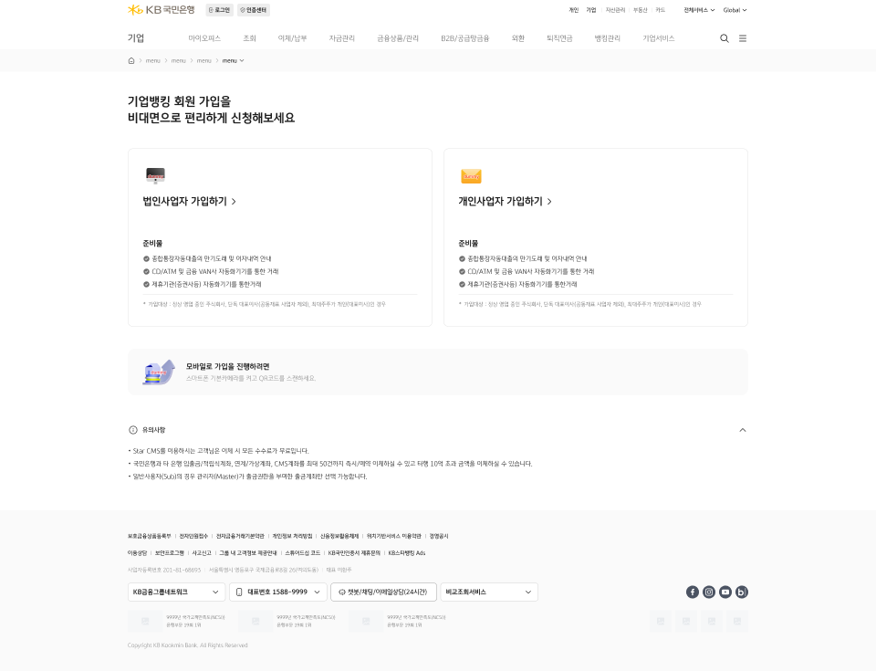

### 40.8. 재현 검수

1. Header 157, BODY 961, Footer 시작 y=1118, 본문 Container 3개와 직접 자식 Accordion 구조를 확인한다.
2. Grid 2열·gap 24, 카드 668 × 391, 테두리·padding·실제 내부 602 × 325와 TextButton 22/31 오버라이드를 확인한다.
3. 준비물 체크 3행·Divider·별표 안내, 배너 1360 × 102와 96px 이미지의 실제 배치를 확인한다.
4. 본문에서 누락 폰트는 0이었다. 실제 생성에서도 KBFG Text, 잘림·겹침과 필요 시 문장 증가에 따른 높이 변경을 한 번 검수한다.
5. dummy·임시 자산 제거, 실제 준비물·가입 요건·버튼 목적·QR, 지정 Footer 인스턴스를 기획과 대조한다. 검수 통과 후 불필요한 재검수는 생략한다.

## 41. 패턴 U — 금융거래 목적 질문·확인과 오른쪽 단계 표시

### 41.1. 출처와 2열 골격

- [원본 화면](https://www.figma.com/design/yojs1BhPrWxLmDDrpg1ihD?node-id=5090-30709): 프레임 이름 `화면ID`, 1920 × 2718.
- 파일 `yojs1BhPrWxLmDDrpg1ihD`, 페이지 `05.기타(기획 v0.6)`. 원본은 금융거래 목적 질문과 안내 확인, 상품가입 단계 표시를 함께 담은 화면이다.
- 루트는 흰색 Vertical, gap 0이다. HEADER는 40장과 같은 GNB 108 → Breadcrumbs 49의 **157px** 셸이다. GNB는 channel=biz, login=false, expand=false, container=1440이다. 원본의 “기업용헤더 X” 표시는 최종 기업용 셸 승인으로 해석하지 않는다.
- BODY: (240,157), 1440 × 2209, padding 48 40. 유효 콘텐츠 너비는 1360이다.
- BODY의 바깥 Container는 (280,205), 1360 × 2113, Horizontal gap **32**다. Main 1012 + gap 32 + Right 316 = 1360이다.
- Main: (280,205), 1012 × 2113, Vertical gap 48. Right: (1324,205), 316 × 394. 두 열의 상단을 맞춘다.
- 오른쪽은 LNB가 아니라 **가입 진행 단계 표시**다. 일반 LNB 메뉴로 치환하지 않는다. 스크롤 고정·sticky·클릭 이동 동작은 정적 화면에서 확정되지 않았다.
- Footer: (0,2366), 1920 × 352. 신규 생성은 13장의 지정 Footer 컴포넌트 인스턴스를 사용한다.

| Main 영역 | y | 크기 |
| --- | --- | --- |
| 페이지 제목 | 205 | 1012 × 36 |
| Infobox / FullWidth | 289 | 1012 × 86 |
| 질문·확인 혼합 래퍼 | 423 | 1012 × 1587 |
| Button Area | 2058 | 1012 × 56 |
| 유의사항 Accordion | 2162 | 1012 × 156 |

Main 높이 검산은 36 + 86 + 1587 + 56 + 156 + gap 48 × 4 = 2113, BODY는 48 + 2113 + 48 = 2209다. 제목은 자리표시자 “타이틀입니다”, KBFG Text Bold 26/36 #1C1C1C이며 실제 텍스트 너비 141, Title / Page 인스턴스 너비 233이다. 제목 행 전체 1012를 텍스트 너비로 오인하지 않는다.

### 41.2. 안내 박스와 기존 계층 보존

- Infobox / FullWidth는 1012 × 86, padding 20 24, radius 12, fill #FAFAFA다.
- Contents/Slot은 964 × 46이며 Slot 자체에 **1px padding**이 있다. 실제 Container는 (305,310), 962 × 44, Vertical gap 4다.
- 불릿 2행은 각각 높이 20, KBFG Text Light 14/20 #1C1C1C다. 본문은 x=317, 너비 950이며 마커는 x=305에 있다. 높이는 20 × 2 + gap 4 + Slot padding 2 + 바깥 padding 40 = 86이다.
- 첫 문장은 입출금통장 개설 시 금융거래 목적을 확인한다는 안내다. 두 번째는 “콘텐츠의 목적과 정보 위계에 따라 적절한 마커 타입을 선택하여 사용합니다.”라는 컴포넌트 설명 샘플이다. 실제 고객 안내로 복사하지 않는다.
- 원본 BODY에는 바깥 `Container 1` 하나가 있고 그 안에 Main/Right가 있다. Main의 Infobox 래퍼에는 잔여 이름 `Container 3`이 붙어 있다. 이 번호를 근거로 Container 2를 새로 만들거나 다른 영역을 이동하지 않는다.
- 12장에 따라 사용자 정의 이름은 현재 역할·반복 구성을 재판정하되 원본의 Container 개수·부모·순서·역할 분할은 보존한다. DS 인스턴스의 내부 Container·Slot은 원형 계층을 유지한다.
- 원본 `Question Group`에는 Question 3개와 Consent 4개가 섞여 있다. 단일 종류의 반복 그룹으로 일반화하지 않으며, 제작 시 혼합 콘텐츠에 맞는 래퍼 이름을 적용한다. 명명 정리를 이유로 7개 카드의 부모나 순서를 바꾸지 않는다.

## 42. 질문·확인 카드의 치수와 상태

### 42.1. 7개 카드의 순서

혼합 래퍼는 너비 1012, Vertical gap **12**다. 카드 높이 합계 1515 + gap 12 × 6 = 1587이다. 각 카드는 일반 FRAME이며 자체가 검증된 라이브러리 카드 인스턴스인 것은 아니다. 제목·선택·동의 등 내부에는 실제 DS 인스턴스를 사용한다.

| 순서 | 종류·내용 | y | 높이 |
| --- | --- | --- | --- |
| 1 | Question — 공급망금융 대출 신청 여부 | 423 | 177 |
| 2 | Question — 통장대여 요청 여부 | 612 | 177 |
| 3 | Question — 타인의 금융거래 요청 여부 | 801 | 177 |
| 4 | Consent — 통장양도 금지 확인 | 990 | 194 |
| 5 | Consent — 불법·탈법 차명거래 금지 설명 | 1196 | 214 |
| 6 | Consent — 예금자 보호제도, 확인 2개 | 1422 | 246 |
| 7 | Consent — 중요 사항 설명, 확인·하위 목록 2묶음 | 1680 | 330 |

모두 #FFFFFF, radius 12, 1px stroke다. Question 1·2와 Consent는 #E5E5E5이며 **Question 3만 #D4D4D4**다. 이 차이를 오류·focus 상태라고 추정하지 않는다.

### 42.2. Question 3개

- padding 32, Vertical gap 20, 내부 너비 **948**이다. 1012 − 32 × 2 = 948이며 40장의 카드에서 관측한 33px 인셋을 이번 카드에 일괄 적용하지 않는다.
- Title / Section: 948 × 53. 제목 KBFG Text Bold 18/25 #1C1C1C, 제목과 설명 gap 8, 설명 Light 14/20 #444444다.
- 제목 시작 y는 455 / 644 / 833, 설명은 488 / 677 / 866이다.
- SelectButton: type=word, variant=single, 948 × 40, y=528 / 717 / 906. 내부 slot은 Horizontal gap **6**다.
- 왼쪽 “네”: 45 × 40, selected=false, 흰색, 1px #D4D4D4 테두리, radius 6, 라벨 Bold 14/20 #444444.
- 오른쪽 “아니요”: 90 × 40, selected=true, 흰색, **2px #1C1C1C** 테두리, radius 6, 라벨 Bold 14/20 #1C1C1C와 체크 아이콘을 표시한다.
- 두 항목의 x좌표는 312 / 363이다. 45 + 6 + 90 = 141이며, 바깥 948px 전체를 양분한 버튼이 아니다.
- 카드 높이는 padding 64 + 제목·설명 53 + gap 20 + 선택 40 = 177이다.
- 원본에서 세 질문 모두 “아니요”가 선택되어 있지만, 새 화면의 기본 응답이나 정상 진행 조건으로 고정하지 않는다. “네” 선택 시 차단·팝업·추가 입력 등의 분기는 기획을 따른다.
- 세 번째 질문의 “신용등급 상환” 등 표현은 원본 문구로만 보존한다. 업무 문구를 확정하는 근거로 삼지 않는다.

### 42.3. Consent 공통 구성

- 제목·설명 → gap 16 → Divider 1 → gap 16 → ConsentFinal/확인 묶음 순서다.
- 제목은 Bold 18/25 #1C1C1C, 설명은 Light 14/20 #444444다. Divider는 secondary/1px, 너비 948이다.
- ConsentFinal은 **variant=plain**, 내부 Item / Consent는 variant=1d다. 체크박스는 large, checked=false, indeterminate=false, invalid=false, disabled=false다. 화면 전체에서 확인 체크는 **6개 모두 미선택**이다.
- 한 줄 확인 ConsentFinal은 948 × 56, 내부 Container 위·아래 padding 4, Item / Consent 위·아래 padding 12, 아이콘과 라벨 gap 8이다.
- 확인 문구는 KBFG Text Bold 16/24 #1C1C1C, x=344, 너비 916이다. 체크 영역을 일반 불릿이나 장식 아이콘으로 대체하지 않는다.

### 42.4. 카드별 높이와 내부 배치

**통장양도 금지 확인 — 194px**

- padding 32 32 20 32, 제목·설명 53, Divider y=1091, ConsentFinal y=1108 높이 56.
- 52 + 53 + 16 + 1 + 16 + 56 = 194.
- 원본 설명에 이체 50건·타행 10억 관련 샘플이 들어 있다. 통장양도 금지 안내 문구로 사용하지 않는다.

**차명거래 금지 설명 — 214px**

- padding 32 32 20 32, 제목·설명 73. 설명이 **40px, 두 줄**이어서 이전 카드보다 20px 높다.
- Divider y=1317, ConsentFinal y=1334 높이 56. 52 + 73 + 16 + 1 + 16 + 56 = 214.
- 원본의 법률·벌칙 문장은 출처의 예시 문구다. 실제 생성에는 승인된 최신 업무 문구를 사용한다.

**예금자 보호제도 — 246px**

- padding 32 32 20 32, 제목만 25, Divider y=1495.
- ConsentFinal Group: (312,1512), 948 × 136, gap **0**. 첫 동의 80px(라벨 두 줄 48), 두 번째 56px(라벨 한 줄 24)다.
- 52 + 25 + 16 + 1 + 16 + (80 + 56) = 246. 모든 동의 행을 56px로 고정해 문장을 자르지 않는다.
- 원본에는 예금보호 한도가 “1인당 5천만원”으로 적혀 있다. **과거 화면의 표시값을 보존한 것이며 현재 한도나 새 화면의 기준으로 채택하지 않는다.** 실제 생성 시 승인된 최신 문구·금액을 적용한다.

**중요 사항 설명과 하위 목록 — 330px**

- 원본 제목은 앞선 카드와 같은 차명거래 금지 설명이지만, 설명은 금융상품 중요 사항에 관한 내용이다. 제목·본문의 불일치를 원본 샘플로 구분한다.
- 이번 카드만 padding **32 전체**, 제목·설명 53, Divider y=1781, 확인 묶음 y=1798, 높이 180이다.
- 첫 묶음: ConsentFinal “우선설명 필수 사항” 56 + dash 목록 1행 20 = 76.
- 두 번째 묶음: ConsentFinal “부담정보 및 금융소비자의 권리 필수 사항” 56 + dash 목록 2행 48 = 104.
- 두 묶음 사이 gap은 0이며 76 + 104 = 180이다. 전체는 64 + 53 + 16 + 1 + 16 + 180 = 330이다.
- 하위 목록 래퍼는 왼쪽 padding **32**다. 마커 x=344, 본문 x=356, 본문 너비 904로 체크 문구 아래에 들여쓴다.
- 목록은 dash/14/depth=1, KBFG Text Light 14/20 #1C1C1C다. 두 줄 목록은 gap 8로 총 48이다.
- 이자율·산출근거, 중도해지 불이익, 금리변동형 상품 안내는 각 동의와 연결된 설명이다. 동의와 하위 목록을 분리하거나 카드 밖으로 이동하지 않는다.

## 43. 오른쪽 단계 표시와 하단 액션

### 43.1. 오른쪽 StepIndicator / Vertical

- Right: 316 × 394, padding 20, radius 20, #FFFFFF. 내부는 (1344,225), 276 × 354, Vertical gap 20이다.
- 아래 실제 높이 32 + 32 + 24 + 154 + 32와 gap 20 × 4 = 354를 유지한다.

| 순서 | 표시 | y / 높이 | 원본 상태·구현 |
| --- | --- | --- | --- |
| 1 | 사업자 정보 확인 | 225 / 32 | StepIndicator 인스턴스, completed |
| 2 | 정보입력 | 277 / 32 | StepIndicator 인스턴스, completed |
| 3 | 본인인증 | 329 / 24 | **일반 FRAME**, 24px 번호 영역·회색 텍스트·chevron |
| 4 | 상품가입 | 373 / 154 | StepIndicator 인스턴스, inProgress, 하위 2단계 |
| 5 | 가입완료 | 547 / 32 | StepIndicator 인스턴스, notStarted |

- 완료 단계 제목은 KBFG Text Bold 16/24 #1C1C1C, 체크와 편집 아이콘을 표시한다.
- 본인인증은 원본에서 DS StepIndicator 인스턴스가 아니다. 제목 Bold 16/24 **#8D8D8D**, 번호 영역 24 × 24, fill #F2F2F2다. 보이는 표현만으로 완료·건너뜀·비활성 정책을 확정하지 않는다.
- 현재 “상품가입”은 번호 4, Pretendard SemiBold 17/24 #FFFFFF와 파란 원형, 제목 KBFG Text Bold 16/24 **#1F6AFF**다.
- 현재 하위 단계 “금융거래목적 확인”: 제목 (1386,417), Bold 14/20 #1C1C1C, 입력값 “-” (1386,443), Medium 12/17 #1C1C1C.
- 다음 하위 “정보입력”: 제목 (1386,476), Medium 14/20 #6E6E6E, 입력값 “-” (1386,502), Light 12/17 #6E6E6E.
- 가입완료는 제목 Medium 16/24 #6E6E6E, 번호 5는 Pretendard Light 17/24 #6E6E6E다.
- 단계 표시를 전체 가입 절차의 공통 단계 개수·전이·수정 가능 정책으로 확대하지 않는다. 생성 화면의 실제 현재 단계·완료 여부·하위 내용을 적용한다.

### 43.2. 하단 버튼과 유의사항

- Button Area는 Main의 1012px 안에서 가운데 정렬한다. 전체 화면 1920px의 중앙으로 옮기지 않는다.
- ButtonGroup: (626,2058), 320 × 56. tertiary → primary 순서, 각 154 × 56, 내부 gap **12**다.
- 두 버튼 모두 disabled=false다. 왼쪽 #EDEDED를 비활성 버튼으로 오해하지 않는다. 오른쪽 fill #FFC517, 둘 다 radius 6, 라벨 Bold 18/25 #1C1C1C다.
- “버튼명”은 자리표시자다. 이전·다음 등 목적, 확인 미완료 시 활성화 정책은 실제 기획을 적용한다.
- Accordion: (280,2162), 1012 × 156, standard/basic/medium/expanded=true. Header 56 + 위 padding 8 + 불릿 76 + 아래 padding 16 = 156이다.
- “유의사항” Bold 14/20 #444444, 양끝 아이콘 24px, 본문 Light 14/20 #1C1C1C 3행, 행간 gap 8이다.
- 유의사항의 Star CMS·이체 한도·권한 안내는 40장의 샘플과 같다. 이번 목적 확인 화면의 실제 정책으로 복사하지 않는다.

### 43.3. 원형 키와 보존 이미지

아래는 사고신고 파일에서 관측한 원형 키다. 기준 디자인 시스템에서 변형·슬롯·실제 스타일을 확인한 뒤 재사용한다.

| 컴포넌트 / 변형 | main component key |
| --- | --- |
| Title / Section — left | `3f4d2d1fdde69c122f754927d46b0b2aacb2948e` |
| Infobox / FullWidth | `5fb7ce75dbc07c0aeca6e8cd5bfb876c0d0f7892` |
| SelectButton — word/single | `7b6e4a769ba3ff3401fbc04068873ddcf5128dbd` |
| Item / Word / Single — selected=false | `0aa745072fcb556409dd4d354a11afd582006a62` |
| Item / Word / Single — selected=true | `403764ddf4f1684762dfba5f7ff303f6c811f3dc` |
| ConsentFinal — plain | `ed8ff12cbe279b93e2e49c4dccce51472844bd1b` |
| Item / Consent — 1d | `ebac2930b3bb7662d3b37ef88d01213c7785aa81` |
| Item / CheckBox — large/unchecked/enabled | `19fa54efbf624c0e95e9873e12de59755ed73489` |
| TextList — dash/14/depth=1 | `4cdd6bf4ad8ea8f9b7fecaf98d814f28214a1479` |
| StepIndicator / Vertical | `6d64a53e165cf7f9d92e29637bba2a700ef84253` |
| Item / Vertical — completed/depth=1 | `a987f53a4b28ffad5c754c7007263c2464f91c25` |
| Item / Vertical — inProgress/depth=1 | `2232dc849bc42a252539f67b545d887f61a3b523` |
| Item / Vertical — inProgress/depth=2 | `372b1d67bb72ac32649528121eab56461e3819e3` |
| Item / Vertical — notStarted/depth=2 | `6eac8b67ca784693d8d105417dddd5bddff1bf07` |
| Item / Vertical — notStarted/depth=1 | `50fca46a7172d923a82d0dba23c767a5313e7501` |
| BoxButton — tertiary large | `44749aad1a2b8b103e2068161e6058a3ee80a0a6` |
| BoxButton — primary large | `d206f834d8d80e5bd6ab306b8033f3c0e5214bc5` |

Title / Page, ButtonGroup, Divider, Accordion 및 bullet TextList는 앞 장의 동일 키와 일치했다. 일반 프레임 Question·Consent·본인인증 step에는 존재하지 않는 component key를 임의로 부여하지 않는다.

전달 시점 화면을 0.5배 PNG(960 × 1359)로 저장소에 보존했다. 원본의 임시 문구·과거 금액도 출처 확인을 위해 이미지에는 그대로 남아 있다.

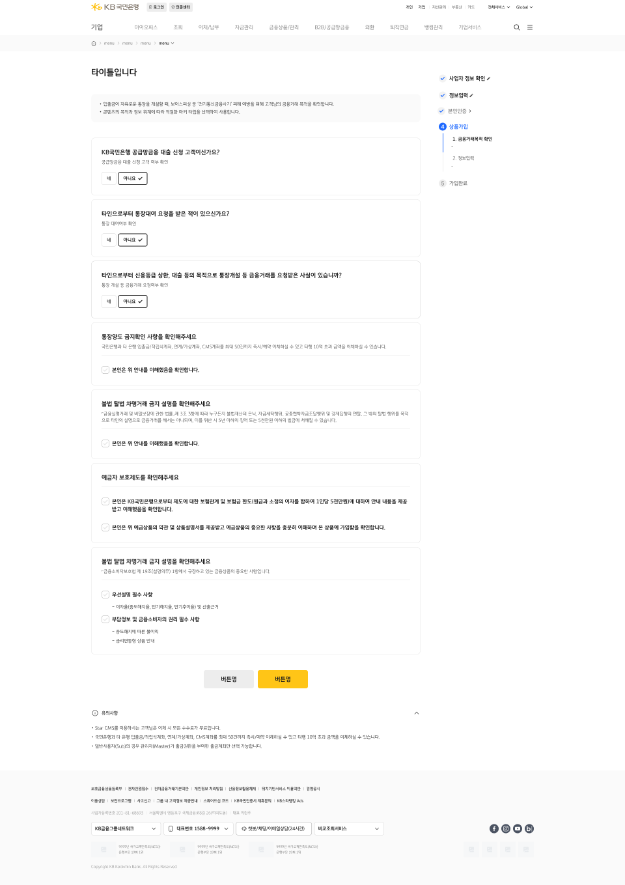

### 43.4. 재현 검수

1. Main 1012 + gap 32 + Right 316, 상단 y=205와 Footer y=2366을 확인한다.
2. 카드 7개·gap 12, 질문 3개 selected 상태, 확인 6개 unchecked 상태 및 원형 연결을 확인한다.
3. 설명 1줄/2줄, 확인 문구 2줄 및 하위 들여쓰기 차이에 따른 카드 높이 177/194/214/246/330을 확인한다.
4. 오른쪽 완료·현재·예정 상태와 본인인증 일반 프레임을 구분하고 하위 2단계·서체를 확인한다.
5. 원본 BODY의 누락 폰트는 0이었다. 생성 화면에서도 필수 서체·잘림·겹침, 실제 안내·최신 승인 문구·액션, 지정 Footer 인스턴스를 한 번 검수한다. 통과한 검수는 반복하지 않는다.

## 44. 패턴 V — 오른쪽 단계 표시 없는 전체 정보 입력

### 44.1. 출처·셸·영역 배치

- [원본 브랜치 화면](https://www.figma.com/design/ftIWLlgj5Ldgt1uyQu9Gb8/branch/GDnwWiuiGzIZA734GOm3Yr?node-id=16116-77573): `정보입력_우측 스텝인디게이터가 없는 경우`, 1920 × 2652.
- 실제 조회한 브랜치 키는 `GDnwWiuiGzIZA734GOm3Yr`, 페이지 `Templates (작성중)`(`15115:110263`)다.
- 흰색 Vertical 화면, gap 0. HEADER 157은 GNB 108 → Breadcrumbs 49 순서다. BODY는 (240,157), 1440 × 2143, padding 48 40, Vertical gap **48**이다.
- 유효 콘텐츠 x=280, 너비 **1360**이며 오른쪽 StepIndicator나 LNB가 없다. 41장의 1012px Main과 빈 오른쪽 열을 남기는 구조로 만들지 않는다.
- FOOTER는 (0,2300), 1920 × 352다. 신규 화면은 13장의 지정 Footer 인스턴스를 사용한다.
- BODY 직접 자식은 Container 1~10이며, Container 2 안에 같은 이름의 래퍼가 한 번 더 있다. 중복 이름을 정리할 때도 기존 부모·개수·순서·역할을 임의로 바꾸지 않는다.

| Container | 내용 | y / 높이 |
| --- | --- | --- |
| 1 | 페이지 제목 | 205 / 36 |
| 2 | 상단 안내 | 289 / 86 |
| 3 | 출금계좌·비밀번호 | 423 / 179 |
| 4 | 가입기간 | 650 / 170 |
| 5 | 안내 + 금액·쿠폰 사용 | 868 / 343 |
| 6 | 등록 선택·텍스트 버튼 | 1259 / 153 |
| 7 | 계약서류 수신 방법·이메일 | 1460 / 266 |
| 8 | 권유직원 검색 | 1774 / 170 |
| 9 | Button Area | 1992 / 56 |
| 10 | 유의사항 Accordion | 2096 / 156 |

제목 Container는 실제 141 × 36이며 다른 콘텐츠는 1360px다. 높이 검산: 콘텐츠 합계 1615 + 간격 48 × 9 + 상하 padding 96 = BODY 2143, 전체 157 + 2143 + 352 = 2652다.

### 44.2. 제목·안내·표 공통 규격

- 페이지 제목 “타이틀입니다”: KBFG Text Bold 26/36 #1C1C1C.
- 각 입력 섹션은 Title / Headline 28px → gap **20** → 본문이다. 제목은 “타이틀입니다”, Bold **20/28** #1C1C1C다. 자리표시자를 실제 업무 제목으로 교체한다.
- 상단 Infobox / FullWidth: 1360 × 86, padding 20 24, radius 12, #FAFAFA. Slot의 1px padding을 포함해 내부 본문은 x=305, 너비 1310, 불릿 20px 2행 + gap 4다.
- 상단 문구의 “00:00 ~ 00:00”은 시간 자리표시자다. 휴일·인증·해지 관련 안내도 화면의 샘플이며 실제 상품 정책으로 일반화하지 않는다.
- 표는 실제 GRID 2열, 열 너비 **180 + 1180 = 1360**, 행·열 gap 0이다. top stroke 1px #444444, 왼쪽 Header fill #F2F2F2·stroke #E5E5E5, 오른쪽 Cell fill #FFFFFF·stroke #EDEDED다.
- Header/Cell padding은 12 16, Header 텍스트 Medium 14/20 #444444다. Cell의 실제 입력 시작 x는 **476**이며 입력을 전체 1180px로 늘리지 않는다.
- 원형은 Table / Header default/onlyNumber=false, Table / Cell last/onlyNumber=false다.
- 표 높이는 섹션별 **131 / 122 / 187 / 65 / 122 / 122**다. 네 번째 표는 프레임 높이 65인데 실제 행 y=1308, 높이 65로 프레임 아래 1px까지 이어진다. 다른 표의 top line 포함 계산을 일괄 적용해 원본 배치를 바꾸지 않는다.

### 44.3. 표 안 입력 패턴

**출금계좌·비밀번호**

- 표 (280,471), 1360 × 131, 65px 2행이다. 계좌 InputField는 (476,484), **400 × 40**, select-default/entered=true로 은행 아이콘·은행명·계좌번호·chevron을 표시한다.
- 비밀번호 InputField는 (476,549), 400 × 40, entered=false. 오른쪽 “확인” secondary small은 (884,549), **50 × 40**, gap **8**이다. 두 요소가 차지하는 너비는 458이다.
- 계좌 값은 Bold 14/20 #1C1C1C, 은행명 Medium 14/20 #6E6E6E, 비밀번호 자리표시자는 Bold 14/20 #8D8D8D다.

**가입기간**

- 표 (280,698), 1360 × 122, 실제 행 121px. 위 preset은 y=711, 높이 40, “6개월/12개월/24개월/36개월” 너비 **58/67/67/67**, 간격 **4**다.
- 아래 직접 입력은 (476,767), 400 × 40, 단위 “개월”을 오른쪽에 둔다. 위 버튼과 아래 입력 사이 gap **16**, 전체 콘텐츠 높이 96이다.
- amount 타입의 바깥 InputField는 entered=true지만 내부 FilledStyle은 entered=false이며 화면에 자리표시자가 보인다. 원형의 entered 이름만으로 실제 숫자가 입력되었다고 판단하지 않는다.

**금액·쿠폰/포인트리**

- Title 28 → gap 20 → Infobox / Card **88** → gap 20 → Table **187** = 343이다.
- Infobox / Card는 (280,916), padding 20, radius **20**, #FAFAFA, 불릿 20px 2행 + gap 8이다. FullWidth 안내 박스의 radius 12·padding 20 24와 구분한다.
- 표 첫 행 (y=1025, h=121) 위 금액 버튼은 (476,1037), 높이 40, 표시 “1000만/500만/300만/100만원”, 너비 **71/63/63/75**, gap 4다.
- 직접 입력은 (476,1093), 400 × 40, “매달 넣을 금액 직접 입력”과 단위 “원”이다. 원본 행 라벨은 **가입기간**이어서 내용과 맞지 않는다. 생성 시 금액이라는 실제 역할에 맞는 승인된 라벨을 사용한다.
- 두 번째 행(y=1146, h=65)은 “KB금융쿠폰/포인트리 사용”. SelectButton은 (476,1158), 400 × 40, word/single이다. “사용” 58px, gap **6**, “사용안함” 103px이며 후자가 selected=true다.

**등록 선택**

- 표 프레임 (280,1307), 1360 × 65. SelectButton은 (476,1320), 400 × 40, “등록” 58px / gap 6 / “등록안함” 103px이며 후자가 selected=true다.
- 아래 TextButton은 (280,1392), 1360 × 20. 실제 라벨 “텍스트버튼”은 Medium 14/20 #1C1C1C이며 16px chevron과 gap 2다. 인스턴스 전체 너비와 실제 라벨·아이콘 너비를 구분한다.
- 단일 선택의 미선택 테두리는 #D4D4D4, 선택 테두리는 #1C1C1C와 체크 아이콘이다. 선택은 화면 샘플이며 모든 상품의 기본값으로 고정하지 않는다.

**이메일 수신 방법**

- 표 (280,1508), 1360 × 122. Slot은 (476,1521), **500 × 96**, Vertical gap **16**이다.
- SegmentedControl medium/enabled: 192 × 40, “이메일/SMS” 각 96px, 이메일이 selected=true다.
- 아래 email InputField: (476,1577), **500 × 40**, entered=false. 아이디·@·도메인 선택·직접입력 영역을 원형 내부 구성으로 유지한다.
- 선택 항목은 Bold 14/20 #1C1C1C, 미선택은 Medium 14/20 #8D8D8D다. 회색을 disabled로 오인하지 않는다.
- 아래 별표 안내는 (280,1650), 1360 × 76, 20px 3행 + gap 8, Light 14/20 #1C1C1C다. 계약서류 발송·메뉴 경로는 출처 문구이며 실제 기획을 적용한다.

**권유직원 검색**

- 표 (280,1822), 1360 × 122. Slot은 (476,1835), 400 × 96, gap 16이다.
- SegmentedControl 384 × 40, “지점명/직원이름/직원번호/없음” 각 96px, 지점명 selected=true다.
- 검색 InputField는 (476,1891), 400 × 40, search/entered=false, 오른쪽 검색 아이콘과 “검색어를 입력하세요”를 표시한다.

### 44.4. 하단 액션

- ButtonGroup은 (800,1992), **320 × 56**, 각 154 × 56, gap 12, tertiary → primary 순서다. fill #EDEDED / #FFC517, 라벨 Bold 18/25 #1C1C1C, 두 버튼 모두 enabled다.
- 유의사항 Accordion은 1360 × 156, medium/basic/standard/expanded=true. 제목 Bold 14/20 #444444, Header 56, 본문 20px 3행 + gap 8, Expand Area padding 8 0 16이다.
- 원본 버튼명·표 라벨·상품값·유의문은 예시이며 실제 동작·검증·계좌·상품 정책으로 고정하지 않는다.

## 45. 패턴 W·X·Y — 오른쪽 요약을 둔 개별 정보 입력

### 45.1. 출처와 공통 배치

- [W — 출금계좌 입력](https://www.figma.com/design/yojs1BhPrWxLmDDrpg1ihD?node-id=5090-33112): 1920 × 1417.
- [X — 가입기간 입력](https://www.figma.com/design/yojs1BhPrWxLmDDrpg1ihD?node-id=5090-33272): 1920 × 1341.
- [Y — 금액·쿠폰 사용 입력](https://www.figma.com/design/yojs1BhPrWxLmDDrpg1ihD?node-id=5090-33435): 1920 × 1559.
- 세 원본 모두 프레임 이름은 `화면ID`, 파일 `yojs1BhPrWxLmDDrpg1ihD`, 페이지 `05.기타(기획 v0.6)`다. 실제 본문을 기준으로 위 패턴명을 붙였다.
- HEADER 157, BODY (240,157), 너비 1440, padding 48 40, Horizontal gap **32**다. BODY 직접 자식은 **Container 1(Main), Container 2(오른쪽 요약)** 두 개다. 41장의 바깥 Container 내부 Main/Right 구조와 혼동하지 않는다.
- 왼쪽 (280,205), 너비 **1012**, Vertical gap 48. 오른쪽 (1324,205), **316 × 704**, padding 20, radius 20, 내부 276 × 664다. 오른쪽은 LNB가 아닌 StepIndicator다.
- 페이지 제목 “가입에 필요한 정보들을 입력해주세요”: 398 × 36, KBFG Text Bold 26/36 #1C1C1C.
- 공통 상단 Infobox는 (280,289), 1012 × **106**, padding 20 24, radius 12, #FAFAFA다. 44장의 86px와 같은 안내가 **좁은 너비에서 두 번째 문장 2줄**이 되어 20px 높아진다.
- Slot 964 × 66, padding 1, 내부 962 × 64 = 불릿 20 + gap 4 + 불릿 40이다. 첫 본문 시작 (317,310), 다음 (317,334), Light 14/20 #1C1C1C다.

| 영역 | W | X | Y |
| --- | --- | --- | --- |
| Main 높이 | 812 | 736 | 954 |
| BODY 높이 | 908 | 832 | 1050 |
| 입력 섹션 y / 높이 | 443 / 266 | 443 / 190 | 443 / 408 |
| 하단 버튼 y | 757 | 681 | 899 |
| Accordion y / 높이 | 861 / 156 | 785 / 156 | 1003 / 156 |
| Footer y / 높이 | 1065 / 352 | 989 / 352 | 1207 / 352 |

Main 높이는 제목 36 + 상단 안내 106 + 입력 섹션 + 버튼 56 + Accordion 156 + gap 48 × 4다. BODY는 Main 높이 + padding 96이다. 각 Footer는 신규 생성 시 13장의 지정 인스턴스로 넣는다.

### 45.2. W — 계좌·비밀번호를 세로로 배치

- Title / Headline (280,443), 1012 × 28, “타이틀입니다”, Bold 20/28 #1C1C1C.
- gap 20 아래 입력 박스는 (280,491), **1012 × 218**, padding 32, radius 12, stroke #E5E5E5. 실제 내부 시작은 **(313,524)**, 너비 946이다. 테두리 포함 실제 인셋 33을 보존한다.
- InputField Group 946 × 152, Vertical gap **16**. 계좌 필드 400 × **68** + gap 16 + 비밀번호·버튼 행 높이 68 = 152다.
- 각 필드 68은 라벨 20 + gap 8 + 실제 입력 40이다. 라벨은 Bold 14/20 #1C1C1C다. V의 표 라벨 Medium 14/20 #444444를 그대로 적용하지 않는다.
- 계좌 라벨 (313,524), 입력 y=552, 400 × 40, select-default/entered=true다. 비밀번호 라벨 y=608, 입력 y=636, 400 × 40, entered=false다.
- 비밀번호 옆 “확인”은 (721,636), 50 × 40, gap 8이다. 라벨 높이를 포함한 필드 상단에 맞추지 않고 실제 입력칸과 정렬한다.
- 박스 높이는 padding 64 + 테두리 2 + 내부 152 = 218이다.
- 하단은 primary large “다음” **1개**, (709,757), 154 × 56, Main의 중앙이다. count=multi라는 ButtonGroup 원형 이름만 보고 버튼을 추가하지 않는다.

### 45.3. X — 기간 입력과 preset을 한 행에 배치

- Title / Headline은 (280,443), 1012 × **64**다. 제목 Bold 20/28 아래 gap 12, “가입기간은 가입 후 변경할 수 없어요.” 설명 Light **16/24** #444444가 있다.
- 입력 박스는 (280,527), **1012 × 106**, padding 32, radius 12, stroke #E5E5E5다. 내부 한 행은 (313,560), **679 × 40**이다.
- 직접 입력 **400 × 40**을 먼저 놓고 gap **8** 뒤에 기간 버튼을 놓는다. preset은 “6개월/12개월/24개월/36개월”, 너비 58/67/67/67, 서로 gap **4**다.
- 전체 400 + 8 + (58 + 67 × 3 + 4 × 3) = 679다. V처럼 preset 위·입력 아래의 두 줄 구성으로 바꾸지 않는다.
- 오른쪽 단위 “개월”을 포함한 amount 입력이며 바깥 entered=true/내부 FilledStyle entered=false가 공존한다. 실제 표시된 자리표시자와 원형 내부 상태를 함께 확인한다.
- 한 줄 40 + padding 64 + 테두리 2 = 박스 106이다. 하단 primary “다음”은 (709,681), 154 × 56이다.
- 변경 불가 문장은 출처의 문구이며 모든 상품의 기간 변경 정책으로 확대하지 않는다.

### 45.4. Y — 안내·금액·쿠폰·보조 액션

- 입력 섹션 (280,443), 1012 × **408**, Vertical gap 20이다. 제목 28 + gap 20 + 보조 Infobox 86 + gap 20 + 입력/텍스트버튼 묶음 254 = 408이다.
- 보조 Infobox (280,491), 1012 × 86는 FullWidth다. V의 Infobox / Card 88·radius 20과 구분한다. 이 안의 컴포넌트 설명 샘플은 실제 안내로 교체한다.
- 입력 박스 (280,597), **1012 × 218**, padding 32, radius 12, stroke #E5E5E5, Vertical gap **16**이다.
- 첫 행 (313,630), **692 × 68**. 라벨 20 + gap 8 + 금액 입력 40이다. 원본 라벨은 “가입기간”이지만 단위는 원·금액 preset이므로 업무 라벨 불일치를 실제 기획에 맞게 정리한다.
- InputField 400px 뒤 gap 8, “1000만/500만/300만/100만원” 너비 71/63/63/75·gap 4를 가로로 놓는다. 400 + 8 + (71 + 63 + 63 + 75 + 4 × 3) = 692다.
- 금액 입력과 preset은 y=658로 정렬한다. 다음 쿠폰 SelectButton은 (313,714), **167 × 68**, 라벨 Bold 14/20 + gap 8 + 선택 행 40이다.
- 선택 행 y=742: “사용” 58 + gap **6** + “사용안함” 103 = 167. 사용안함 selected=true, 테두리 #1C1C1C와 체크 표시다. 미선택은 #D4D4D4다.
- 박스 아래 gap **16** 뒤 TextButton은 (280,831), 1012 × 20, “텍스트버튼” Medium 14/20 #1C1C1C와 chevron 16이다. `Text Button`이라는 원본 래퍼 안에는 입력 박스도 있으므로 현재 구성에 맞게 이름을 재판정한다.
- 하단 ButtonGroup은 (626,899), **320 × 56**, tertiary/primary 각각 154, gap 12다. 둘 다 enabled이며 “버튼명”은 자리표시자다.
- 3가지 입력 섹션은 일반 프레임 박스와 실제 DS 필드·버튼을 조합한 것이다. 박스 이름만으로 Card 컴포넌트 인스턴스라고 기록하지 않는다.

### 45.5. 오른쪽 요약의 공통 구조와 원본 상태 차이

- 첫 StepIndicator는 (1344,225), 276 × **508**, 상위 “사업자 정보 확인” inProgress다. 번호는 Pretendard SemiBold 17/24 #FFFFFF, 제목은 KBFG Text Bold 16/24 #1F6AFF다.
- 내부 상위 행 32 + gap 4 + 하위 8개 × 59 = 508이다. 하위 항목은 x=1360, 너비 212, y=261부터 **59px 간격**이다.
- 하위 순서는 **출금계좌 → 가입기간 → 가입금액 → 자동이체 → 비과세종합저축 → 계약서류 받을방법 → 만기알림 설정 → 권유직원 선택**이다.
- 현재 하위 항목은 Bold 14/20 #1C1C1C, 요약값 Medium 12/17 #1C1C1C다. 예정 항목은 Medium 14/20 및 Light 12/17 #6E6E6E다.
- 첫 화면의 계좌 요약은 “국민은행 000000-00-000000”, 기간 요약은 “12개월”, 나머지는 “-”인 샘플이다. 본문 실제 계좌 예시와 다르므로 연결된 동기화가 구현되어 있다고 단정하지 않는다.
- 다음 상위 단계는 정보확인(y=753), 약관동의(805), 가입완료(857), 각각 276 × 32, notStarted다. 상위 인스턴스 사이 gap 20이며 내부 전체 높이는 508 + 32 × 3 + 20 × 3 = 664다.

| 출처 | 실제 하위 상태 |
| --- | --- |
| W — 출금계좌 | 출금계좌 inProgress, 나머지 7개 notStarted |
| X — 가입기간 | **W와 동일**: 출금계좌 inProgress, 가입기간 notStarted |
| Y — 금액 | **출금계좌·가입기간·가입금액 completed**, 나머지 5개 notStarted |

X의 본문과 현재 하위 단계가 다르고, Y는 금액 입력 화면인데 가입금액까지 completed다. 원본 상태를 출처별로 보존하되 신규 화면에서는 실제 업무 진행 상태에 맞게 적용한다. 이를 자동 전이 규칙으로 학습하거나 원본에 없는 inProgress 단계를 추정해 기록하지 않는다.

세 화면의 Accordion은 동일한 standard/basic/medium/expanded=true, 1012 × 156이며 Header 56, Expand Area 100, 실제 불릿 슬롯 76이다. 세 출처의 Star CMS·이체·권한 유의문은 샘플로 구분하고 필요한 업무 문구로 교체한다.

## 46. 전체형·개별 입력형의 원형 키·이미지·검수

### 46.1. 원형을 구분하는 기준

브랜치 V와 사고신고 사본 W·X·Y는 이름·크기가 같아도 component key가 다르다. 아래는 이번 조회에서 확인한 원형이며, 기준 라이브러리에서 변형·슬롯·토큰을 대조해 가져오고 detach하지 않는다. 사용자 정의 래퍼·Container 명명은 12장을 따른다.

#### V — 브랜치 원형

| 컴포넌트 | 관측 변형 | main component key |
| --- | --- | --- |
| Title / Page | align=left | `fea4cdb5f41c8b7b949ab39623587a8646bdc860` |
| Infobox / FullWidth | Infobox / FullWidth | `14346e87099b727159e6e8d7cfb168e4abffb498` |
| Title / Headline | align=left | `cd6a27c70df81353de0a000dd9666a8de67326cd` |
| Table / Header | variant=default, onlyNumber=false | `d6f6aa68c8312a786fa075924789390b57f50f20` |
| Table / Cell | variant=last, onlyNumber=false | `e626ba01a8daa7459cc037df4e92dd501961cd5b` |
| InputField | hover=false, focused=false, disabled=false, entered=true, error=false | `a093b7a53adbf43b22d53daf0b76f7c424513330` |
| Item / Input | variant=select-default, _hover=false, _focused=false, _disabled=false, _entered=true, _error=false | `125ae17bdbfff31b50366a0d46a9df37d017cc1f` |
| InputField | hover=false, focused=false, disabled=false, entered=false, error=false | `6eb7815286692dc574ebe162983fcb9afe06fc05` |
| Item / Input | variant=default, _hover=false, _focused=false, _disabled=false, _entered=false, _error=false | `2da0a30103387cdead791d10a275160ca57d047e` |
| BoxButton | variant=secondary, size=small, hover=false, disabled=false, pressed=false | `6189993d8226c13a73fc1fb3a3bb64b06956ed09` |
| Item / Input | variant=amount, _hover=false, _focused=false, _disabled=false, _entered=true, _error=false | `b692809c9923ce36aa58befd494dca33bd1c6b8b` |
| Infobox / Card | status=info | `9b7a87a64520a9ad8b7554e5cc97c1bd55ef5de0` |
| SelectButton | type=word, variant=single | `ff0eef934cbb6cca7abebb8823083a19c3786a34` |
| TextButton | variant=primary, size=small, hover=false, disabled=false, pressed=false | `fc4c6a2aaa487f6f6a3dcd4c7ea7a1602f7c0b5b` |
| SegmentedControl | size=medium, disabled=false | `1213543158dc74382389e4f350960e6e742d94fa` |
| Item / Input | variant=email, _hover=false, _focused=false, _disabled=false, _entered=false, _error=false | `9a9c642d9f1dd8463adbcb7dada3f76bfb12d76b` |
| Item / Input | variant=search, _hover=false, _focused=false, _disabled=false, _entered=false, _error=false | `9ce41eaee5a714ad605017e2c49da482ddd3e179` |
| ButtonGroup | count=multi, size=large | `d6fa72df43fd699544dbad352e3b60caecb2e139` |
| BoxButton | variant=tertiary, size=large, hover=false, disabled=false, pressed=false | `16865b7cf50ee59e3475a8886ef45eaf7411ffb1` |
| BoxButton | variant=primary, size=large, hover=false, disabled=false, pressed=false | `b0139d7de8a2b88746eb885cc88afb141b1fc954` |
| Accordion | variant=standard, type=basic, size=medium, expanded=true | `18f649bcb9d04acbd270bb44877e5ca42d1c6af9` |

#### W·X·Y — 사고신고 사본 원형

| 컴포넌트 | 관측 변형 | main component key |
| --- | --- | --- |
| Title / Headline | align=left | `bf50f457ca5583c356608499f2a479e58248073a` |
| InputField | hover=false, focused=false, disabled=false, entered=true, error=false | `f689ed1a91c3666eab721996119a0b3540668190` |
| Item / Input | variant=select-default, _hover=false, _focused=false, _disabled=false, _entered=true, _error=false | `f8bed42a8ed0d1e4e4f0634209a7babd6f3e5cf4` |
| InputField | hover=false, focused=false, disabled=false, entered=false, error=false | `6a180f941f7bc12168489ec44f9203d0f3a4e7cc` |
| Item / Input | variant=default, _hover=false, _focused=false, _disabled=false, _entered=false, _error=false | `1a21da059bc9d4f0221961b447fec3e41c87a5f9` |
| BoxButton | variant=secondary, size=small, hover=false, disabled=false, pressed=false | `b20b82eee273f930c668788109e73de668023c03` |
| BoxButton | variant=primary, size=large, hover=false, disabled=false, pressed=false | `d206f834d8d80e5bd6ab306b8033f3c0e5214bc5` |
| Item / Vertical | state=inProgress, depth=1, hover=false | `2232dc849bc42a252539f67b545d887f61a3b523` |
| Item / Vertical | state=inProgress, depth=2, hover=false | `372b1d67bb72ac32649528121eab56461e3819e3` |
| Item / Vertical | state=notStarted, depth=2, hover=false | `6eac8b67ca784693d8d105417dddd5bddff1bf07` |
| Item / Vertical | state=notStarted, depth=1, hover=false | `50fca46a7172d923a82d0dba23c767a5313e7501` |
| Item / Input | variant=amount, _hover=false, _focused=false, _disabled=false, _entered=true, _error=false | `37f87b24570c9f551aabdd03fafd56df1fac43ad` |
| SelectButton | type=word, variant=single | `7b6e4a769ba3ff3401fbc04068873ddcf5128dbd` |
| TextButton | variant=primary, size=small, hover=false, disabled=false, pressed=false | `95687195c8b0873f0e13393cf059964ecfde2604` |
| BoxButton | variant=tertiary, size=large, hover=false, disabled=false, pressed=false | `44749aad1a2b8b103e2068161e6058a3ee80a0a6` |
| Item / Vertical | state=completed, depth=2, hover=false | `a45c78a3d618cfadbef50a7a27e509f0af3f3169` |


StepIndicator / Vertical은 `6d64a53e165cf7f9d92e29637bba2a700ef84253`, Title / Page는 `366007b354df25708d9dce4a7788c2b44e30dba3`, Infobox / FullWidth는 `5fb7ce75dbc07c0aeca6e8cd5bfb876c0d0f7892`로 앞 장의 사본과 같다. 표에는 원형 이름을 그대로 기록했으며 입력값·자리표시자·실제 내부 상태를 이름만으로 판단하지 않는다.

### 46.2. 원본 삭제 대비 이미지

원본 그대로 0.5배 PNG, 너비 960px로 저장소에 보존했다. 제작 시 치수는 위 논리 px를 따른다. 임시 제목·계좌·요약값·시간·안내문은 이미지에 남겨 출처를 확인할 수 있게 했다.

#### V — 오른쪽 단계 표시 없는 전체형

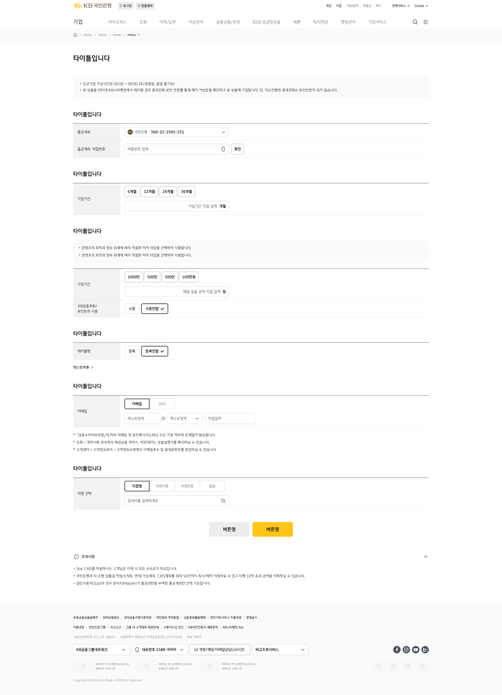

#### W — 출금계좌 개별 입력

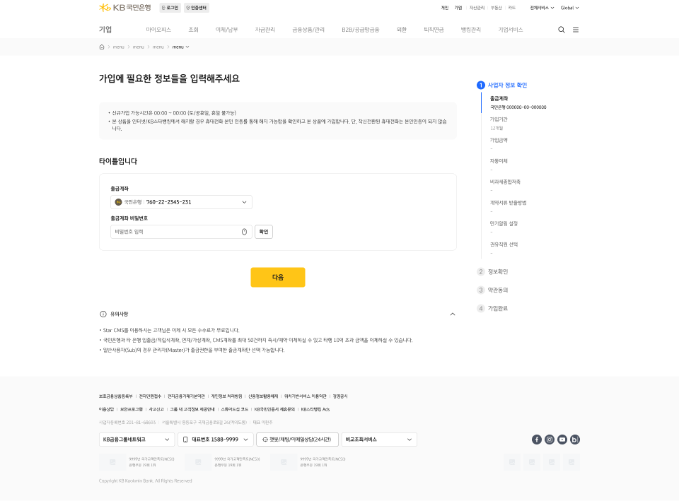

#### X — 가입기간 개별 입력

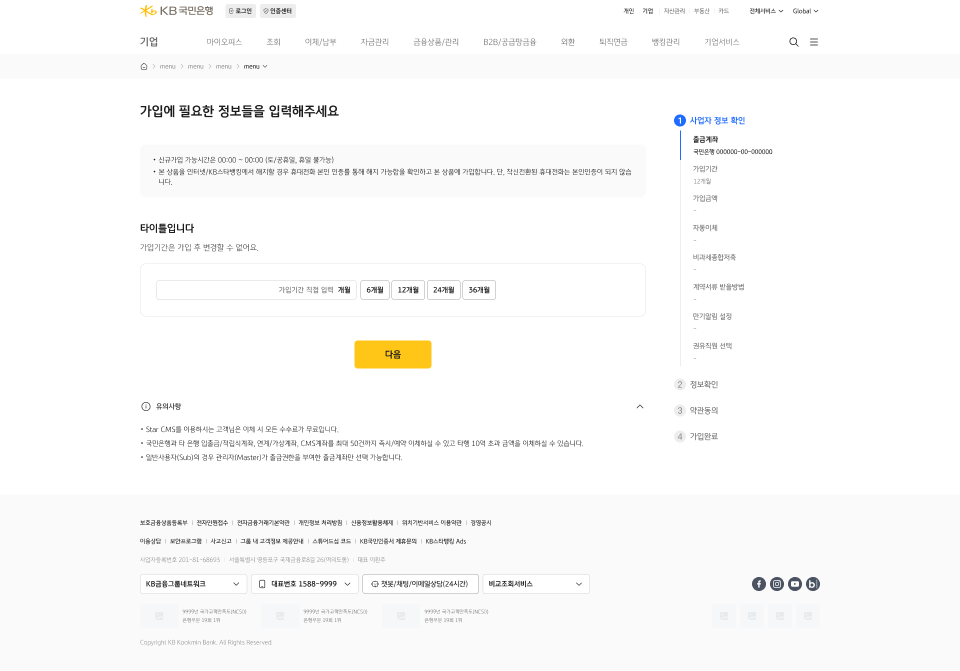

#### Y — 금액·쿠폰 개별 입력

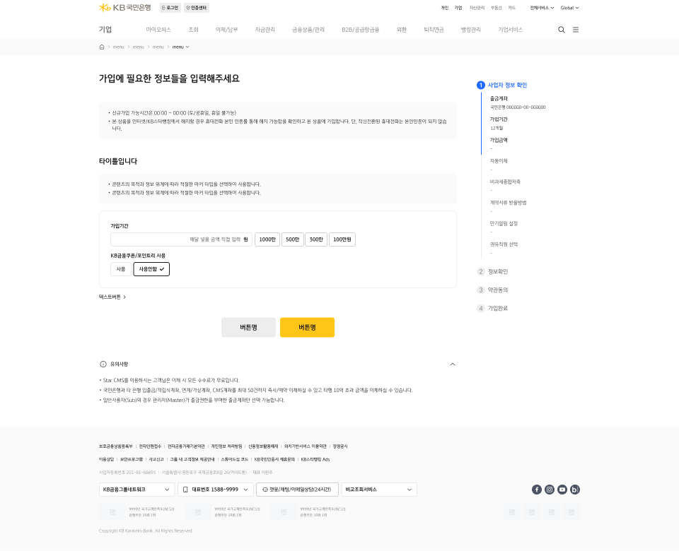

### 46.3. 재현 검수

1. V는 1360px 전체형·Container 10개, W~Y는 1012 + 32 + 316의 2열·BODY 직접 Container 2개임을 확인한다.
2. V의 GRID 표 180/1180, 400px 입력과 500px 이메일 입력, preset 4px·확인 버튼 8px·선택 6px·Segment 후속 입력 16px 간격을 확인한다.
3. W의 라벨 포함 68px 필드·확인 버튼 하단 정렬, X의 679px 한 행·64px 제목, Y의 692px 행·선택 라벨·보조 TextButton을 확인한다.
4. 긴 안내 문장의 86→106px 줄바꿈, 입력 박스 106/218px, ButtonGroup 개수와 Main 중앙 정렬을 확인한다.
5. 우측 508px 상세 + 32px 상위 3개, 출처별 상태 불일치를 실제 기획과 대조한다. V에 오른쪽 요약을 자동 추가하지 않는다.
6. 4개 원본 BODY의 누락 폰트는 모두 0이었다. 생성 시 필수 서체·잘림·겹침·한 줄 표의 1px 경계, 실제 업무 문구·선택 상태·입력 검증 및 지정 Footer 인스턴스를 한 번 검수한다.

## 47. 패턴 Z — 왼쪽 단계 요약과 이메일 수신 입력

### 47.1. 출처와 좌우 배치

- [원본 화면](https://www.figma.com/design/yojs1BhPrWxLmDDrpg1ihD?node-id=5090-35245): 프레임 `화면ID`, **1920 × 1457**.
- 파일 `yojs1BhPrWxLmDDrpg1ihD`, 페이지 `05.기타(기획 v0.6)`.
- 이번 화면은 **왼쪽 StepIndicator → 오른쪽 Main** 배치다. 45장의 오른쪽 단계 요약을 모든 화면에 강제하는 규칙으로 해석하지 않는다. 단계 요약은 LNB가 아니다.
- 흰색 Vertical 루트, gap 0. HEADER 높이는 157이며 화면 이미지에서 GNB → Breadcrumbs 순서를 확인했다.
- BODY: (240,157), 1440 × **948**, Horizontal gap 32, padding 48 40.
- 왼쪽 요약: (280,205), **316 × 704**, padding 20, radius 20, #FFFFFF. Main: (628,205), **1012 × 852**, Vertical gap 48.
- BODY 자식 순서는 실제로 `Container 2`(왼쪽 요약) → `Container 1`(오른쪽 Main)이다. 출처의 역순 이름은 이름 정리 대상과 실제 배치 순서를 구분해 기록한다. 12장 기준으로 명명을 재판정하되 부모·역할·좌우 순서를 임의로 바꾸지 않는다.
- Footer: (0,1105), 1920 × 352. 신규 생성은 13장의 지정 Footer 컴포넌트 인스턴스를 사용한다.

| Main 영역 | 좌표 (x,y) | 크기 |
| --- | --- | --- |
| 페이지 제목 | (628,205) | 1012 × 36 |
| 상단 Infobox / FullWidth | (628,289) | 1012 × 106 |
| 수신 방법 입력 섹션 | (628,443) | 1012 × 306 |
| Button Area | (628,797) | 1012 × 56 |
| 유의사항 Accordion | (628,901) | 1012 × 156 |

Main 높이는 36 + 106 + 306 + 56 + 156 + 48 × 4 = 852, BODY는 852 + 96 = 948, 전체 157 + 948 + 352 = 1457이다.

### 47.2. 제목·상단 안내와 이메일 입력 박스

- 페이지 제목 “가입에 필요한 정보들을 입력해주세요”: KBFG Text Bold 26/36 #1C1C1C, 실제 텍스트 398 × 36.
- 상단 안내는 45장과 같은 106px FullWidth 형태다. padding 20 24, radius 12, fill #FAFAFA. Slot은 964 × 66, padding 1, 내부 962 × 64, gap 4다.
- 안내 본문은 x=665, 너비 950, Light 14/20 #1C1C1C이며 두 번째 문장이 40px 두 줄이다. 시간 “00:00 ~ 00:00”과 휴일·해지·인증 문장은 샘플로 구분하고 실제 상품 기획을 적용한다.
- 섹션 제목은 (628,443), 1012 × 28의 Title / Headline, “타이틀입니다”, Bold 20/28 #1C1C1C다.
- gap 20 아래 입력 박스: **(628,491), 1012 × 162**, padding 32, radius 12, 1px stroke #E5E5E5, 별도 fill 없음.
- 실제 내부 InputField Group은 **(661,524), 500 × 96**, Vertical gap **16**이다. 테두리 포함 인셋은 33이며 96 + padding 64 + 테두리 2 = 162다.
- SegmentedControl: (661,524), **192 × 40**, medium/enabled. “이메일” 96px selected=true, “SMS” 96px selected=false이며 항목 사이 gap은 0이다. 바깥 원형의 gap=8을 두 항목 사이 여백으로 적용하지 않는다.
- 선택 항목은 2px #1C1C1C 테두리·#FFFFFF, 라벨 Bold 14/20 #1C1C1C다. 미선택 SMS는 Medium 14/20 #8D8D8D이며 disabled=false다.
- 이메일 InputField: **(661,580), 500 × 40**, entered=false/error=false/disabled=false, 내부 Item / Input은 variant=email이다. 아이디·@·도메인·직접입력 구성을 원형 내부 계층으로 유지한다.
- 일반 placeholder “텍스트영역”, “직접입력”은 Bold 14/20 #8D8D8D, @는 Bold 16/24 #8D8D8D다. 유효성 검사·직접입력 전환 동작은 정적 화면만으로 확정하지 않는다.

### 47.3. 박스 밖 별표 안내와 버튼

- 입력 박스 아래 gap **20** 뒤 TextList Group은 **(628,673), 1012 × 76**이다.
- star/14/depth=1 인스턴스 3행, 높이 20, gap 8. 마커 x=628, 본문 x=640, 본문 너비 1000이다.
- **KBFG Text Light 14/20 #6E6E6E**다. 44장 전체형의 동일 문구 #1C1C1C와 다르므로 출처별 색상을 보존한다.
- 안내 내용은 계약서류 발송·확인·고객정보 변경 경로다. 실제 메뉴·법률 적용·수신 정책을 화면 샘플만으로 확정하지 않는다.
- 원본 `Text Button` 래퍼는 실제 TextButton이 아니라 **입력 박스 + TextList Group**을 담은 FRAME이다. 이름을 근거로 버튼을 생성하지 않으며 현재 자식 구성에 따라 이름을 다시 정한다.
- 입력 섹션 높이는 제목 28 + gap 20 + 박스 162 + gap 20 + 목록 76 = 306이다.
- ButtonGroup: **(974,797), 320 × 56**. tertiary (974,797) → primary (1140,797), 각각 154 × 56, gap 12다. **오른쪽 Main의 중앙**에 맞추며 전체 화면 중앙으로 이동하지 않는다.

## 48. 패턴 AA — 직원 검색과 제목 옆 보조 버튼

### 48.1. 출처와 영역 배치

- [원본 화면](https://www.figma.com/design/yojs1BhPrWxLmDDrpg1ihD?node-id=5090-35414): 프레임 `화면ID`, **1920 × 1393**, Z와 같은 파일·페이지.
- HEADER 157, BODY (240,157), **1440 × 884**, padding 48 40, Horizontal gap 32.
- 이번에는 **왼쪽 Main (280,205), 1012 × 788 → 오른쪽 요약 (1324,205), 316 × 704** 순서다. BODY 직접 자식은 Container 1 → Container 2다.
- Main은 Vertical gap 48이며 페이지 제목·상단 106px Infobox의 크기·서체는 Z와 같다. 좌표는 각각 (280,205)/(280,289)다.
- Footer: (0,1041), 1920 × 352. 신규 화면은 13장의 지정 인스턴스를 사용한다.

| Main 영역 | y / 높이 |
| --- | --- |
| 페이지 제목 | 205 / 36 |
| 상단 안내 | 289 / 106 |
| 직원 검색 섹션 | 443 / 242 |
| Button Area | 733 / 56 |
| 유의사항 Accordion | 837 / 156 |

36 + 106 + 242 + 56 + 156 + 48 × 4 = Main 788, BODY 788 + 96 = 884, 전체 157 + 884 + 352 = 1393이다.

### 48.2. 제목 행과 직원선택 액션

- 제목 행은 **(280,443), 1012 × 28**, Horizontal이다. Title / Headline 인스턴스는 **951 × 28**, “직원선택” BoxButton은 **(1231,443), 61 × 28**이다.
- 제목은 “타이틀입니다”, KBFG Text Bold 20/28 #1C1C1C. 보조 버튼은 secondary/**xsmall**, padding 2 6, radius 4, fill #FFFFFF, stroke 1px #A5A5A5다.
- “직원선택” 라벨은 **Bold 12/17 #1C1C1C**다. small 40px 버튼으로 확대하거나 하단 액션으로 옮기지 않는다.
- 원본 제목 행의 itemSpacing 속성은 **12**지만 실제 측정에서 Title 오른쪽과 버튼 왼쪽이 모두 x=1231이다. **실제 배치 951 + 61 = 1012**와 속성값을 구분한다. 12px를 다시 더해 1024px로 넘치게 만들지 않는다.
- 직원선택 버튼의 팝업·검색 결과·선택 확정 동작은 이번 정적 화면에서 확인되지 않았다.

### 48.3. 직원 검색 박스

- 제목 아래 gap 20, 박스 **(280,491), 1012 × 194**, padding 32, radius 12, 1px stroke #E5E5E5, 별도 fill 없음.
- 내부 InputField Group: **(313,524), 400 × 128**, Vertical gap **12**다.
- Title / Element “직원 선택”은 (313,524), 높이 20, Bold 14/20 #1C1C1C다.
- 아래 `Segmented / Input` 실제 Auto Layout은 **(313,556), 400 × 96**, Vertical gap **16**이다. Segment와 후속 입력을 함께 묶는 12장 규칙에 맞는 참조다.
- SegmentedControl: (313,556), **384 × 40**, medium/enabled. “지점명 → 직원이름 → 직원번호 → 없음” 순서, 각 96px, 항목 간 gap 0이다.
- 지점명 selected=true, Bold 14/20 #1C1C1C, 2px #1C1C1C 테두리다. 나머지는 selected=false/disabled=false, Medium 14/20 #8D8D8D다. 회색을 비활성 상태로 해석하지 않는다.
- 검색 InputField: **(313,612), 400 × 40**, entered=false/error=false/disabled=false, 내부 variant=search다. “검색어를 입력하세요”는 Bold 14/20 #8D8D8D이며 오른쪽 검색 아이콘을 유지한다.
- 높이 검산: 라벨 20 + gap 12 + Segment 40 + gap 16 + 검색 40 = 내부 128, padding 64 + 테두리 2 + 내부 128 = 박스 194다.
- InputField Group에는 제목·Segment/입력 조합이 있으므로 사용자 정의 이름은 12장에 따라 현재 구성에 맞게 재판정한다. 원형 내부 이름과 인스턴스 연결은 보존한다.
- ButtonGroup: **(626,733), 320 × 56**, tertiary → primary 각 154 × 56, gap 12다.

## 49. Z·AA의 공통 상태·원형 키·보존 이미지

### 49.1. 단계 요약과 공통 하단 규격

- Z의 요약 내부는 **(300,225)**, AA는 **(1344,225)**, 모두 **276 × 664**다. 상세 StepIndicator 508 + gap 20 + 예정 단계 32 + gap 20 + 32 + gap 20 + 32 = 664다.
- 상위 “사업자 정보 확인”은 inProgress, 하위 출금계좌·가입기간·가입금액은 **completed**, 나머지 5개는 notStarted다. 하위 순서는 45.5장을 따른다.
- 완료 하위 항목은 제목 **Medium 14/20 #1C1C1C**, 요약값 **Light 12/17 #1C1C1C**다. 현재 하위 단계의 Bold/Medium 조합과 구분한다. 예정 항목은 같은 크기·굵기의 #6E6E6E다.
- 두 화면의 본문은 수신 방법/직원 검색인데 해당 하위 단계는 아직 notStarted다. 출처의 실제 상태를 보존하되 신규 생성에서는 실제 업무 진행 상태와 일치시키며 자동 전이 정책으로 일반화하지 않는다.
- 계좌 요약 “국민은행 000000-00-000000”, 가입기간 “12개월”, 나머지 “-”는 예시다.
- 두 하단 버튼은 radius 6, tertiary #EDEDED / primary #FFC517, enabled, 라벨 Bold 18/25 #1C1C1C다. “버튼명”은 실제 액션 라벨로 교체한다.
- Accordion은 standard/basic/medium/expanded=true, 1012 × 156이다. Header 56, Expand Area padding 8 0 16, 슬롯 불릿 20px 3행 + gap 8 = 76이다.
- 제목 “유의사항”은 Bold 14/20 #444444, 본문 Light 14/20 #1C1C1C다. Star CMS·이체·권한 유의문은 앞선 참조와 같은 샘플이며 실제 기획을 적용한다.
- 이번 화면의 왼쪽/오른쪽 배치는 각각 별도 참조다. 기존 화면의 구조 정리만 요청받았을 때 요약 열을 반대편으로 이동하지 않는다.

### 49.2. 이번 사본에서 관측한 main component key

같은 Segment·입력 이름도 44장의 브랜치와 키가 다르다. 기준 디자인 시스템에서 원형·변형·슬롯을 확인하고 연결을 유지한다.

| 컴포넌트 | 관측 변형 | main component key |
| --- | --- | --- |
| TextList / Unordered | variant=bullet, size=14, depth=1 | `5e484496e22e7e84c91c23bddfe11d1b4a13f35b` |
| SegmentedControl | size=medium, disabled=false | `0913c191bc17e51c03c037c519dcc4149ac4ac23` |
| Item / Medium | position=left, selected=true, disabled=false | `218a71973ac5b1d4b695e4788e1497ef069b1918` |
| Item / Medium | position=right, selected=false, disabled=false | `e30d31349bfb0fb6adbb2ef75b3105bd93fb8af1` |
| InputField | hover=false, focused=false, disabled=false, entered=false, error=false | `6a180f941f7bc12168489ec44f9203d0f3a4e7cc` |
| Item / Input | variant=email, _hover=false, _focused=false, _disabled=false, _entered=false, _error=false | `c2325fc6a61d51fc09e3395d91a1f1db2a2845d5` |
| TextList / Unordered | variant=star, size=14, depth=1 | `46dcbc74d52e84d05f8f79c5f152bb5d988efd45` |
| BoxButton | variant=tertiary, size=large, hover=false, disabled=false, pressed=false | `44749aad1a2b8b103e2068161e6058a3ee80a0a6` |
| BoxButton | variant=primary, size=large, hover=false, disabled=false, pressed=false | `d206f834d8d80e5bd6ab306b8033f3c0e5214bc5` |
| BoxButton | variant=secondary, size=xsmall, hover=false, disabled=false, pressed=false | `9d292f00e41cb996e999ff0f9f25faa2994eedd6` |
| Title / Element | Title / Element | `e4916a803defee8f227f104ea4dce8d6b4f28d74` |
| Item / Medium | position=center, selected=false, disabled=false | `2493f29473b9ae446e8f76abe0fee21649a4b400` |
| Item / Input | variant=search, _hover=false, _focused=false, _disabled=false, _entered=false, _error=false | `fe91b83a402643ef9acb651adde4329917215050` |


Title / Page `366007b354df25708d9dce4a7788c2b44e30dba3`, Title / Headline `bf50f457ca5583c356608499f2a479e58248073a`, FullWidth Infobox `5fb7ce75dbc07c0aeca6e8cd5bfb876c0d0f7892`, StepIndicator / Vertical `6d64a53e165cf7f9d92e29637bba2a700ef84253`, ButtonGroup `f6fbbaad278bc5dc3e0568efdc16711894a01e47`, Accordion `d14342b496bd3aa5d2e707cf26a183daf5d401ce`는 앞선 사고신고 사본과 같다. 일반 프레임 입력 박스와 DS 인스턴스를 구분하며 detach하지 않는다.

### 49.3. 원본 삭제 대비 이미지

전달 시점 원본을 너비 960px의 0.5배 PNG로 보존했다. 논리 px 치수는 위 본문을 기준으로 재현한다.

#### Z — 왼쪽 요약·이메일 수신

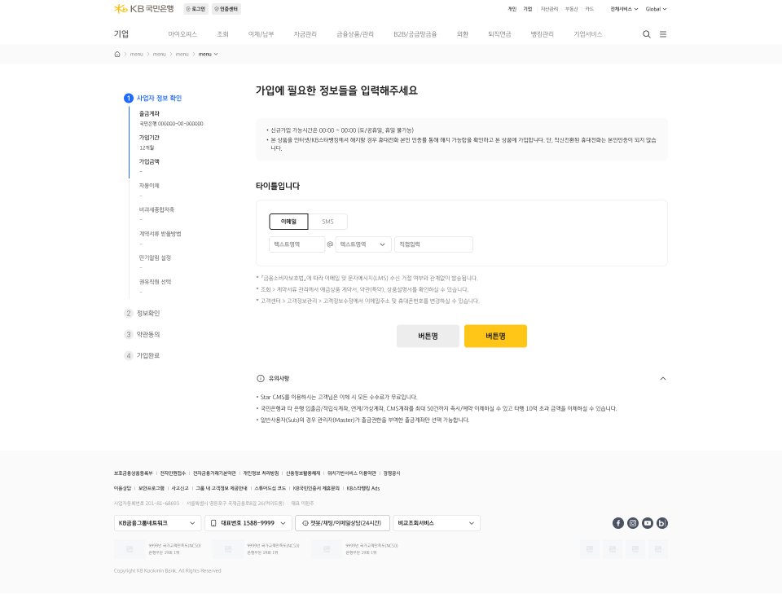

#### AA — 직원 검색·제목 옆 직원선택

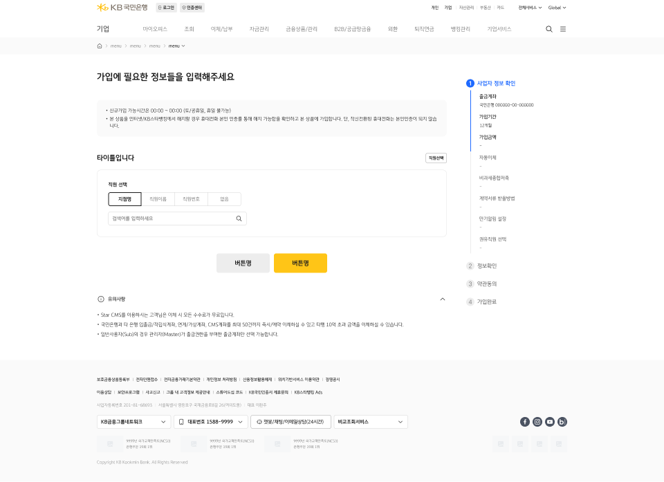

### 49.4. 재현 검수

1. Z는 316 + 32 + 1012의 왼쪽 요약, AA는 1012 + 32 + 316의 오른쪽 요약인지 확인한다.
2. Z의 500 × 96 입력 묶음·162px 박스·박스 밖 3행 #6E6E6E 안내, AA의 400 × 128 묶음·194px 박스·제목 옆 61 × 28 액션을 확인한다.
3. Segment 항목 96px·gap 0, 후속 입력 gap 16, 선택/미선택 서체와 enabled 상태를 확인한다.
4. 제목 행의 실제 너비, Main 중앙의 하단 버튼 위치, 156px Accordion, Footer 시작 1105/1041과 지정 Footer 인스턴스를 확인한다.
5. 두 원본 BODY의 누락 폰트는 모두 0이었다. 생성 시 필수 서체·잘림·겹침·계층과 실제 업무 문구·요약 상태·액션을 한 번 검수한다. 통과한 검수는 반복하지 않는다.

## 50. 패턴 AB — 즉시이체 완료·계좌별 결과

### 50.1. 출처와 전체 배치

- [원본 — 이체완료](https://www.figma.com/design/yojs1BhPrWxLmDDrpg1ihD?node-id=5090-37578): **1920 × 2335**.
- 파일 `yojs1BhPrWxLmDDrpg1ihD`, 페이지 `05.기타(기획 v0.6)`. HEADER는 157, 화면 이미지에서 GNB → Breadcrumbs 순서를 확인했다.
- BODY: (240,157), **1440 × 1826**, Vertical gap 48, padding **48 40 80 40**. 이번 완료형은 아래 padding이 80이다. 이전 입력형의 48을 일괄 적용하지 않는다.
- 실제 본문 Container는 5개이며 유효 너비는 1360, x=280이다. LNB·StepIndicator가 없는 전체형이다.
- FOOTER: (0,1983), 1920 × 352. 신규 생성은 13장의 지정 Footer 인스턴스를 사용한다.

| Container | 내용 | y / 높이 |
| --- | --- | --- |
| 1 | 완료 Feedback | 205 / 168 |
| 2 | 이체 요약 SummaryBox | 421 / 96 |
| 3 | 계좌별 결과 Accordion | 565 / 750 |
| 4 | 결과조회 이동 버튼 | 1363 / 56 |
| 5 | 알려드립니다 Accordion | 1467 / 436 |

168 + 96 + 750 + 56 + 436 + gap 48 × 4 + padding 128 = BODY 1826이다.

### 50.2. 완료 피드백과 요약

- Container 1은 padding 20 0, 실제 Feedback은 (280,225), 1360 × 128, Vertical gap **20**이다.
- status-circleCheck 인스턴스 **80 × 80**를 x=920에 중앙 배치하며 원본은 노란 체크 표시다. “Feedback”, “Item / Feedback” 래퍼는 일반 FRAME이며 이름만으로 별도 Feedback 컴포넌트 인스턴스로 가정하지 않는다.
- 완료 제목 “즉시이체를 마쳤어요”: (280,325), 1360 × 28, KBFG Text Bold **20/28** #1C1C1C, 가운데 정렬이다.
- SummaryBox는 (280,421), 1360 × 96, Item / Surface solid, fill #FAFAFA, radius 12, padding **20 32**다.
- 내부 1296 × 56에 Item / Content 5개(각 너비 **207.2**)와 세로 Divider 1px 4개를 둔다. 인접 자식 사이 gap 32로 207.2 × 5 + 1 × 4 + 32 × 8 = 1296이다.
- 각 항목은 제목 20 + gap 8 + 값 25 = 53px이며 56px 영역 안에서 세로 중앙에 놓인다.
- 요약 제목은 KBFG Text Medium 14/20 #6E6E6E, 숫자는 **Pretendard SemiBold 20/25 #1C1C1C**, 단위는 KBFG Text Medium **16/24**다.
- 표시 예: 총 이체 금액 180,540,000원 / 총 이체 계좌 4개 / 총 수수료 0원 / 총 성공 이체건수 197건 / 총 실패 이체건수 1건. **실패 숫자와 단위는 #E53838**다.
- 요약 수치·계좌 그룹 3개·실제 표 5행 사이에 일관된 집계 관계가 구현되어 있지는 않다. 예시 숫자를 연산 규칙·정상 결과 조건으로 확정하지 않는다.

### 50.3. 계좌별 boxData Accordion

- 섹션 제목은 1360 × **56**이며 파란 “서브타이틀” Bold 14/20 #1F6AFF → gap 8 → “타이틀입니다” Bold 20/28 #1C1C1C다.
- 제목 아래 gap **20**, Accordion Group은 (280,641), 1360 × **674**, Vertical gap **12**다.
- 첫 계좌는 boxData/basic/large/**expanded=true**, **1360 × 494**. 두 번째·세 번째는 expanded=false, 각 **1360 × 78**, y=1147/1237이다.
- 494 + 78 × 2 + gap 12 × 2 = 674. 첫 계좌만 펼친 원본 상태를 보존하며 모든 계좌를 일괄 펼치거나 접지 않는다.
- 외곽은 radius 12, fill #FFFFFF, stroke #D4D4D4. Header는 테두리 안 (281,642), **1358 × 76**, padding **24 32**, gap 12, fill #FAFAFA다.
- Header 왼쪽은 은행 아이콘·은행명·계좌번호·예금주/별명, 오른쪽은 이체건수·이체금액·28px 펼침 아이콘이다.
- 은행명은 KBFG Text Bold 18/25 #1C1C1C, 계좌번호는 Pretendard SemiBold **20/25**, 예금주·별명은 Light 14/20 #444444다.
- 오른쪽 설명은 Light 16/24 #444444, 숫자는 Pretendard SemiBold 20/25 #1C1C1C, 단위는 Medium 16/24 #444444다. 문자열 길이에 따라 왼쪽 시작점이 달라지며 오른쪽 끝 정렬을 유지한다.
- 펼친 Expand Area는 내부 y=718, 높이 **416**, 그 안의 1px 구분선 뒤 Slot-contents는 y=719, 높이 **415**다. 실제 콘텐츠 시작은 (313,751)이다.
- 내부 표·액션 묶음은 **1294 × 351**로 테두리 안에서 좌우 32px 인셋이다. 위아래 32 + 콘텐츠 351 = 슬롯 415다.
- 계좌·건수·금액·별명은 예시다. 펼침·접힘의 상호 배타 여부나 서버 조회·페이지 처리·행 선택 동작은 정적 화면만으로 확정하지 않는다.

### 50.4. 결과 표와 보조 액션

- 결과 GRID는 **(313,751), 약 1292 × 295**, **9열 × 6행**, 실제 행·열 gap **0**이다. 일반 itemSpacing=10 속성만 보고 GRID 셀 사이 10px를 넣지 않는다.
- 열 너비는 **57 / 52 / 169 / 169 / 169 / 169 / 169 / 169 / 169**다. 바깥 1294px 래퍼보다 GRID가 2px 좁은 실제값을 구분한다.
- 열 순서: 선택 / No / 입금기관 / 계좌번호 / 예금주 / 이체금액(원) / 수수료(원) / 받는분 통장표기 / 내통장 표시.
- Header y=752, 이후 데이터 y=801/850/899/948/997, 각 **49px**다. top line 포함 1 + 49 × 6 = 295다.
- Header는 KBFG Text Medium 14/20 #444444. 일반 데이터는 Light 14/20 #1C1C1C, No·계좌번호·금액·수수료는 **Pretendard Light 15/20** #1C1C1C다. 금액·수수료는 오른쪽 정렬, 다른 셀은 원형의 실제 정렬을 따른다.
- 체크 항목은 헤더 1개 + 데이터 5개, 실제 Item / CheckBox **24 × 24**, checked=false, enabled다. 바깥 CheckBox의 size=large와 내부 size=medium 이름이 공존하므로 이름만으로 32px로 확대하지 않는다.
- 표 아래 gap **16**, y=1062에 secondary small 버튼 **6개**, 높이 40, 서로 gap 8을 두고 오른쪽 정렬한다.

| 원본 버튼 라벨 | 너비 |
| --- | --- |
| 확인증일괄 출력 | 133 |
| 확인증건별 출력 | 133 |
| 수수료확인증 출력 | 146 |
| 메세지 전송 | 108 |
| 엑셀로 저장 | 108 |
| 인쇄 | 66 |

보조 버튼은 Bold 14/20 #1C1C1C다. 실제 출력·전송·다운로드·선택 행 적용 범위는 업무 기획을 따른다.

### 50.5. 주요 액션과 긴 안내

- 주요 “이체결과조회로 이동”은 **(864,1363), 192 × 56**, primary large, fill #FFC517, radius 6, Bold 18/25 #1C1C1C다.
- 바깥 ButtonGroup은 **count=multi, size=medium**이지만 실제 보이는 버튼은 large 1개다. 원형 이름만으로 버튼 개수·크기를 변경하지 않는다.
- “알려드립니다” Accordion은 standard/basic/medium/expanded=true, **1360 × 436**다. Header 56, Expand Area 380, padding 8 0 16, 실제 본문 슬롯 **356**이다.
- 원본 불릿은 **20px 13행 + gap 8 × 12 = 356**이다. 기존의 3행 156px Accordion 높이를 고정 적용하지 않는다.
- 제목 Bold 14/20 #444444, 본문 Light 14/20 #1C1C1C다. 일부 문장 안 링크·강조색을 원형의 텍스트 구간 단위로 유지한다.
- 수수료·이체 한도·오류 처리·기관 시간 등의 안내는 출처의 샘플이다. 실제 거래 서비스의 최신 승인 문구를 적용하며 이 정적 자료를 거래·법률 정책으로 확정하지 않는다.

## 51. 패턴 AC — 중요 사항 설명과 필수 이해 확인

### 51.1. 출처·실제 구조

- [원본 화면](https://www.figma.com/design/yojs1BhPrWxLmDDrpg1ihD?node-id=5090-37319): **1920 × 2029**.
- 프레임 이름은 `정보입력_우측 스텝인디게이터가 없는 경우`이지만 **실제로 오른쪽 StepIndicator가 있다**. 이름보다 현재 구성·화면을 기준으로 재현한다.
- HEADER 157, BODY (240,157), **1440 × 1520**, Horizontal gap 32, padding 48 40.
- BODY 자식은 Main Container 1 **(280,205), 1012 × 1424** → 요약 Container 2 **(1324,205), 316 × 704**다.
- Main은 top 844 → gap 48 → bottom 532, top은 Vertical gap 48이다. Footer는 **y=1677, 1920 × 352**, 신규 생성은 13장 지정 인스턴스를 사용한다.
- 페이지 제목 “중요 사항 및 필수 확인 사항을 확인해주세요”: (280,205), **469 × 36**, KBFG Text Bold 26/36 #1C1C1C.

| 영역 | y / 높이 | 구성 |
| --- | --- | --- |
| 첫 Info | 289 / 260 | 제목 28 + gap 20 + Infobox/목록 212 |
| 둘째 Info | 597 / 124 | 제목 28 + gap 20 + 목록 76 |
| 셋째 Info | 769 / 280 | 제목 28 + gap 20 + 복합 본문 232 |
| 필수 이해 확인 박스 | 1097 / 428 | 안내·Divider·질문 3개 |
| Button Area | 1573 / 56 | tertiary/primary |

Main: 제목 36 + Info 260 + 124 + 280 + top gap 48 × 3 = 844, bottom 428 + 48 + 56 = 532, 전체 844 + 48 + 532 = 1424다.

### 51.2. 설명·목록·본문 구분

- 각 Info 제목은 Title / Headline, “타이틀입니다”, Bold 20/28 #1C1C1C다.
- 첫 Infobox / Solid는 **(280,337), 1012 × 44**, medium/info, padding **12 16**, radius 12, #FAFAFA. 문구는 Medium 14/20 #1C1C1C다.
- 아래 gap **16**, 불릿 목록 (280,397), 1012 × **152**, gap 8이다. 실제 5행 높이 20/20/20/40/20으로 문장 줄바꿈을 반영한다.
- “3개월 변동금리” 구간만 **#1F6AFF**, 나머지는 #1C1C1C다. 혼합 fill인 전체 텍스트를 단색으로 덮어쓰지 않는다. 전체 서체는 Light 14/20이다.
- 둘째 Info는 불릿 20px 3행 + gap 8로 높이 76, Light 14/20 #1C1C1C다.
- 셋째 복합 본문은 (280,817), 1012 × **232**, 두 내용 묶음 사이 gap **16**이다.
- “위법계약해지권” 제목 Bold 16/24 #1C1C1C → gap 8 → 일반 본문 Light 14/20 #444444 3줄, 높이 60. 첫 묶음 92px다.
- “자료 열람 요구권”은 제목 24 + gap 8 + 일반 본문 40 + gap 12 + dash 목록 40 = 두 번째 묶음 **124px**다.
- 일반 Text·Title과 TextList가 섞인 원본 `Text Group`은 순수 Text 반복 그룹으로 일반화하지 않는다. 12장에 따라 `Title / Contents` 등 실제 자식 구성에 맞는 이름을 적용하고 본문과 목록의 의미·계층을 보존한다.
- 금리·인지세·연체 기준·권리 행사 기간 등 금융·법률 수치는 원본 표시 예시다. 실제 생성에서 승인된 최신 문구를 적용한다.

### 51.3. 필수 이해 확인 3개

- 외곽 박스 **(280,1097), 1012 × 428**, padding 32, radius 12, stroke 1px #E5E5E5다.
- 실제 내부는 **(313,1130), 946 × 362**, Vertical gap **20**. 테두리 포함 인셋 33을 보존한다.
- 상단 안내 65 = 아이콘/“꼭 확인해주세요” 25 + gap 20 + 설명 20. 제목 Bold 18/25 #1C1C1C, 설명 Medium 14/20 #6E6E6E다. 원본 아이콘은 status-circleAlertGray이며 불릿으로 치환하지 않는다.
- Divider는 (313,1215), 946 × 1, secondary/1px. 다음 질문 묶음은 (313,1236), 946 × **256**, 각 질문 72, 질문 사이 gap 20이다.
- 질문 제목은 **Medium 14/20 #1C1C1C**, 제목과 선택 행 gap **12**, 선택 행 높이 40이다. 앞 장 카드 질문의 Bold 18/25와 구분한다.
- 세 SelectButton은 모두 word/single이며 원본 선택은 **네 / 네 / 아니요**다. 세 번째를 자동으로 네로 바꾸거나 모든 질문의 초기값으로 저장하지 않는다.
- 첫째·둘째: 네 selected=true **65px**, gap 6, 아니요 selected=false **70px**. 셋째: 네 selected=false **45px**, gap 6, 아니요 selected=true **90px**. 선택 체크 유무 때문에 같은 라벨도 너비가 달라진다.
- 각 SelectButton 전체 너비는 141이다. 선택 라벨 Bold 14/20 #1C1C1C, 미선택 #444444다.
- 내부 높이는 65 + gap 20 + Divider 1 + gap 20 + 256 = 362, 외곽 362 + padding 64 + 테두리 2 = 428이다.
- 하단 버튼은 (626,1573), 320 × 56, tertiary → primary, 각 154 × 56, gap 12다. 원본 “버튼명”의 실제 액션·동의에 따른 진행 조건은 별도 기획을 따른다.

### 51.4. 오른쪽 단계

- 45장의 276 × 664 상세 요약과 같은 골격이며 첫 상위 단계 508px, 다음 3개는 32px, 사이 gap 20이다.
- 이번 원본은 **사업자 정보 확인과 하위 8개 completed → 정보확인 inProgress → 약관동의·가입완료 notStarted**다.
- 프레임 이름의 “없는 경우”를 근거로 이 영역을 삭제하지 않는다. 스크롤 고정·편집 동작은 별도 업무 기획을 적용한다.

## 52. 패턴 AD — 적합성·적정성 질문과 결과 수신

### 52.1. 출처·배치·제목 예외

- [원본 — 적정성확인](https://www.figma.com/design/yojs1BhPrWxLmDDrpg1ihD?node-id=5090-37974): **1920 × 2609**.
- HEADER 157, BODY (240,157), **1440 × 2100**, Horizontal gap 32, padding 48 40.
- Main Container 1: **(280,205), 1012 × 2004**, Vertical gap 48. 오른쪽 Container 2: **(1324,205), 316 × 394**다.
- 페이지 제목은 “적합성ㆍ적정성 확인을 위해 아래 내용을 입력해주세요”, **KBFG Text Bold 26/36 #1C1C1C**다.
- 원본 Title / Page 인스턴스는 **233 × 36**인데 실제 텍스트는 **578 × 36**으로 래퍼 밖에 표시된다. 이를 제목의 정상 고정 너비로 학습하지 않는다. 신규 생성은 Main 1012px 안에서 실제 문장이 잘리지 않도록 래퍼·슬롯의 크기를 맞춘다.
- 상단 별도 Infobox와 하단 유의사항 Accordion은 없다. 기존 입력형의 안내/Accordion을 자동 추가하지 않는다.
- FOOTER는 **(0,2257), 1920 × 352**, 신규 화면은 13장의 지정 인스턴스다.

### 52.2. 질문 9개 + 확인 1개

- 원본 `Question Group`: **(280,289), 1012 × 1816**, Vertical gap **12**다. Question 9개와 Consent 1개가 섞인 래퍼임을 명시하며 순수 반복 Question 그룹으로 일반화하지 않는다.
- 각 카드: #FFFFFF, 1px stroke #E5E5E5, radius 12, padding 32. 실제 내부 x=312, 너비 **948**이며 51장의 33px 인셋과 구분한다.
- 질문 제목은 Title / Section **Bold 18/25 #1C1C1C**, 제목과 입력 사이 gap **20**다.
- 기본 질문 높이 **149** = padding 64 + 제목 25 + gap 20 + 입력 40이다. 1~8번이 이 높이다.

| 순서 | 질문 역할 | y / 높이 | 원본 입력 상태 |
| --- | --- | --- | --- |
| 1 | 후견인 도움 여부 | 289 / 149 | 단일: 아니요 |
| 2 | 대출 목적 | 450 / 149 | 단일: 시설자금 |
| 3 | 총 보유 자산 | 611 / 149 | 단일: 1억원 초과 10억원 이하 |
| 4 | 연소득 | 772 / 149 | 단일: 1억원 초과 10억원 이하 |
| 5 | 고정지출 규모 | 933 / 149 | 단일: 연소득 30% 초과 70% 이하 |
| 6 | 신용관리대상 정보 조회 동의 | 1094 / 149 | 단일: 아니요 |
| 7 | 상환 재원 | 1255 / 149 | **복수: 사업소득·근로소득** |
| 8 | 결과 수신 이메일 | 1416 / 149 | 500px 이메일 입력, 비어 있음 |
| 9 | 결과 문자 수신·휴대폰 | 1577 / 237 | 네 + 예시 전화번호 |
| 10 | 적합성 정보 관련 확인 | 1826 / 279 | 단일: 동의 |

149 × 8 + 237 + 279 + gap 12 × 9 = 1816, Main은 제목 36 + 48 + 질문 1816 + 48 + 버튼 56 = 2004다.

### 52.3. 단일 선택과 복수 선택의 차이

- 단일 선택은 word/single, 실제 항목 사이 gap **6**, 높이 40이다. 라벨 Bold 14/20, 선택 #1C1C1C·체크 표시, 미선택 #444444다.
- 선택 예시의 너비: 네/아니요 45/90, 운전자금/시설자금 83/103, 자산·소득 구간 96/192/104, 고정지출 구간 146/230/146px다. 문자열과 체크 표시의 실제 크기를 반영하며 균등 분할하지 않는다.
- 상환 재원은 **word/multiple**이다. “사업소득/근로소득/임대소득/연금소득/기타” 순서, 너비 103/103/103/103/78, gap 6, 전체 표시 514px다.
- 복수 선택에서 사업소득·근로소득만 selected=true이며 나머지는 false다. 미선택 항목에도 연한 체크 모양이 보이지만 disabled=false다. 체크 모양만 보고 모두 선택되었거나 비활성이라고 판단하지 않는다.
- 단일 선택 컴포넌트로 복수 선택을 대체하지 않는다. 예시 응답을 신규 설문의 기본 응답·심사 정답으로 고정하지 않는다.

### 52.4. 이메일·문자 수신과 마지막 확인

- 이메일 InputField: **(312,1493), 500 × 40**, entered=false, 내부 email 타입. placeholder Bold 14/20 #8D8D8D, @ Bold 16/24 #8D8D8D다.
- 문자 수신 카드: 제목 (312,1609), 높이 25 → gap 20 → SegmentedControl **(312,1654), 192 × 40** → gap **20** → 전화번호 필드 **(312,1714), 400 × 68**.
- Segment는 네/아니요 각 96px, 네 selected=true, medium/enabled다. 이 카드에서는 Segment와 후속 필드 간격이 **20**이며 앞선 직원 검색의 16을 적용하지 않는다.
- 휴대폰 필드는 라벨 20 + gap 8 + 입력 40이다. 라벨 Bold 14/20 #1C1C1C, 표시값 “010-1234-5678”도 Bold 14/20 #1C1C1C다.
- 바깥 InputField entered=false와 내부 Item / Input entered=true가 함께 존재한다. 원형 이름 하나만 보고 전화번호를 placeholder로 바꾸지 않는다. 예시 번호는 실제 고객 정보로 재사용하지 않는다.
- 12장의 Segment 그룹핑 규칙에 따라 제작 시 후속 필드와 실제 Auto Layout으로 묶고 현재 구성에 맞게 명명한다. 기존 Container 개수·부모·역할 분할을 바꾸지는 않는다.
- 마지막 Consent 카드: **1012 × 279**, padding 32, Vertical gap **16**이다. 제목 25 + gap 16 + Infobox 118 + gap 16 + 선택 40 + padding 64 = 279.
- Infobox / FullWidth: **(312,1899), 948 × 118**, padding 20 24, radius 12, #FAFAFA. info 아이콘과 Bold 14/20 제목이 있는 20px Header → gap 12 → 46px Slot(1px padding, 불릿 20px 2행·gap 4)이다.
- 그 아래 (312,2033), 높이 40의 단일 선택은 동의 **78px selected=true** → gap 6 → 동의 안 함 **91px selected=false**다. 체크박스형 ConsentFinal로 바꾸지 않는다.

### 52.5. 단계 표시와 하단 버튼

- 오른쪽 요약 내부는 **276 × 354**, padding 20을 포함한 외곽 316 × 394다. 704px 상세 요약으로 임의 확대하지 않는다.
- 단계 순서는 사업자 정보 확인 completed → 정보입력 completed → **본인인증 일반 FRAME(24px)** → 상품가입 inProgress(하위 2개 포함 154px) → 가입완료 notStarted다.
- 상위 y는 225/277/329/373/547, 높이는 32/32/24/154/32이며 사이 gap 20이다. 기본 골격·현재 상품가입의 하위 “금융거래목적 확인/정보입력”은 43장 참조와 같다.
- 적합성 질문 본문과 금융거래목적 확인이라는 단계 문구가 완전히 일치하는 것은 아니다. 출처의 실제 상태로 보존하며 신규 화면은 기획의 현재 단계·하위 명칭에 맞춘다.
- 하단 버튼: **(626,2153), 320 × 56**, “이전” tertiary / “다음” primary 각 154 × 56, gap 12다.
- 응답·수신·동의에 따른 진행·차단·오류 처리와 적합성 판단 기준은 이 정적 화면에서 확정하지 않는다.

## 53. AB·AC·AD 원형 키와 원본 삭제 대비 자료

### 53.1. 주요 원형 키

다음은 이번 사고신고 파일에서 확인한 원형이다. 기준 디자인 시스템의 실제 컴포넌트·변형·슬롯·토큰과 대조해 사용한다.

| 컴포넌트 | 관측 변형 | main component key |
| --- | --- | --- |
| SummaryBox | SummaryBox | `ac8b7b22c4ce82ef89da0d169d5e1cb4bb62fe19` |
| Item / Surface | variant=solid | `f5a63d3d0715c038047d7617618f3a634029c74c` |
| Accordion | variant=boxData, type=basic, size=large, expanded=true | `15a36367e1935a1a4ace29356ec692971d820bdf` |
| Table / Header | variant=default, onlyNumber=false | `ba105a8f29acb712e5c5aa6a3cb2015de330f392` |
| CheckBox | size=large, fontWeight=bold, checked=false, disabled=false, indeterminate=false, invalid=false | `50a2ddb9717f6061eaae8aecea2b2e6ea9f48201` |
| Item / CheckBox | size=medium, checked=false, indeterminate=false, invalid=false, disabled=false | `883706bd3f353bcf32024b0dc282b51f1bcb2913` |
| Table / Cell | variant=default, onlyNumber=false | `99ea32176b75cd8c61852334027aea5149d926a5` |
| Table / Cell | variant=default, onlyNumber=true | `344a92f1499d52f34343a05da003acb2ef07ac87` |
| Table / Cell | variant=last, onlyNumber=false | `1b5a0ae0fefd157325271672a78224db2575f047` |
| Accordion | variant=boxData, type=basic, size=large, expanded=false | `c471cbf555989a4fab5e31de5919f5166ea5d392` |
| Accordion | variant=standard, type=basic, size=medium, expanded=true | `d14342b496bd3aa5d2e707cf26a183daf5d401ce` |
| Infobox / Solid | size=medium, status=info | `18356a16cb958afdf54f8fe4da07401b6412640d` |
| status-circleAlertGray | status-circleAlertGray | `6103f2735acff9e9b8542d7da313e72ae562cc33` |
| SelectButton | type=word, variant=single | `7b6e4a769ba3ff3401fbc04068873ddcf5128dbd` |
| SelectButton | type=word, variant=multiple | `b31fcefc4208613d97eddb3e1bdb20f649a5f493` |
| Item / Word / Multiple | selected=true, hover=false, pressed=false, disabled=false | `935ebc20e5bbdebd04fae7cf3d1631503f0a1317` |
| Item / Word / Multiple | selected=false, hover=false, pressed=false, disabled=false | `cd15a331e38f32f7070236b1104a7b0c203f7de6` |


단일 선택 Item / Word / Single의 선택/미선택은 `403764ddf4f1684762dfba5f7ff303f6c811f3dc` / `0aa745072fcb556409dd4d354a11afd582006a62`, SegmentedControl은 `0913c191bc17e51c03c037c519dcc4149ac4ac23`, InputField 미입력은 `6a180f941f7bc12168489ec44f9203d0f3a4e7cc`로 앞선 사본과 같다. 일반 Feedback·질문·안내 래퍼는 FRAME임을 구분하고 인스턴스를 detach하지 않는다.

### 53.2. 보존 이미지

원본을 수정하지 않고 너비 960px의 0.5배 PNG로 저장소에 보존했다. 재현 치수는 위 논리 px를 사용한다. 원본 문구·표시 수치·상태 불일치도 출처 근거로 이미지에는 그대로 남아 있다.

#### AB — 즉시이체 완료

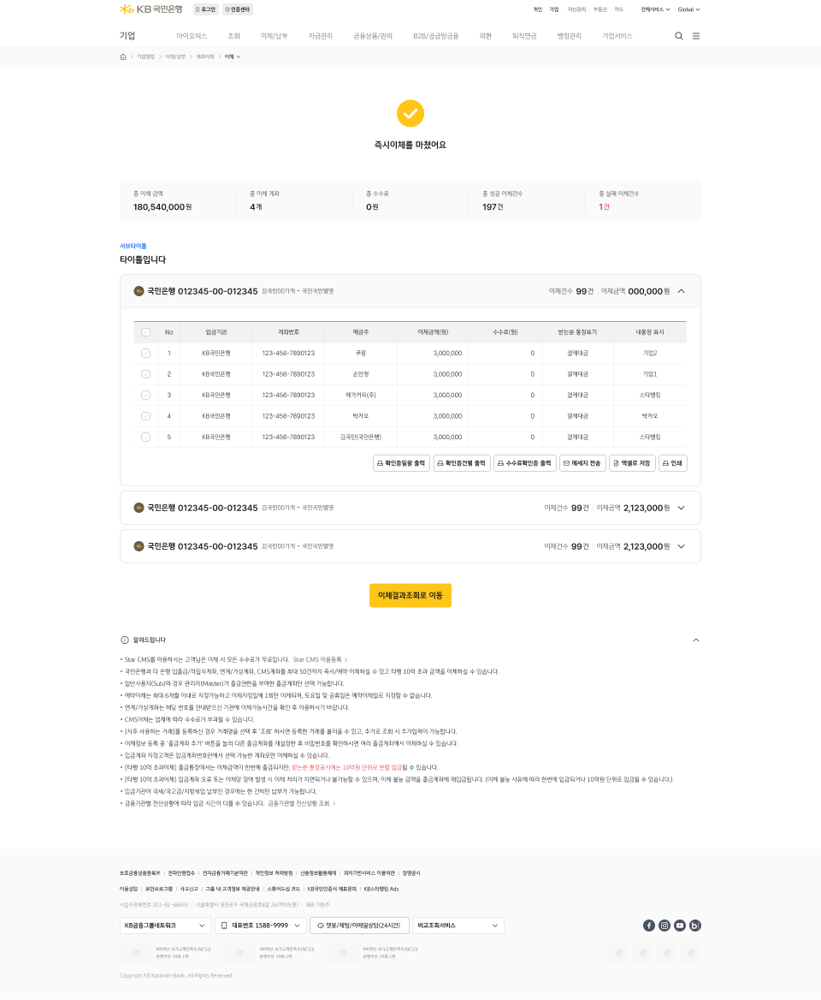

#### AC — 중요 사항과 필수 이해 확인

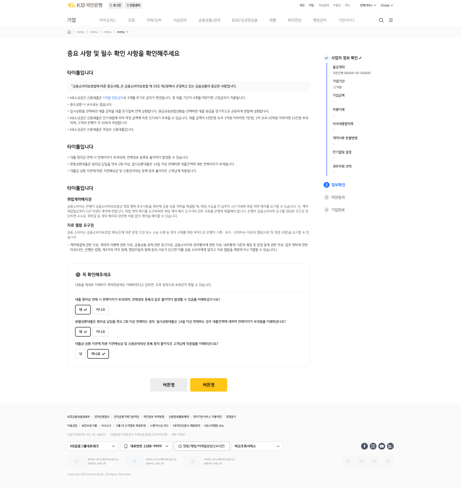

#### AD — 적합성·적정성 질문

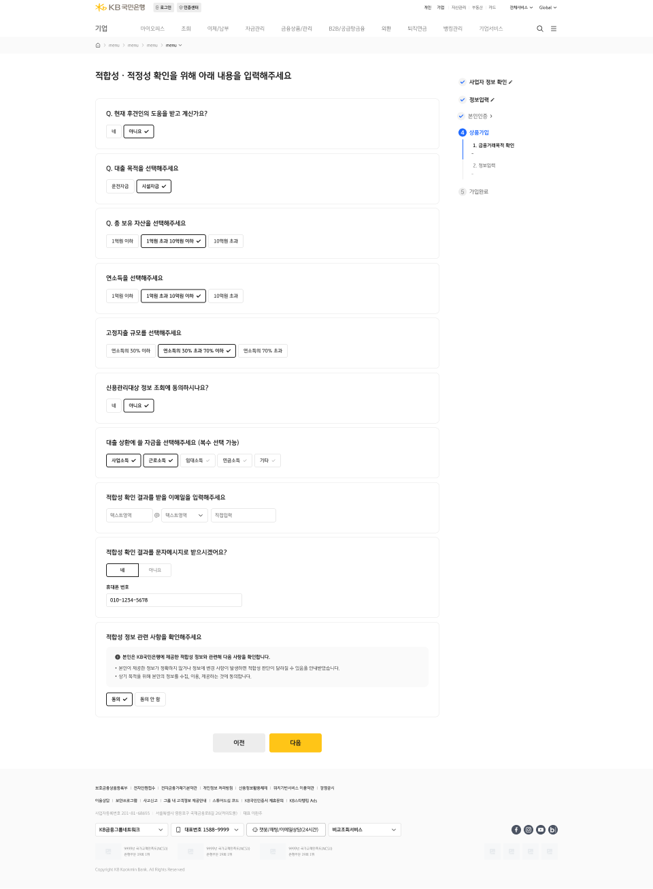

### 53.3. 재현 검수

1. AB의 BODY 하단 padding 80, 5개 Container·요약 5항목·boxData 1개 펼침/2개 접힘, 실제 GRID 너비·49px 행을 확인한다.
2. AB의 표 체크 상태, 6개 보조 버튼, 192 × 56 단일 주요 버튼, 13행·436px 안내를 확인한다.
3. AC의 이름과 실제 오른쪽 단계 표시 차이, 3개 Info의 본문/목록 구분, 구간별 파란 강조, 428px 확인 박스의 네/네/아니요를 확인한다.
4. AD의 149/237/279px 카드·gap 12, 단일/복수 선택, 이메일 500px·전화 400px, phone의 실제 입력 상태와 제목 래퍼 넘침을 확인한다.
5. 세 원본 BODY의 누락 폰트는 모두 0이었다. 실제 생성에서도 필수 서체·문장 줄바꿈·잘림·겹침·계층·상태를 한 번 검수한다.
6. 예시 집계·응답·법률/상품 문구를 승인된 기획과 대조하고 지정 Footer 인스턴스를 확인한다. 통과한 검수는 반복하지 않는다.

## 54. 패턴 AE — 등록 정보 확인과 추가 인증

### 54.1. 출처·배치

- [원본 — 정보확인](https://www.figma.com/design/yojs1BhPrWxLmDDrpg1ihD?node-id=5090-41193): **1920 × 1889**.
- 파일 `yojs1BhPrWxLmDDrpg1ihD`, 페이지 `05.기타(기획 v0.6)`. HEADER 157이며 화면 이미지에서 GNB → Breadcrumbs 순서를 확인했다.
- BODY: (240,157), **1440 × 1380**, padding 48 40, Horizontal gap **32**. Main은 (280,205), **1012 × 1284**, 오른쪽 단계 영역은 (1324,205), **316 × 228**이다.
- Main 내부 영역 간격은 **48**이다. Footer는 **(0,1537), 1920 × 352**, 신규 생성은 13장의 지정 Footer 인스턴스를 사용한다.
- 이번 장부터도 원본 BODY의 미정리 이름·중간 래퍼·번호를 제작 규칙으로 복제하지 않는다. 아래는 UI 역할과 실측 배치이며 생성 레이어는 **12.0~12.11**을 적용한다.

| 역할 | y / 높이 |
| --- | --- |
| 페이지 제목 | 205 / 36 |
| 안내 Infobox | 289 / 110 |
| 계좌·받는분 확인 | 447 / 184 |
| 자동이체 설정 확인 | 679 / 364 |
| 추가 인증·하단 액션 | 1091 / 398 |

Main 높이: 36 + 110 + 184 + 364 + 398 + 48 × 4 = 1284. BODY는 상하 padding 96을 더한 1380이다.

### 54.2. 안내·확인 표와 DataList

- 제목 “이대로 등록하시겠습니까?”는 **KBFG Text Bold 26/36 #1C1C1C**, 280 × 36이다.
- 상단 Infobox / FullWidth는 **1012 × 110**, padding 20 24, radius 12, #FAFAFA다. Slot은 964 × 70, padding 1, 실제 20px 불릿 3행 + gap 4 × 2 = 68px다. Slot의 2px와 바깥 padding 40을 포함해 110이다.
- 보안카드/OTP·KB국민인증서 안내는 Light 14/20 #1C1C1C다. 실제 보안매체·인증·등록 정책은 업무 기획을 따른다.
- 각 표 섹션은 Title / Headline **Bold 20/28 #1C1C1C** → gap **20** → Table GRID 순서다. “타이틀입니다”는 실제 업무 제목으로 교체한다.
- 표 열은 **180 + 832 = 1012**, gap 0, 행 높이 **45**, top line 1px #444444다.
- 첫 표는 (280,495), **1012 × 136**, 3행: 출금계좌번호 / 입금계좌번호 / 받는분. 1 + 45 × 3 = 136이다.
- 둘째 표는 (280,727), **1012 × 316**, 7행: KB 입출금 계좌 / 이체금액 / 이체주기 / 자동이체일 / 이체기간(시작·종료) / 내 통장 표시 / 받는 분 통장 표시. 1 + 45 × 7 = 316이다.
- Header 라벨은 **Medium 14/20 #444444**, 값은 **Medium 14/20 #1C1C1C**이며 값 시작 x=476이다.
- 값 영역에는 단순 Text가 아니라 **DataList — layout=inLine, size=14, accordion=false, expanded=false** 인스턴스를 사용한다. 텍스트 오른쪽의 16px chevron을 유지한다.
- DataList 실제 너비는 문자열에 따라 계좌 178 / 받는분 55 / “0원” 39px 등으로 달라진다. 값 셀 832px 전체 너비를 각 DataList에 강제하지 않는다.
- 원본 계좌번호·이체 0원·날짜 2026.08~2026.08은 샘플이다. chevron의 편집·조회·팝업 이동 동작도 정적 화면만으로 확정하지 않는다.

### 54.3. 인증 UI 조합과 액션

- 인증 제목 (280,1091), 높이 28 → gap 20 → 인증 박스 **(280,1139), 1012 × 246**다.
- 박스는 padding 32, radius 12, 1px stroke #E5E5E5이며 실제 내부 시작 **(313,1172)**다.
- 실제 UI 조합은 **SegmentedControl → gap 20 → TextList Group → gap 24 → 인증받기 Button Area**다. Segment와 후속 본문은 실제 Auto Layout으로 묶고 현재 구성에 맞게 명명한다.
- Segment는 **192 × 40**, 각 항목 96px, 항목 사이 gap 0. ARS 인증 selected=true, 해외출국확인 selected=false, 둘 다 enabled다.
- 선택 라벨은 Bold 14/20 #1C1C1C, 미선택은 Medium 14/20 #8D8D8D다.
- 안내 목록은 (313,1232), **946 × 48**, 20px 2행 + gap 8, Light 14/20 **#6E6E6E**다.
- “인증받기”는 **(313,1304), 400 × 48**, secondary medium, Bold 16/24 #1C1C1C다. 박스 높이는 padding 64 + 테두리 2 + (40 + 20 + 48) + gap 24 + 버튼 48 = 246이다.
- 박스 아래 gap **48**, 하단 tertiary/primary 버튼은 **(626,1433), 320 × 56**, 각 154 × 56, gap 12다. “버튼명”과 인증 후 상태·진행 조건은 기획을 적용한다.
- 오른쪽 단계는 내부 276 × **188**, 외곽 padding 20을 포함해 316 × 228이다. **약관동의 completed → 정보입력 completed → 정보확인 inProgress → 가입완료 notStarted**, 각 32px, 사이 gap 20이다. 긴 하위 요약을 자동 추가하지 않는다.

## 55. 패턴 AF — 계좌 요약·조건 조회·거래내역 목록

### 55.1. 출처와 전체형 배치

- [원본 화면](https://www.figma.com/design/yojs1BhPrWxLmDDrpg1ihD?node-id=5090-41507): **1920 × 1970**.
- 프레임 이름은 `자동이체등록-계좌정보 추가입력`, 페이지 제목은 “이대로 등록하시겠습니까?”이지만 실제 본문은 **계좌 요약 + 거래내역 조건 조회 + 목록**이다. 이름·제목을 최종 업무 성격으로 확정하지 않는다.
- HEADER 157, BODY (240,157), **1440 × 1461**, Vertical gap 48, padding 48 40. 유효 콘텐츠는 x=280, 너비 **1360**이며 StepIndicator·LNB가 없다.
- Footer는 **(0,1618), 1920 × 352**, 신규 생성은 지정 Footer 인스턴스를 사용한다.

| 역할 | y / 높이 |
| --- | --- |
| 페이지 제목 | 205 / 36 |
| 계좌 요약 카드 | 289 / 164 |
| 조회 조건·조회 버튼 | 501 / 413 |
| 조회 건수·정렬·목록·페이지 | 962 / 608 |

36 + 164 + 413 + 608 + gap 48 × 3 + padding 96 = BODY 1461이다.

### 55.2. 계좌 요약 카드

아래는 원본 실측 기록이다. 신규 제작에서는 내부 이체/조회 액션에 따라 60장의 Card / Surface 기준을 적용하되, List 등 전용 패턴이 해당하면 그 규칙을 우선한다.

- 일반 카드 프레임은 **1360 × 164**, padding **32 32 24 32**, radius 12, 흰색, stroke #8D8D8D다.
- 내부 List 인스턴스는 **(312,321), 1296 × 60**, 은행 아이콘·상품명·한도계좌 라벨·은행/계좌번호·펼침·더보기 아이콘을 조합한다.
- 상품명 “KB Star 저축예금 보통예금”: Bold 16/24 #1C1C1C. 한도계좌 라벨은 Bold 12/17, 은행명 Medium 12/17 #6E6E6E, 계좌번호 Pretendard Regular 13/17 #6E6E6E다.
- 아래 gap **8**, 잔액·버튼 행은 y=389, 높이 40이며 왼쪽 들여쓰기 32다.
- 잔액 설명은 Medium 14/20 #8D8D8D, 금액은 **Pretendard Regular 15/20**다. 출금 가능 금액만 #1F6AFF, 나머지는 #1C1C1C다.
- 오른쪽 “이체/조회” secondary small은 **120 × 40**씩, gap 8, (1360,389)/(1488,389)다.
- 높이는 60 + 8 + 40 + padding 56 = 164다. 계좌·잔액은 예시이며 제한·가용금액 산식·더보기 동작은 별도 기획을 따른다.

### 55.3. 조건 조회 표

- GRID는 **(280,501), 1360 × 341**, **160 + 1200**의 2열, 4행 높이 **161/49/65/65**, top line 1px, 실제 행·열 gap 0이다.
- 라벨은 Medium 14/20 #444444, 입력 시작 x=**456**이다. 54장 180px 라벨 열의 시작점 476과 구분한다.
- 첫 행은 조회 기간. 내부 (456,514), 높이 **136** = Radio 24 + gap 16 + 날짜 입력 40 + gap 16 + preset 40이다.
- 기간조회/월별조회 Radio는 24px 아이콘을 사용하고 항목 간 gap **16**이다. **실제 내부 Item / Radio는 기간조회 checked=true**, 월별조회 false다. 바깥 Radio의 checked=false 원형 이름만 보고 둘 다 미선택으로 기록하지 않는다.
- 기간 InputField는 **(456,554), 400 × 40**, period 타입이다. 달력 버튼 **40 × 40**은 (816,554)로 그 안에 포함된다. 날짜 필드 외부에 40px를 다시 더하지 않는다.
- 아래 preset은 “오늘/1주일/1개월/3개월/6개월/12개월/24개월”, 너비 **50/58/58/58/58/67/67**, 높이 40, gap **4**다.
- 둘째 행은 전체/입금 내역만/출금 내역만 Radio, 높이 24, gap **16**. 실제 내부 상태는 **전체만 checked=true**다.
- 셋째 행은 최소금액~최대금액, **(456,724), 400 × 40**, amount-start-end 타입과 단위 원을 유지한다.
- 넷째 행은 보낸 분/받는 분·내통장 표시, **(456,789), 400 × 40**, “글자 최대 20자까지 입력 가능해요” placeholder다. 샘플 문구를 구현된 검증 로직으로 간주하지 않는다.
- 표 아래 gap **24**, “조회” secondary medium **(883,866), 154 × 48**를 가로 중앙에 둔다.

### 55.4. 결과 도구·8열 목록·페이지

- 결과 상단은 **(280,962), 1360 × 40**. 왼쪽 “조회 건 수 100건”, 오른쪽 정렬/표시 개수 InputField 각 **152 × 40**, gap **8**로 총 312px다.
- 정렬 “최근 거래내역 순”, 표시 “10개씩 보기”는 실제 선택값이다. 바깥 InputField entered=false라도 내부 select-default는 entered=true이므로 표시값을 placeholder로 치환하지 않는다.
- 결과 GRID: **(280,1022), 1360 × 496**, **8열 × 11행**, 각 열 **170**, Header·데이터 행 각각 **45**다. top line 1 + 45 × 11 = 496.
- 실제 GRID gap은 **0**이다. 일반 itemSpacing=10 속성을 셀 사이 간격으로 적용하지 않는다.
- 열 순서: 거래일시 / 통장 표시 / 보낸 분·받는 분 / 출금액(원) / 이체금액(원) / 잔액(원) / 받는 분 통장 표시 / 거래점.
- Header는 Medium 14/20 #444444. 이번 데이터의 거래일시와 보낸 분/받는 분은 **Pretendard Light 15/20**, 나머지 일반/금액 값은 **KBFG Text Light 14/20 #1C1C1C**로 확인됐다. 모든 숫자를 단일 서체로 일괄 변경하지 않는다.
- 목록 아래 gap **16**, Pagination / Basic은 **(692,1534), 536 × 36**, 중앙 정렬이다. 숫자 항목은 36 × 36, Pretendard Regular 17/24다.
- 원본 페이지 **1은 active, 2는 hover, 3~10은 enabled**다. 2의 회색 배경을 현재 페이지로 오인하지 않는다. 처음/이전/다음/마지막 화살표를 원형과 함께 유지한다.
- 건수 100·표시 10행·날짜·금액·계좌는 예시다. 정렬·페이지·검색·이체의 실제 동작과 데이터 정책은 기획에 따라 구현한다.

## 56. 패턴 AG — 중앙 정렬 투자성향 설문

### 56.1. 출처·중앙 본문·안내

- [원본 — 투자성향분석](https://www.figma.com/design/yojs1BhPrWxLmDDrpg1ihD?node-id=5090-42021): **1920 × 2168**.
- HEADER 157, BODY (240,157), **1440 × 1659**, padding 48 40. 유효 1360px 영역 안에 **1012px Main을 중앙 정렬**, 실제 x=**454**, y=205다.
- Main 높이 **1563**, Vertical gap **48**. 오른쪽 빈 열을 둔 입력형이 아니며 LNB·StepIndicator도 없다.
- 제목 “투자 성향 분석”: **157 × 36**, KBFG Text Bold **26/36 #1C1C1C**다.
- Infobox / FullWidth: **(454,289), 1012 × 162**, padding 20 24, radius 12, #FAFAFA다.
- info 아이콘이 있는 제목은 Bold 14/20 #1C1C1C. Header 20 → gap 12 → Slot 90, 위아래 padding 40으로 162px다.
- Slot은 padding 1, 실제 불릿 높이 **20/20/40**, gap **4**, 합계 88 + padding 2 = 90이다. 문장 증가로 안내 높이를 확장하며 106px 등 과거 값으로 고정하지 않는다.
- 일반 안내는 Light 14/20 #1C1C1C이며 **“온라인 또는 영업점 창구”와 “1일 1회”만 Medium 14/20 #1F6AFF**다. 전체 문장을 한 색·굵기로 덮어쓰지 않는다.
- 일일 분석 횟수·상품 가입 제한·투자 정책은 원본 안내 예시이며 승인된 실제 정책을 적용한다. 이 문서는 투자 조언이나 설문 채점 기준을 정의하지 않는다.

### 56.2. 단어형·문장형, 단일·복수 선택

질문 카드 5개는 (454,499)부터 너비 1012, Vertical gap **12**로 반복된다. #FFFFFF, 1px stroke #E5E5E5, radius 12, padding **32**다. 내부는 x=486, 너비 **948**이며 Title / Section **Bold 18/25 #1C1C1C** → gap **20** → SelectButton 순서다.

| 질문 | 역할·UI | y / 높이 | 원본 선택 |
| --- | --- | --- | --- |
| Q1 | 연령대, word/single 5항목 | 499 / 149 | 30대 |
| Q2 | 연소득, word/single 5항목 | 660 / 149 | 5천만원 이하 |
| Q3 | 수입원, **sentence/single** 4행 | 821 / 309 | 현재 수입 수준 유지 예상 |
| Q4 | 금융자산 비중, word/single 5항목 | 1142 / 149 | 30% 이내 |
| Q5 | 투자 경험, **sentence/multiple** 5행 | 1303 / 361 | 첫째·둘째 항목 |

- 단어형은 높이 **40**, 항목 사이 gap **6**다. 문구 길이와 체크 표시를 반영한 실제 너비를 사용하며 균등 분할하지 않는다.
- Q1 너비는 62/82/62/62/92, Q2는 108/128/96/96/96, Q4는 92/112/92/92/92px다. 선택된 항목은 체크 표시만큼 넓다.
- 문장형 항목은 각각 **948 × 44**, padding **12 12 12 16**, 내부 gap 8, radius 6이다. 텍스트와 오른쪽 20px 체크 영역을 유지한다.
- Q3는 44 × 4 + 행간 **8 × 3 = 200**, 카드 64 + 제목 25 + gap 20 + 목록 200 = **309**다.
- Q5는 44 × 5 + 행간 **8 × 4 = 252**, 카드 64 + 25 + 20 + 252 = **361**이다.
- 기본 word 카드는 64 + 25 + 20 + 40 = **149**다. 질문 전체는 149 × 3 + 309 + 361 + gap 12 × 4 = **1165**다.
- 선택 문구는 **Bold 14/20 #1C1C1C**, 미선택은 **Bold 14/20 #444444**. 선택 stroke #1C1C1C, 미선택 stroke #D4D4D4다.
- Q3는 하나만 선택하는 Sentence / Single, Q5는 여러 개를 선택하는 Sentence / Multiple이다. 긴 문장을 단어형 버튼으로 바꾸거나 복수 선택을 단일 선택으로 대체하지 않는다.
- Q5의 첫째·둘째는 selected=true, 나머지는 false이며 모두 disabled=false다. 미선택의 연한 체크를 선택 완료나 비활성으로 오인하지 않는다.
- 원본 응답과 금액 구간·상품 목록은 예시다. 신규 설문의 기본 답변·점수·등급 판정 기준으로 고정하지 않는다.

### 56.3. 결과 액션과 제작 계층

- 질문 그룹 아래 gap **48**, “결과보기” primary large는 **(883,1712), 154 × 56**, Main 중앙에 놓는다.
- Main 높이는 제목 36 + 안내 162 + 질문 1165 + 버튼 56 + gap 48 × 3 = **1563**이다. BODY는 padding 96을 더한 1659다.
- Footer: **(0,1816), 1920 × 352**, 신규 생성은 13장의 지정 인스턴스를 사용한다.
- UI 조합은 제목 / 안내 / 반복 Question Group / Button Area로 정립한다. 각 Question은 제목과 실제 word 또는 sentence SelectButton을 조합하고 원형 내부 고유 계층을 유지한다.
- 원본의 Main 중간 래퍼·Container 번호를 복제 조건으로 삼지 않는다. 실제 생성 명명·Auto Layout 그룹핑은 12장을 따른다.

## 57. AE·AF·AG 원형 키·보존 이미지·검수

### 57.1. 확인한 주요 main component key

사고신고 파일에서 이번 UI 조합에 사용한 원형이다. 지정 디자인 시스템의 실제 원형·변형·슬롯·토큰과 대조하여 재사용한다.

| 컴포넌트 | 관측 변형 | main component key |
| --- | --- | --- |
| DataList | layout=inLine, size=14, accordion=false, expanded=false | `7cf5e6aaa6810575694f82ff5db34068635c7f2e` |
| List | List | `efc578a125431c008569ed3affe51759bb11531b` |
| Radio | size=medium, fontWeight=bold, checked=false, disabled=false, invalid=false | `a74b3740e5e5e0c5f6a09bbb44fe88dee6248cdb` |
| Item / Radio | checked=true, invalid=false, disabled=false | `ab9ce0577cb295003dfc8d4b13ab7de10b0deb80` |
| Item / Radio | checked=false, invalid=false, disabled=false | `f37eb975057dc7840f53db65633a65c769cfa1a8` |
| Item / Input | variant=period, _hover=false, _focused=false, _disabled=false, _entered=false, _error=false | `a69bf9237990a9897dd7ab431a56ab62b592818f` |
| Item / Input | variant=amount-start-end, _hover=false, _focused=false, _disabled=false, _entered=false, _error=false | `cf639656a56928b009a21426c05cde657401f755` |
| Pagination / Basic | variant=default | `13fdebbc05101067ac4c6cad5d74f38fd6c3af7f` |
| Item / Pagination | state=active | `2cd1237baa5132e02aa1fcd57156a97b9f1c7114` |
| Item / Pagination | state=hover | `56da6187ca9837d43304a4f1e259396d2ac4cdb7` |
| Item / Pagination | state=enabled | `8e136e3edc6db2a3ed136fa6d8334971dd866ae5` |
| SelectButton | type=word, variant=single | `7b6e4a769ba3ff3401fbc04068873ddcf5128dbd` |
| SelectButton | type=sentence, variant=single | `d906bc780d318f3e84e15949dbd8c428e0d905b4` |
| Item / Sentence / Single | selected=false, hover=false, pressed=false, disabled=false | `28c17e110f22a77046f2a09bb035405ed5ce8b2f` |
| Item / Sentence / Single | selected=true, hover=false, pressed=false, disabled=false | `8704f7f139687dc0aec73e9ecee31dfcd1554a34` |
| SelectButton | type=sentence, variant=multiple | `b1eb31fb3fe2eff386229bde06d83f205a9c12ff` |
| Item / Sentence / Multiple | selected=true, hover=false, pressed=false, disabled=false | `449ca551c6456561bbda45a98f1851a3fef65a27` |
| Item / Sentence / Multiple | selected=false, hover=false, pressed=false, disabled=false | `bb4f82d8380f1a9ed9499ad2081678f08a1e6527` |


SegmentedControl `0913c191bc17e51c03c037c519dcc4149ac4ac23`, InputField 미입력 `6a180f941f7bc12168489ec44f9203d0f3a4e7cc`, FullWidth Infobox `5fb7ce75dbc07c0aeca6e8cd5bfb876c0d0f7892`, secondary medium BoxButton `5886824ec2647b1ba57dbf06a4f86605080586fe`와 primary large `d206f834d8d80e5bd6ab306b8033f3c0e5214bc5`는 앞선 사본과 같다. 제작 시 원형 연결을 유지하고 detach하지 않는다.

### 57.2. 원본 삭제 대비 이미지

이번 세 화면을 너비 960px의 0.5배 PNG로 보존했다. 이미지 속 임시 제목·데이터·선택 상태는 출처 확인용이며, 실제 생성은 기획과 위 규칙을 적용한다.

#### AE — 등록 정보 확인·인증

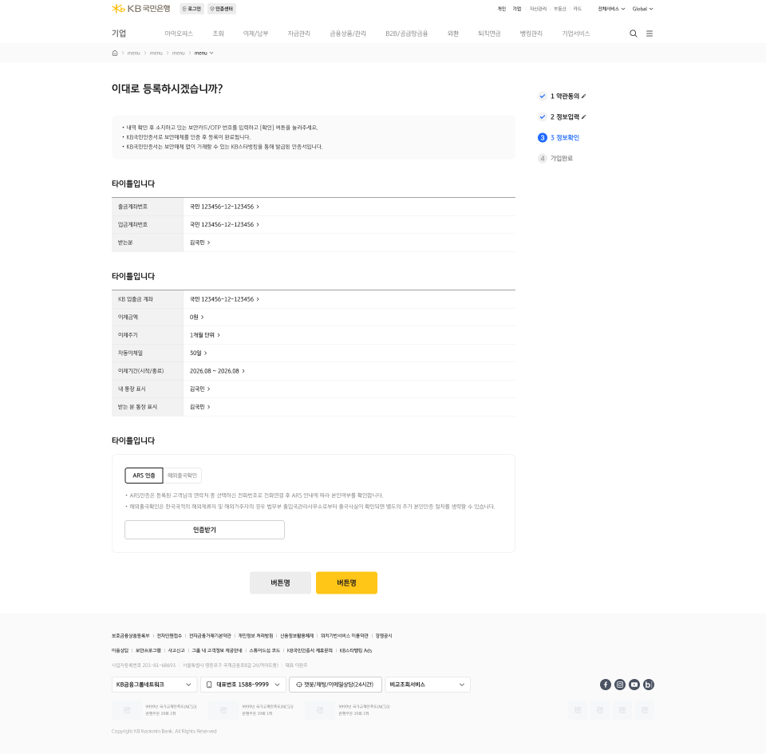

#### AF — 계좌 거래내역 조회

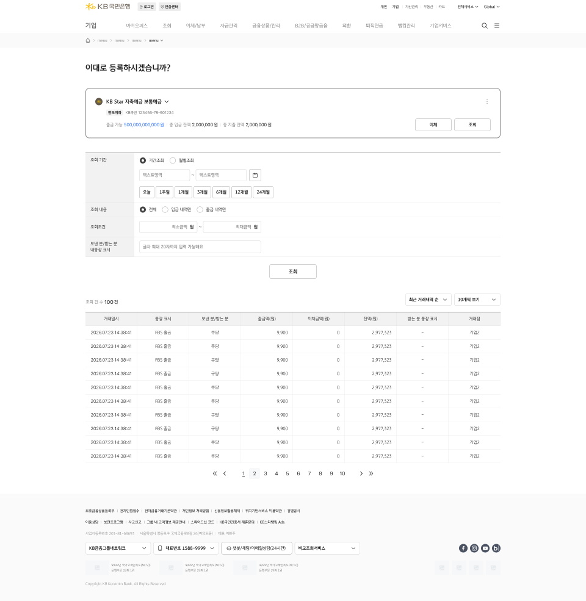

#### AG — 투자성향 설문

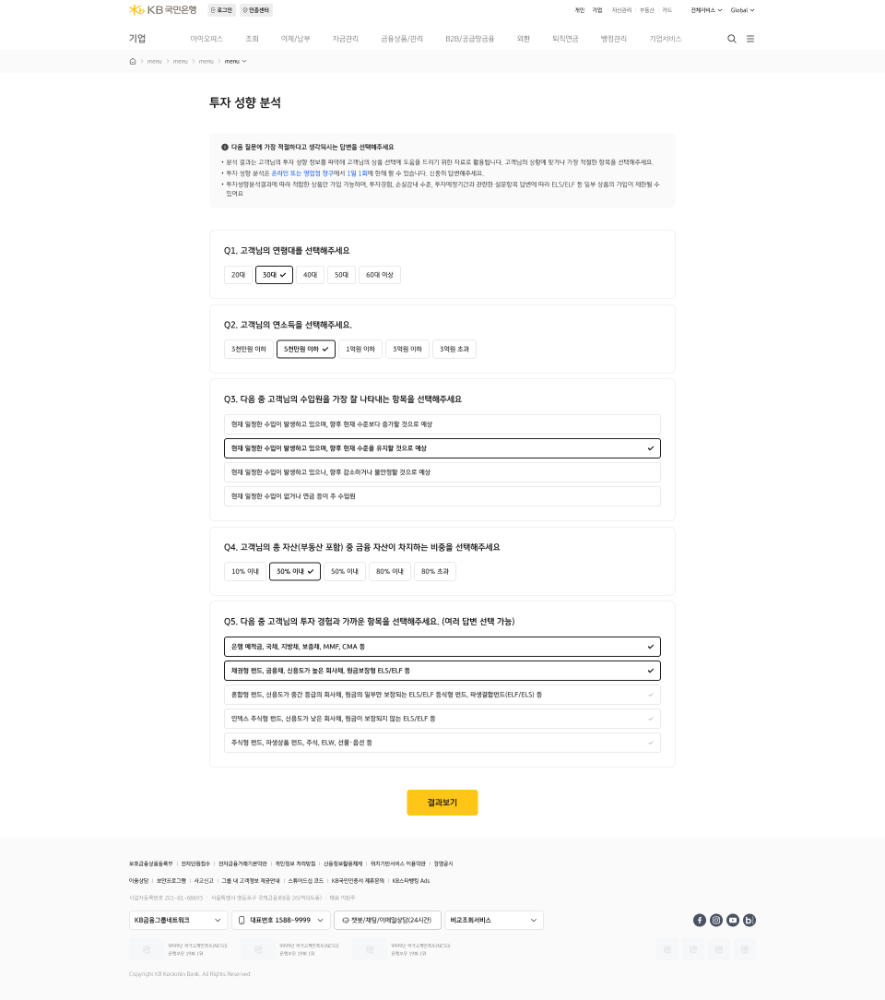

### 57.3. 재현 검수

1. AE의 1012 + 32 + 316과 짧은 228px 단계 영역, AF의 1360px 전체형, AG의 x=454·1012px 중앙형을 구분한다.
2. AE의 180/832 표·45px 행·inLine DataList, 246px 인증 박스와 ARS Segment·인증받기 400 × 48을 확인한다.
3. AF의 160/1200 필터 표·24px Radio 실제 선택, 기간 필드 내부 달력·preset 간격 4, 8열/45px 결과 행, 1 active·2 hover 페이지 상태를 확인한다.
4. AG의 40px word/44px sentence, 단일/복수 선택, 149/309/361px 카드, 안내의 구간별 굵기·파란 강조를 확인한다.
5. 세 원본 BODY의 누락 폰트는 모두 0이었다. 생성 시 필수 서체·줄바꿈·잘림·겹침·UI 상태·기획 문구를 한 번 검수한다.
6. BODY 명명·실제 Auto Layout은 12장을 우선 적용하고, 디자인 시스템 인스턴스의 원형 계층과 지정 Footer를 확인한다. 검수 통과 후 불필요하게 반복하지 않는다.

## 58. 패턴 AH — 투자성향 분석 결과

### 58.1. 출처와 실제 화면 범위

- [전달 링크 — 투자성향분석 결과](https://www.figma.com/design/yojs1BhPrWxLmDDrpg1ihD?node-id=5090-42222)는 **2320 × 4971 Section**이다. 실제 화면은 내부 [Frame 5090:42223](https://www.figma.com/design/yojs1BhPrWxLmDDrpg1ihD?node-id=5090-42223), **1920 × 1877**이다.
- 파일 `yojs1BhPrWxLmDDrpg1ihD`, 페이지 `05.기타(기획 v0.6)`. 아래 좌표는 Section이 아닌 **실제 화면 Frame의 좌상단** 기준이다. Section의 큰 빈 공간·200/400 오프셋을 화면 여백으로 학습하지 않는다.
- HEADER 높이는 157, 화면 이미지에서 GNB → Breadcrumbs 순서를 확인했다.
- BODY: **(240,157), 1440 × 1368**, padding 48 40. Main은 **(280,205), 1360 × 1272**, Vertical gap **48**이다. LNB·StepIndicator가 없는 전체 너비 결과형이다.
- Footer는 **(0,1525), 1920 × 352**이며 신규 생성은 13장의 지정 Footer 인스턴스를 사용한다.

| 역할 | 좌표 (x,y) | 크기 |
| --- | --- | --- |
| 페이지 제목·투자 위험 안내 | (280,205) | 1360 × 72 |
| 결과 배너·상세 설명·그래프 | (280,325) | 1360 × 844 |
| 유의사항 Accordion | (280,1217) | 1360 × 156 |
| Button Area | (280,1421) | 1360 × 56 |

Main은 72 + 844 + 156 + 56 + gap 48 × 3 = **1272**, BODY는 padding 96을 더한 1368이다. 생성 레이어는 원본의 중간 프레임명·번호를 복제하지 않고 12장의 역할 기반 명명·실제 Auto Layout 규칙을 적용한다.

### 58.2. 제목과 결과 배너

- 페이지 제목 “나의 투자성향”: **KBFG Text Bold 26/36 #1C1C1C**, 실제 텍스트 149 × 36.
- 제목 아래 gap **12**, 일반예금과 다른 원금 손실 가능성·투자자 귀속 안내는 **Light 16/24 #444444**, 실제 821 × 24다. 합계 높이 36 + 12 + 24 = 72다.
- 원본 Title / Page 내부 Slot은 233px이지만 설명은 821px로 밖에 표시된다. 신규 제작에서는 Main 1360px 안에서 설명이 잘리지 않게 슬롯·래퍼 크기를 맞추며 233px를 고정 규칙으로 채택하지 않는다.
- 결과 배너: **(280,325), 1360 × 126**, Horizontal gap **20**, padding 32, radius 12, fill **#FFF6F5**, stroke 1px **#FFD1D1**.
- 왼쪽 흰 아이콘 영역은 **(313,358), 60 × 60**, radius 12, 안쪽 실제 공격투자형 도형은 **40 × 40**다.
- 오른쪽 텍스트 묶음은 **(393,359), 383 × 58**, Vertical gap **2**다.
- 첫 줄은 “김국민님의 투자 성향은” Bold **20/28** → gap **6** → “공격투자형” Bold **26/36 #E53838** → gap 6 → “입니다.” Bold 20/28이다. 일반 부분 색상은 #1C1C1C이며 서로 다른 높이를 세로 중앙에 맞춘다.
- “분석일: 2026.08.03”은 **Light 14/20 #6E6E6E**, y=397이다. 높이 36 + gap 2 + 20 = 58이다.
- 배너 높이는 padding 64 + 테두리 2 + 아이콘 60 = **126**이다. 배너와 아래 상세 카드 사이 gap **20**이다.
- 이 배너와 아이콘은 원본에서 **일반 프레임·도형 조합**이며 별도 Banner/Feedback 라이브러리 인스턴스가 아니다. 신규 제작은 검증된 적합한 KBDS 구성을 우선 재사용하되 존재하지 않는 원형 키를 만들어 기록하지 않는다.
- 이름·분석일·공격투자형 결과는 예시다. 앞선 설문 응답에서 이 결과가 계산된다고 추정하거나 모든 고객의 기본 결과로 적용하지 않는다.

### 58.3. 결과 설명·가입가능 상품 카드

아래의 카드 호칭·외형·치수는 원본 기록이다. 신규 제작 시 설명·상태 전달이 주목적인 박스는 60장의 Text Box 기준으로 구성하고, 사실 데이터 조회가 주목적인 하위 박스는 Data Block으로 분류한다. 박스 바깥의 형제 Button Area만으로 Card / Surface로 분류하지 않는다.

- 상세 카드: **(280,471), 1360 × 698**, padding 32, radius 12, fill #FFFFFF, stroke 1px #E5E5E5. 실제 내부 시작은 **(313,504)**, 너비 **1294**다.
- 설명 묶음은 1294 × **85**: “공격투자형” **Medium 22/31 #1C1C1C** → gap **12** → 설명 20px 2행, 행 사이 gap **2**다.
- 설명은 **Medium 14/20 #6E6E6E**다. 원본의 “원금 소실” 표현은 출처 문구이며 실제 기획의 승인된 문장을 사용한다.
- 설명 아래 gap **20**, 가입가능 상품 영역은 **(313,609), 1294 × 58**, padding **16 20**, radius **8**, fill #FAFAFA, stroke 1px #EDEDED다.
- “가입가능 상품”은 **Medium 16/24 #6E6E6E**, 실제 텍스트 x=334. 값은 x=463, **Bold 16/24 #1C1C1C**이며 두 요소 간 gap **40**이다.
- 원본 값 “1~2등급(매우높음위험) 이하”는 표기 예시다. 현재 상품 등급·가입 가능 범위·적합성 판단 정책으로 일반화하지 않는다.
- 이후 gap **20** 아래 위험도 그래프 영역으로 이어진다. 전체 높이 검산은 padding 64 + 테두리 2 + 설명 85 + gap 20 + 상품 영역 58 + gap 20 + 그래프 449 = **698**이다.

### 58.4. 5단계 위험도 그래프

- 실제 배경은 **(313,687), 1294 × 449**, 원본 fill 속성 **#F0F3F9**다.
- 원본의 `Image` 래퍼 자체는 **(487,687), 946 × 449**지만 배경 자식이 좌우로 넘쳐 1294px까지 표시된다. 새 화면은 실제 시각 영역 1294px를 기준으로 그래프 래퍼·배경을 구성하고 원본의 넘침 구조를 복제하지 않는다.
- 차트는 이미지 fill이나 DS 컴포넌트가 아니라 **일반 도형·벡터·텍스트 조합**이다. 좌하단 → 우상단으로 원 크기와 기대수익·위험도를 함께 높이는 개념도이며 수익률 수치·확률을 나타내는 정량 그래프로 해석하지 않는다.
- 아래 좌표는 화면 기준이며 원의 실제 width/height는 stroke를 제외한 Figma 치수다. 각 원은 흰색 **6px stroke**, 라벨은 **Bold 16/24 #FFFFFF**다.

| 단계 | 원 좌상단 (x,y) | 지름 | fill |
| --- | --- | --- | --- |
| 안정형 | (620,978) | 88 | #2D73FF |
| 안정추구형 | (740,949) | 100 | #27B7DF |
| 위험중립형 | (868,893) | 110 | #12A770 |
| 적극투자형 | (1002,829) | 120 | #FF6122 |
| 공격투자형 | (1141,739) | 130 | #EF414A |

- 위쪽 화살표 옆 “기대수익 / 높음”은 (544,727), 58 × 48, 오른쪽 화살표 위 “위험도 높음”은 (1291,1064), 77 × 24, 모두 **Bold 16/24 #1C1C1C**다. 화살표 끝 도형 fill은 #D1DDED다.
- 결과 배너의 강조 #E53838과 그래프 공격투자형 #EF414A는 서로 다른 관측값이다. 화면 전체 빨강을 임의로 하나로 통일하지 않는다.
- 그래프는 현재 결과 하나만 그리는 표시가 아니라 **다섯 유형을 모두 보여 주는 비교**다. 현재 결과는 배너·설명으로 표현한다.

### 58.5. 유의사항과 3개 액션

- 유의사항 Accordion: **(280,1217), 1360 × 156**, standard/basic/medium/expanded=true.
- Header 56, Expand Area 100, 위 padding 8 + 불릿 20px 3행·gap 8(76px) + 아래 padding 16이다.
- 제목은 Bold 14/20 #444444, 본문 Light 14/20 #1C1C1C다. 원본 “약돤” 같은 오타·상품 문구를 그대로 승인 문구로 채택하지 않는다.
- 하단 ButtonGroup은 **(706,1421), 508 × 56**, 가로 중앙, 실제 버튼 **3개**, gap **12**다.

| 순서·원본 라벨 | 변형 | 너비 |
| --- | --- | --- |
| 이전 답변 보기 | tertiary large | 154 |
| 적합상품 등급안내 | tertiary large | **176** |
| 결과보기 | primary large | 154 |

- 154 + 176 + 154 + gap 12 × 2 = **508**이다. 가운데 라벨이 길어 넓어진 값을 보존하며 모두 154px로 고정하지 않는다.
- 버튼은 높이 56, radius 6, tertiary #EDEDED / primary #FFC517, 라벨 Bold 18/25 #1C1C1C다.
- 결과 화면에 이미 “결과보기”가 있는 출처 상태를 기록한다. 실제 버튼 라벨·이전 응답 조회·등급 안내·후속 동작은 기획에 따라 확정한다.

## 59. AH 원형 키·보존 자산·검수

### 59.1. 재사용 원형과 사용자 정의 영역

| UI | main component key |
| --- | --- |
| Title / Page — left | `366007b354df25708d9dce4a7788c2b44e30dba3` |
| 제목 설명 — description-16 | `c93bdeedab40b0fdb123608f9c8d1e2d68aeaed4` |
| Accordion — standard/basic/medium/expanded | `d14342b496bd3aa5d2e707cf26a183daf5d401ce` |
| TextList — bullet/14/depth=1 | `5e484496e22e7e84c91c23bddfe11d1b4a13f35b` |
| ButtonGroup — multi/large | `f6fbbaad278bc5dc3e0568efdc16711894a01e47` |
| BoxButton — tertiary large | `44749aad1a2b8b103e2068161e6058a3ee80a0a6` |
| BoxButton — primary large | `d206f834d8d80e5bd6ab306b8033f3c0e5214bc5` |

결과 배너·설명 카드·그래프의 원본 프레임명과 그룹핑은 제작 기준이 아니다. 제목+설명, 결과 안내, 상세 콘텐츠, 단일 Accordion 래퍼와 Button Area를 실제 역할에 맞게 명명하고 Auto Layout으로 구성한다. 단일 Accordion에 불필요하게 Group을 붙이지 않는다. DS 인스턴스의 원형 이름·내부 고유 계층은 유지한다.

### 59.2. 원본 삭제 대비 보존

실제 화면 Frame을 0.5배 PNG(너비 960px)로 보존했다. 큰 Section의 빈 캔버스를 화면 이미지로 사용하지 않는다.

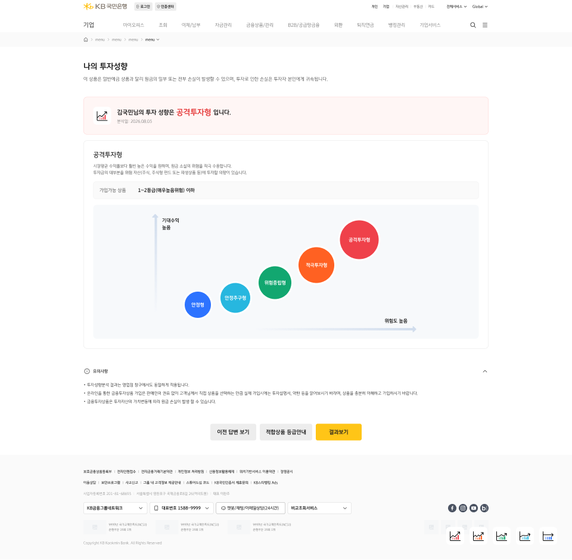

아래는 원본 삭제 뒤에도 사용자 정의 그래프와 아이콘을 확인·재사용할 수 있도록 **원본을 변경하지 않고 1배 PNG로 보존한 자산**이다. 편집 가능한 재구성은 58장의 도형 치수·색·텍스트를 따른다.

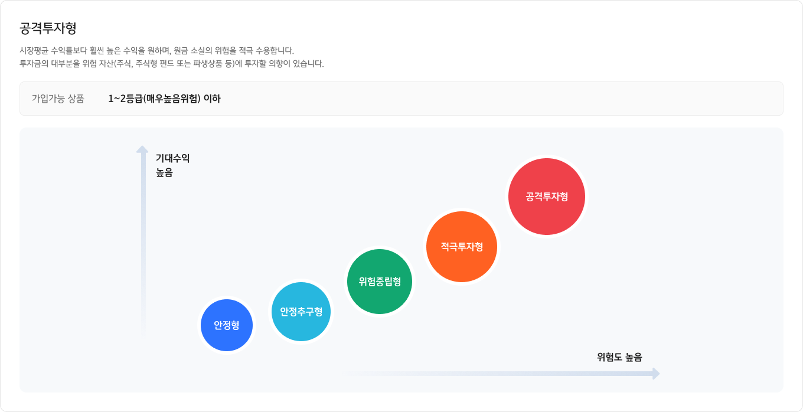


### 59.3. 재현 검수

1. Section 2320 × 4971과 실제 화면 1920 × 1877을 구분하고 BODY 1368·유효 너비 1360·Footer 시작 y=1525를 확인한다.
2. 제목 설명의 실제 너비, 배너 126·강조 26/36·날짜 14/20, 상세 카드 698·상품 영역 58을 확인한다.
3. 그래프 실제 배경 1294 × 449, 다섯 원의 크기·색·순서와 라벨·축을 확인한다. 원본 946px 래퍼의 넘침을 재현 규칙으로 삼지 않는다.
4. Accordion 156과 버튼 154/176/154·gap 12, 실제 업무 결과·분석일·상품 등급·문구·액션을 대조한다.
5. 원본 BODY의 누락 폰트는 0이었다. 생성 시 필수 서체·잘림·겹침, 12장의 명명·실제 Auto Layout, 인스턴스 연결과 13장의 지정 Footer를 한 번 검수한다.

## 60. Card / Surface · Data Block · Text Box 정의

이 장은 사용자 지정 제작 기준이다. 1~59장의 원본 실측 기록에 나오는 일반 프레임·카드 호칭·외형을 그대로 제작 방식으로 적용하지 않고, 이 장의 역할 분류·제작 방식·기본 스타일을 우선한다. 전용 선택 패턴·Infobox와 별도로 승인된 패턴의 간격 예외는 명시된 범위에서만 유지한다.

### 60.1. 역할 구분

박스의 외형보다 콘텐츠의 주된 목적과 사용자 동작을 먼저 판단한다.

| 구분 | Card / Surface | Data Block | Text Box |
| --- | --- | --- | --- |
| 목적 | 정보와 사용자 동작의 결합 | 사실 데이터 조회·대조 | 설명·안내·주의·상태 전달 |
| 예시 | 계좌 선택, 상품 선택, 상세 이동, 이체 | 이름, 계좌정보, 거래내역, 금액 | 유의사항, 상담센터 안내, 설명 문구 |
| 사용자 동작 | 박스 전체 또는 내부 요소에 동작 있음 | 박스 자체에 동작 없음 | 정보 전달이 주목적 |
| 제작 방식 | 실제 Card / Surface 인스턴스 사용 | Auto Layout 프레임으로 직접 구성 | Auto Layout 프레임으로 직접 구성 |
| 주요 내부 요소 | 원형 Slot과 Card 하위 컴포넌트 | Title, DataList | Title, Text, TextList, Divider |
| 패딩·라운드 | 해당 원형·variant 기준 | 패딩20px·라운드20px | 패딩20px·라운드14px |
| 외형 | 원형의 공개 variant로 설정 | 항상 아웃라인형 | 아웃라인형 또는 회색 배경·무테형 |

- 먼저 역할을 결정하고 해당 역할의 스타일을 적용한다.
- 배경이나 테두리를 바꾸어도 역할과 레이어 이름은 바뀌지 않는다.
- 별도로 정의된 SelectButton·GridButton·List 등 전용 선택 패턴은 해당 규칙을 우선한다.

### 60.2. Card / Surface

#### 적용 조건

다음과 같이 사용자 동작이 결합된 박스에 사용한다.

- 박스 전체가 상세 화면으로 이동하는 대상인 경우
- 박스 전체가 선택 대상인 경우
- 내부에 이체·상세 이동 등의 액션이 포함된 경우
- 라디오·체크박스와 설명이 결합된 복합 선택 카드인 경우

상태 Label이나 Badge가 있다는 이유만으로 Card로 분류하지 않는다.

#### 제작 방식

- 최신 디자인 시스템의 실제 `Card / Surface` 인스턴스를 사용한다.
- 필요한 콘텐츠는 원형이 제공하는 Slot과 하위 컴포넌트로 구성한다.
- 원형의 패딩·라운드·스타일·공개 속성을 유지한다.
- Data Block이나 Text Box의 스타일을 일괄 적용하지 않는다.
- detach하거나 수동 프레임으로 Card 외형을 흉내 내지 않는다.
- Header·Footer는 해당 variant와 기획에서 필요한 경우에만 사용한다.

#### 제목·설명 조합 예시

```text
Card / Surface
└─ Slot
   └─ Body
      └─ Groups
         ├─ Group
         │  └─ Card / Body / Group-A
         └─ Group
            ├─ Card / Body / Group-C
            └─ Card / Body / Group-C
```

- 제목은 해당 원형의 `Card / Body / Group-A` variant로 매핑한다.
- 설명·목록은 해당 원형의 `Card / Body / Group-C` variant로 매핑한다.
- Groups의 대표 조합 간격은16px, 설명 목록용 Group 내부 간격은12px이다.
- Footer 버튼형은 원형의 `Card / Footer / Button` 등을 사용한다.
- 실제 Slot 구조와 공개 옵션은 사용하는 최신 variant를 확인한다.
- 기획에 없는 Header·Footer·버튼을 임의로 추가하지 않는다.

#### 라디오 선택형 Card

```text
Card / Surface
└─ Slot
   └─ Body
      ├─ Groups
      │  └─ 실제 제목·설명 콘텐츠
      └─ Card / Header / Affix
         └─ Item / Radio
```

- 실제 `Card / Header / Affix (variant: radio)`를 사용한다.
- Affix를 Body 안에 넣고 일반 Auto Layout 흐름(AUTO)으로 배치한다.
- Body는 Horizontal / 가로 Fill·세로 Hug / gap12px로 구성한다.
- Groups는 남은 폭을 Fill로 사용한다.
- Affix는 원형24×24px을 유지한다.
- 기본으로 숨겨진 Affix와 Body 안 Affix를 동시에 노출하지 않는다.
- 카드당 실제 노출되는 Affix는 하나만 둔다.
- Card의 선택·비활성 상태와 Item / Radio의 상태를 일치시킨다.
- 라디오 도형을 직접 그리거나 별도 일반 Radio로 임의 대체하지 않는다.

### 60.3. Data Block

#### 적용 조건

- 내부 동작 없이 사실 데이터를 보여주는 박스에 사용한다.
- 이름·전화번호·거래내역·계좌정보·금액 등이 해당한다.
- Card / Surface를 사용하거나 detach하지 않고 Auto Layout으로 직접 구성한다.

#### 기본 구조

```text
Data Block
├─ Title
└─ DataList Group
   ├─ DataList
   └─ DataList
```

- 제목은 기획에 필요한 경우에만 배치한다.
- 복수 DataList는 `DataList Group`으로 묶고 내부 간격은12px로 설정한다.
- DataList는 `layout: split`, `size: 14`, `hasDivider: false`를 기본으로 사용한다.
- 라벨·값 쌍이 하나뿐이면 불필요한 Group 없이 직접 배치한다.

```text
Data Block
└─ DataList
```

#### 기본 스타일

- Layout: Vertical Auto Layout
- Resizing: 가로 Fill·세로 Hug
- 내부 gap:16px (`spacing/xl`)
- Padding:20px (`spacing/2xl`)
- Radius:20px (`radius/2xl`)
- Fill: `surface/neutral/quaternary-muted`
- Border: `stroke/md` + `border/neutral/secondary-muted`
- 회색 배경·무테형으로 임의 변경하지 않는다.
- 별도로 승인된 패턴의 간격 예외는 해당 범위에만 적용한다.

### 60.4. Text Box

#### 적용 조건

- 설명·이용 안내·주의·상태 전달이 주목적인 박스에 사용한다.
- 전화번호·이메일이 포함되어도 안내 문맥이 주목적이면 Text Box로 분류한다.
- 단순 연락처 텍스트의 존재를 버튼이나 선택 동작으로 간주하지 않는다.
- 기존 Infobox의 용도에 해당하면 해당 Infobox 컴포넌트와 전용 규칙을 우선한다.
- Card / Surface를 사용하거나 detach하지 않고 Auto Layout으로 직접 구성한다.

#### 구성 예시

```text
Text Box
├─ Title / Section
└─ TextList Group
   ├─ TextList / Unordered
   └─ TextList / Unordered
```

- 기획에 따라 Title·Text·TextList·Divider 등을 조합한다.
- 일반 본문은 `Text > Content` 구조를 사용한다.
- 제목·불릿·구분선 등 기획에 없는 요소를 임의로 추가하지 않는다.
- Data Block의 DataList 구조를 일괄 적용하지 않는다.

#### 기본 스타일

- Layout: Vertical Auto Layout
- 내부 gap:16px (`spacing/xl`)
- Padding:20px (`spacing/2xl`)
- Radius:14px (`radius/lg`)

아웃라인형:

- Fill: `surface/neutral/quaternary-muted`
- Border: `stroke/md` + `border/neutral/secondary-muted`

회색 배경·무테형:

- Fill: `surface/neutral/tertiary-muted`
- 외곽 Border 없음 (`strokes: []`)
- 내부 콘텐츠 구분용 Divider는 필요에 따라 유지한다.

독립 영역의 경계가 필요하면 아웃라인형을 사용한다.
테두리가 반복·중첩되거나 보조 안내를 부드럽게 구분할 때는 회색 배경·무테형을 고려한다.
스타일을 바꾸어도 역할과 레이어 이름은 Text Box로 유지한다.

### 60.5. 반복 그룹 명명

복수의 박스는 실제 Auto Layout으로 묶는다.

```text
Card Group
├─ Card / Surface
└─ Card / Surface
```

```text
Data Block Group
├─ Data Block
└─ Data Block
```

```text
Text Box Group
├─ Text Box
└─ Text Box
```

- 반복 자식에 숫자 순번을 붙이지 않는다.
- Card Group과 Data Block Group의 기본 내부 간격은12px이다.
- 페이지 배치용 Container와 콘텐츠 박스의 역할을 구분한다.
- Container 규칙을 이유로 콘텐츠 박스 이름을 Container로 변경하지 않는다.

### 60.6. 분류 시 주의사항

- Data Block 바깥의 형제 Button Area에 수정 버튼 등이 있어도 박스 자체가 동작하지 않으면 Data Block을 유지한다.
- 상태 Label이나 Badge만 있는 사실 데이터 박스는 Data Block이다.
- 상태를 설명하는 안내 메시지가 주목적이면 Text Box다.
- 선택·이동 등 실제 동작이 결합된 박스는 Card / Surface 또는 해당 전용 컴포넌트 규칙을 적용한다.
- 지정된 Infobox 패턴을 Text Box로 일괄 대체하지 않는다.
- 최신 디자인 시스템의 컴포넌트·서체·색상·간격 토큰을 사용한다.

## 61. 수치 변수 바인딩·GNB Fill·LNB 2열 구조와 고객정보 화면 수정 기준

사용자가 2026-11-09에 지정한 필수 제작 기준이다. 수치가 기존 실측값과 같더라도 변수가 연결되지 않으면 완료로 판단하지 않는다. 1~59장의 실측 기록은 변수 연결을 생략할 근거가 되지 않는다.

### 61.1. 수치 값은 실제 변수에 연결

- gap(`itemSpacing`, 필요한 `counterAxisSpacing`), 상하좌우 padding, 각 모서리 radius, 실제 테두리 두께뿐 아니라 텍스트의 글자 크기·행간·자간·굵기 등 수치 속성도 해당 역할의 최신 디자인 시스템 변수에 실제 바인딩한다. 단순히 같은 숫자를 입력하거나 변수 이름을 레이어 이름에 쓰는 방식은 적용으로 간주하지 않는다.
- 화면의 사용자 정의 래퍼뿐 아니라 사용 중인 인스턴스·Slot·하위 레이아웃도 확인한다. 관련 속성을 누락하지 않고, 이미 연결된 원형의 유효한 변수는 유지한다.
- 고정 치수는 치수 변수로 관리하고, Fill·Hug가 필요한 곳을 숫자 폭·높이로 고정하지 않는다. 화면 배치 좌표와 콘텐츠에 따라 계산되는 Fill·Hug 결과값은 gap·padding 토큰과 구분한다.
- 0값도 현재 유효한 변수가 있으면 연결한다. 삭제 예정 토큰을 새로 확산하지 않는다.
- 공식 대응 토큰이 없는 화면 고유의 고정 치수·원형의 특수 수치는 용도와 실제 값을 명시한 로컬 변수로 구분한다. 공식 KBDS 토큰인 것처럼 기록하거나, 값이 가깝다는 이유로 의미가 다른 토큰을 대신 연결하지 않는다.
- 이 화면의 공식 대응이 없는 수치는 대상 파일의 `KBDS PC · 화면 배치` 로컬 컬렉션에 구분했다. 예: LNB 열의 고정 너비 `layout/316`, 화면 너비 `layout/1920`, 0 간격 `spacing/0`. 공식 라이브러리 변수가 있으면 공식 변수를 우선한다.

공식 Size 컬렉션: `b2a956c0692942dc214689c3f03b801a2b781d40`.

| 용도 | 변수 | 값 | 원형 키 |
| --- | --- | --- | --- |
| 반복 Data Block 사이·DataList Group 내부 | `spacing/lg` | 12 | `f1822d95f1b0043e2ee435fea6d4725d37db3ebb` |
| Data Block 제목·본문 사이 | `spacing/xl` | 16 | `2b90494af4b83af52e567824fc30afcec9447c32` |
| Data Block padding | `spacing/2xl` | 20 | `f338af7d20bc6e0583d08efdf7e7e389a325b1d0` |
| LNB 열·본문 열 사이 | `spacing/5xl` | 32 | `403b2e3136ffc6d8206f6e63e2f62f235a5d3ae8` |
| BODY 좌우 padding | `spacing/6xl` | 40 | `9f3a6e1ca84e9627129a8315526a0ebd5bc65412` |
| BODY 상하 padding·본문 주요 섹션 사이 | `spacing/7xl` | 48 | `0828de47528b32f0cd679d06a75e61169b841246` |
| Data Block radius | `radius/2xl` | 20 | `8f274529260c1a703dfd211c49e01978e90e8d04` |
| Text Box radius | `radius/lg` | 14 | `fd6386fe7907f327160f3d22b8cdc86a6871afcc` |
| Data Block 테두리 두께 | `stroke/md` | 1 | `1299efbe639a84b71e23f7bdef96e02c9fb80176` |

### 61.2. GNB / Channel 내부 GNB는 Fill

```text
## HEADER
├─ GNB / Channel — 가로 Fill
│  └─ GNB — 가로 Fill
└─ Breadcrumbs Area
```

- 바깥 `GNB / Channel`만 Fill로 설정하고 내부 `GNB`를 고정 폭으로 두지 않는다.
- 원형 이름과 인스턴스 연결을 유지한다. GNB 내부의 본문 정렬용 Container는 기획의 콘텐츠 폭을 따른다.
- 이 화면에서는 화면 폭 1920에 따라 내부 GNB도 1920으로 채워져야 한다. 고정 1280 상태로 남지 않도록 실제 `layoutSizingHorizontal = FILL`을 확인한다.
- 상단 좌우 유틸리티 배치는 고정된 큰 숫자 gap으로 밀어내지 않고 Auto Layout의 공간 분배로 정렬한다.

### 61.3. LNB와 본문의 Container 구조

LNB가 있는 이 고객정보 2열 화면은 다음 구조를 사용한다.

```text
## BODY — 너비 1440, Horizontal, padding 48 40, gap 32
├─ Container 1 — 너비 316, 세로 Hug
│  └─ LNB — 가로 Fill, 실제 라이브러리 인스턴스
└─ Container 2 — 가로 Fill(1012), 세로 Hug
   ├─ Title / Page
   ├─ Data Block Group / Card
   └─ Button Area
```

- LNB를 실제 Auto Layout `Container 1`으로 감싼다. LNB 인스턴스 자체의 원형 이름은 `LNB`로 유지한다.
- `Container 1`의 고정 너비는 316이고, 안쪽 LNB도 Fill로 316을 사용한다.
- 오른쪽 본문은 `Container 2`로 명명하고 남은 폭을 Fill로 사용한다.
- 1440 − 좌우 padding 80 − LNB 316 − gap 32 = 본문 1012로 검산한다.
- 명명 규칙을 이유로 LNB 래퍼를 생략하거나 오른쪽만 `Container`로 남기지 않는다. 다른 화면·다른 Slot의 Container 순번과 합산하지 않는다.

### 61.4. 고객정보조회 화면의 Data Block·Card 분류

대상: [고객정보조회(개인정보열람)](https://www.figma.com/design/2MavuzZhNpHpqer5fk3ML4?node-id=5-31). 화면은 기존 Section `2:286` 기준 x=240, y=240을 유지한다.

| 영역 | 적용 역할·제작 방식 |
| --- | --- |
| 기본정보 | `Data Block` — 일반 Auto Layout 프레임 |
| 자택정보 | `Data Block` — 일반 Auto Layout 프레임 |
| 직장정보 | `Data Block` — 일반 Auto Layout 프레임 |
| 고객관리 안내수단 | 사용자가 지정한 이 화면의 `Card / Surface` 실제 인스턴스 유지 |

```text
Data Block Group / Card
├─ Data Block Group — gap 12
│  ├─ Data Block
│  │  ├─ Title / Headline
│  │  └─ DataList Group
│  ├─ Data Block
│  │  ├─ Title / Headline
│  │  └─ DataList Group
│  └─ Data Block
│     ├─ Title / Headline
│     └─ DataList Group
└─ Card / Surface — 고객관리 안내수단
```

- 세 정보 박스는 이름만 바꾸지 않고 실제 Card / Surface 인스턴스를 제거한 뒤 Auto Layout으로 직접 구성한다. Card를 detach해서 Data Block을 만들지 않는다.
- Data Block은 60장 기준의 padding 20·radius 20·내부 gap 16·아웃라인형을 적용한다.
- Fill은 `surface/neutral/quaternary-muted`(키 `17f1d5c43fa25e1bdd6bffde1ae45e66dd0649b7`), Border는 `stroke/md` + `border/neutral/secondary-muted`(색상 키 `b7d97fe994ce50583baebda8b3b90b2f51b5ed6a`)를 실제 바인딩한다.
- DataList는 `layout=split, size=14, hasDivider=false`를 사용한다. 해당 DataList 원형 키는 `a3ddafd7fca06ab9933697275978c96dc71a8d72`다. 내부 Item / Slot도 size 14로 맞추고 라벨은 가로 Hug, 값은 Fill·오른쪽 정렬을 사용해 잘림·좁은 줄바꿈을 방지한다.
- DataList Group 내부 gap은 12이며, 주소의 명시적 줄바꿈과 마스킹을 유지한다.
- 단일 Card / Surface를 일반 프레임 `Card`로 다시 감싸지 않는다. 실제 인스턴스를 배치 래퍼의 직접 자식으로 둔다.
- Data Block과 Card가 섞인 전체를 `Card Group`으로 부르지 않는다. Data Block 반복은 `Data Block Group`, 이 그룹과 단일 Card의 결합은 `Data Block Group / Card`로 명명한다.
- 바깥 형제 Button Area의 수정 버튼 때문에 기본정보·자택정보·직장정보를 Card로 분류하지 않는다. 고객관리 안내수단의 Card 유지 지시는 이 화면의 적용 기준이며, 다른 모든 수신 상태 정보 박스를 Card로 분류하는 일반 규칙으로 확대하지 않는다.

### 61.5. 완료 전 필수 확인

- 실제 boundVariables를 읽어 gap·padding·radius·테두리 두께와 텍스트의 fontSize·lineHeight·letterSpacing·fontWeight를 각각 확인한다. 간격·패딩 검사만으로 전체 수치 변수 연결이 완료됐다고 보고하지 않는다. 입력 숫자가 토큰 값과 같다는 것만으로 통과시키지 않는다.
- Card / Surface의 바깥 속성만 확인하지 않고 Slot·제목·DataList·Checkbox Group까지 점검한다. 수정 요청이 있는 특정 영역은 저장 후 다시 읽어 실제 변수 alias와 미연결 속성을 확인한다.
- 61.6장에 따라 작업 대상 전체의 Clip content 상태를 확인하고, 명시적 근거 없이 켜진 곳이 없는지 확인한다.
- GNB / Channel 내부 GNB의 가로 Fill, Container 1 너비 316과 내부 LNB Fill, Container 2의 이름·Fill을 확인한다.
- 세 Data Block은 실제 FRAME Auto Layout이고 Card 인스턴스가 남지 않았는지, 고객관리 안내수단은 실제 Card / Surface 인스턴스인지 확인한다.
- 불필요한 `Card` 프레임 래퍼·혼합 콘텐츠의 잘못된 `Card Group` 이름이 없는지 확인한다.
- 원본 문구·마스킹·체크 상태, DataList 라벨 줄바꿈, 필수 서체, 지정 Footer 원형 연결을 검수한다.

### 61.6. Clip content 임의 적용 금지 — 모든 영역 공통

- 앞으로 모든 화면·프레임·Container·반복 그룹·박스·Slot·인스턴스 내부에서 Clip content를 임의로 켜지 않는다.
- 새 Auto Layout이나 프레임을 만들 때 API 기본값에 맡기지 않고 `clipsContent = false`를 명시한다. 생성 함수의 기본값으로 켜져 있어도 그대로 두지 않는다.
- `Data Block Group / Card`를 비롯한 콘텐츠 배치용 래퍼에는 Clip content가 필요하지 않다. 모서리·외형 정리나 넘침 은폐를 이유로 임의 적용하지 않는다.
- 내용이 넘치면 Fill·Hug·너비·줄바꿈·부모 크기·패딩을 바로잡는다. Clip content로 잘림을 숨기지 않는다.
- 사용자 요청 또는 원본 기획에 잘라내기가 명시된 경우에만 그 범위에서 사용한다. 다른 영역으로 확대하지 않는다.
- 이 고객정보조회 화면 `5:31`은 하위 프레임·인스턴스를 포함해 Clip content를 모두 해제했다. 이후 수정에서도 임의로 다시 켜지 않는다.

### 61.7. 고객관리 안내수단 제목의 수치 변수 보정

고객관리 안내수단을 포함한 직접 작성 제목은 간격·패딩 변수 연결과 별도로 타이포그래피 변수도 연결한다. 제목의 외형이 같더라도 20px·28px를 직접 입력한 상태로 남기지 않는다.

| 속성 | 공식 변수 | 값 | 원형 키 |
| --- | --- | --- | --- |
| 글자 크기 | `font-size/title/2xl` | 20 | `89ef2f254f994dd3610263dea567bff021abee8c` |
| 행간 | `line-height/title/2xl` | 28 | `9f6ee781fd8bde6f07a856ee371c70adf50b0b83` |
| 자간 | `letter-spacing/md` | 0 | `0975eeaff3f5ed2bdf4670c949a38eb8726649c7` |
| 굵기 | `font-weight/bold` | 700 | `eb1916f08220e91e07b5bdc7bdd61843ae406d77` |

- Type 컬렉션 키는 `682c2477d61ecf59898d38798e4425884d1f78ed`다.
- 고객관리 안내수단뿐 아니라 같은 방식으로 작성한 기본정보·자택정보·직장정보 제목과 페이지 제목도 동일 범위로 검사한다. 페이지 제목은 해당 제목의 실제 크기·행간 토큰을 사용하고 20/28을 일괄 적용하지 않는다.
